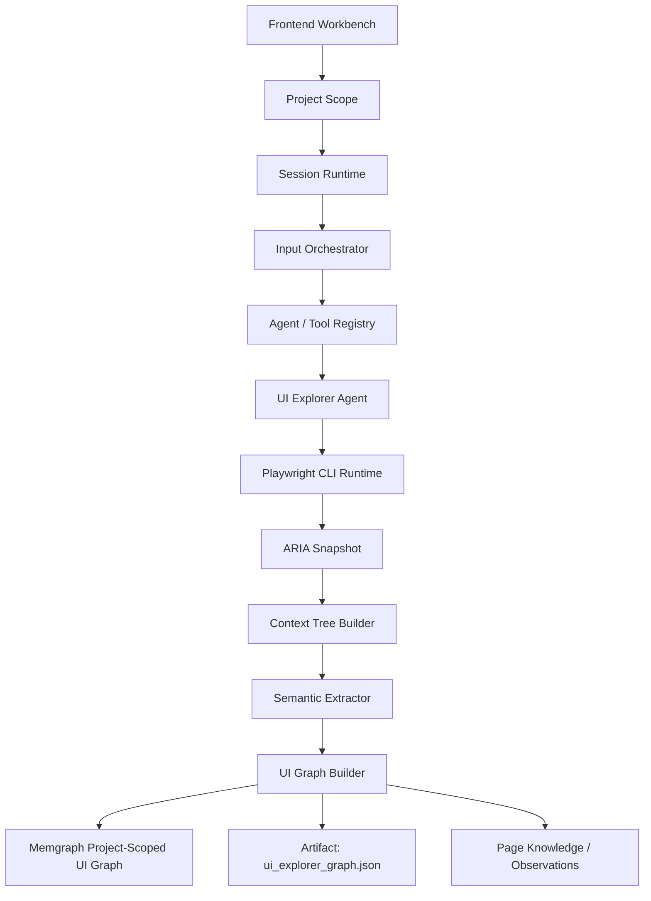

# Enterprise AI QA Agent（御策天检）

`Enterprise_AI_QA_Agent` 是一个面向企业级质量保障场景的多 Agent 编排工作台，目标是参考 `claude_code_ui_Agent` 的运行骨架，构建一个可扩展的：

- 多 Agent 编排系统（Coordinator / Worker 子代理调度）
- 可观测的前后端工作台（会话、事件流、审批、回放）
- 覆盖 API / 性能 / 安全 / 兼容性 / UI 等多方向的 AI 测试平台

当前项目分为两个核心子工程：

- `Agent_Server`：基于 `FastAPI + LangGraph` 的后端运行时与编排服务
- `agent_web`：基于 `Vue 3 + Vite + Naive UI` 的前端工作台（支持 Electron 桌面端打包）

## 项目结构

```text
Enterprise_AI_QA_Agent/
├─ Agent_Server/          # FastAPI + LangGraph 后端
│  ├─ src/
│  │  ├─ main.py          # 应用入口：lifespan 启动流程 + 路由注册
│  │  ├─ api/routes/      # 21 组 REST/SSE 路由（前缀 /api/v1）
│  │  ├─ application/     # 应用服务层（按职责拆分为 36 个子包）
│  │  ├─ modes/           # 14 种测试模式（8 种实装 + 6 种占位）
│  │  ├─ SKILLS/          # 54 个可注册技能包
│  │  ├─ registry/        # Agent / Tool / Model / Skill / MCP / Mode 注册中心
│  │  ├─ core/            # Settings：.env 加载、端口/存储/表名等全部配置
│  │  ├─ contracts/       # 跨层契约定义
│  │  ├─ graph/           # LangGraph 编排链路
│  │  ├─ runtime/         # 运行时状态、事件、快照
│  │  ├─ infrastructure/  # Postgres / MySQL / Memgraph / Redis / RustFS 适配
│  │  ├─ domain/          # 领域模型
│  │  └─ schemas/         # Pydantic 契约
│  ├─ tests/              # pytest 单元与集成测试
│  └─ docs/               # 性能 / 安全测试模式设计文档
├─ agent_web/              # Vue 3 + Vite 前端工作台
│  ├─ src/views/           # 9 个页面：工作台 / 任务池 / 项目 / 知识 / 工具 / 报告 / 设置 / 编排轨迹 / 录制窗口
│  ├─ src/features/        # 插件化功能面板：workbench / flow / recorder / settings / tools
│  ├─ electron/            # Electron 桌面端入口
│  └─ docs/                # VitePress 文档站
├─ databases/              # MySQL 与 PostgreSQL 初始化脚本
├─ docs/                   # 工程规范、复刻文档与开发计划
└─ README.md
```

## 核心文档

开始开发前，建议先阅读以下两份文档：

- [Claude_Code_UI_Agent_全流程复刻规范.md](./docs/Claude_Code_UI_Agent_全流程复刻规范.md)
- [HARNESS_ENGINEERING_开发规范.md](./docs/HARNESS_ENGINEERING_开发规范.md)

这两份文档定义了本项目的核心工程方向：

- 不是只做聊天页面，而是做完整的 Agent 运行骨架
- 前端必须具备运行时可观测性
- 后端必须具备会话、事件、快照、审批、调度与恢复能力
- 所有 Agent / Tool / Runtime 扩展都应走统一协议

## 当前能力概览

### 后端

- 会话创建、读取、消息发送、无头执行（headless execute）
- Agent / Tool / Model / Skill / MCP / Mode 六大注册中心
- LangGraph 编排链路，支持 interrupt / resume 审批中断与恢复
- SSE 事件流输出与事件历史回放（replay）
- Coordinator / Worker 子代理调度
- 工具作业（tool jobs）、产物（artifacts）管理与 RustFS 对象存储
- MCP 连接管理与工具桥接（stdio 命令白名单）
- 向量记忆（pgvector）与 Memgraph 知识图谱 / UI 图谱
- 模型多 Provider 适配（OpenAI / Anthropic / Gemini 等）与 OAuth 授权
- 邮件能力（agently-mail，含腾讯邮箱认证监控）与渠道配对网关（`qq` / `feishu` / `weixin`）
- Docker 容器管理（Redis / RustFS / MySQL / Postgres / Memgraph / 测试引擎）
- **UI 录制链路**：三种浏览器驱动（embedded / cdp-attach / playwright-managed）+ 共用注入脚本 `recorder.js`，事件流幂等落 PostgreSQL、固化成 Memgraph 子图，再经七级定位链回放、转用例草稿、生成置信度分级断言
- **用例驱动治理**：项目（projects）→ 用例草稿/评审/固定版本（test_cases）→ 套件冻结（test_suites）→ 运行条目原子领取与结果入库（test_runs）
- 上传安全扫描（RustFS temp / safe / quarantine 三桶）与安全漏洞台账（`agent_security_bugs`，含复现包与重测）
- 赞助商只读接口（MySQL `system_sponsor_config` → `GET /api/v1/sponsors`）

### 前端

- 会话工作台首页：流式消息渲染、运行状态指示、审批面板、Runtime Event Console
- 任务池、项目、报告中心、知识图谱、工具中心页面
- 编排轨迹（Flow）视图：按会话事件动态生成轨迹节点，支持长文本折叠与下钻
- UI 录制窗口（`RecorderWindowView` + Electron `recorder-window.mjs`）：控制条四按钮状态机、实时时间线
- 插件化设置中心：模型、邮箱、渠道、Docker、存储、平台等
- 顶栏赞助商轮播入口 + 列表弹窗
- 多语言（15 种 locale）
- Electron 桌面端打包（Windows，产物为「御策天检.exe」）
- VitePress 文档站（`npm run dev` 时随应用一起启动）

## 测试模式（modes）

`Agent_Server/src/modes` 下按模式拆分编排实现，`registry/modes.py` 共注册 **14 种**：**8 种已实装**（有专用 Runner 与完整链路），**6 种为占位模式**（manifest 标 `"placeholder": True`，只注册 Skills、`harness_key=placeholder_testing_harness`、`activation_policy=explicit_only`，**没有专用执行链路**）。

### 已实装（8）

| 模式 | key | 说明 |
| --- | --- | --- |
| `api_testing_mode` | `api_testing` | 最完整链路：API 文档解析 → 端点圈定 → 依赖规划 → 前置条件解析 → 执行 → 验证/评估 → 报告，含子代理协调与任务池 |
| `performance_testing_mode` | `performance_testing` | 需求接入 → 负载建模 → k6 / JMeter 引擎执行 → 结果解析 → 失败分析 → 报告，含目标保护（allowlist、VU/RPS/时长上限、smoke 前置） |
| `security_testing_mode` | `security_testing` | 基于 Docker（Kali）运行器的安全测试编排，含攻击链循环与漏洞落库（`agent_security_bugs`） |
| `ui_automation_mode` | `ui_automation` | UI 自动化（Playwright CLI Runtime），并挂接 UI 录制编排（三源检索→审批→录制）与回放执行器 |
| `smoke_testing_mode` | `smoke_testing` | 冒烟测试（方案目录 / 版本 / 运行历史 / 回归候选四表） |
| `compatibility_testing_mode` | `compatibility_testing` | 产品探查 → 环境矩阵 → 用例生成 → 审批策略 → 运行器分发 → 结果聚合 → 报告 |
| `code_review_mode` | `code_review` | 多角色"辩论"式代码评审：源码获取 → 团队组建 → 编排辩论 → 评估 → 验证（含治理规则） |
| `default_mode` | `default` | 默认对话/兜底模式，非测试类问题也能应答 |

### 占位（6）—— 只注册 Skills，尚无专用 Runner

| 模式 | key | 覆盖方向 |
| --- | --- | --- |
| `integration_testing_mode` | `integration_testing` | 集成与依赖测试（服务契约、真实依赖、网络模拟、数据访问） |
| `unit_component_testing_mode` | `unit_component_testing` | 单元 / 组件测试 |
| `mobile_testing_mode` | `mobile_testing` | 移动端测试 |
| `visual_regression_testing_mode` | `visual_regression_testing` | 视觉回归 |
| `accessibility_testing_mode` | `accessibility_testing` | 无障碍测试 |
| `reliability_testing_mode` | `reliability_testing` | 可靠性与韧性（混沌、故障注入方向） |

## UI Explorer Agent 架构

UI 方向已从「UI 测试执行器」收敛为「页面结构理解引擎」：



核心约束：

- 主数据源是 Playwright `aria_snapshot()`，不是 DOM 扁平扫描。
- `ui-page-explorer` 只探索和建模，输出 `pages / elements / entities / edges`。
- 不走 `Verification Harness` 和 `Evaluation Harness`，不生成测试用例、不做断言、不判定通过失败。
- Memgraph 图谱节点主要包括 `Page`、`Element`、`Entity`。
- Memgraph 图谱关系主要包括 `CONTAINS`、`BELONGS_TO`、`TRIGGERS_NAVIGATION`、`REVEALS`。

登录与交互探索：

- 登录不是固定流程；Explorer 只有在检测到可见 password input / 登录表单后，才会使用调用方提供的 `login_credentials`。
- `max_interactions` 用于受控点击非导航控件，采集弹窗、抽屉、Tab、展开区等动态 UI 状态。
- 动态状态会写入 `element_reveals_element` 关系，用于表达“哪个控件揭示了哪些 UI 元素”。

大模型的角色：

- 决定探索策略：根据目标、项目上下文、历史图谱选择是否提供登录凭据、探索深度、交互预算。
- 做语义解释：对 ARIA 事实结果进行业务命名、实体归并、页面意图总结和图谱去重建议。
- 不作为事实源：页面结构、可见性、链接、交互结果必须来自 Playwright / ARIA snapshot / Memgraph 图谱证据。
- 不硬编码流程：登录、点击和导航由 Harness 的检测与策略约束执行，大模型只提出可审计的探索意图。

## 技术栈与依赖

### 后端（Python >= 3.11）

FastAPI、Uvicorn、LangGraph、Pydantic v2、SQLAlchemy、psycopg（PostgreSQL）、PyMySQL、neo4j 驱动（Memgraph）、Redis、RustFS（通过 boto3 S3 客户端）、MCP SDK、cryptography。详见 `Agent_Server/pyproject.toml`。

### 前端

Vue 3、Vite 6、Naive UI、Pinia、Vue Router、TypeScript、Electron 31、VitePress。详见 `agent_web/package.json`。

### 存储

| 存储 | 用途 |
| --- | --- |
| PostgreSQL | 运行时数据：`agent_sessions` / `agent_session_messages` / `agent_session_events` / `agent_session_snapshots` / `agent_session_approvals` / `agent_session_resources` / `agent_tool_jobs` / `agent_tool_artifacts` / `agent_memories`（pgvector 向量记忆）/ `agent_mcp_servers` / `agent_projects` / `agent_api_docs` / `agent_security_bugs` / `agent_perf_runs`；冒烟四表 `agent_smoke_plan_catalog` / `_plan_versions` / `_run_history` / `_regression_candidates`；用例驱动八表 `agent_test_cases` / `_case_versions` / `agent_test_suites` / `_suite_items` / `agent_test_runs` / `_run_items` / `_run_attempts` / `_case_results`；录制两表 `ui_recording` / `ui_recording_event` |
| MySQL | 配置数据：`llm_model_config`、`system_email_config`、`system_channel_config`、`system_sponsor_config` |
| Memgraph | 知识图谱、项目级 UI 图谱（`Page` / `Element` / `Entity`）、录制子图（`Recording` / `Action`） |
| Redis | 分布式锁（如邮箱认证锁） |
| RustFS | 产物对象存储与上传安全扫描桶（temp / safe / quarantine） |

初始化脚本位于 `databases/` 目录（`1、MySQL/QA_Agent.sql`、`2、PSQL/public.sql`）。上述表名都可通过 `Agent_Server/.env` 的 Settings 项覆盖。

> **注意**：`databases/2、PSQL/public.sql` 只建 17 张表（会话族、tool jobs/artifacts、memories、mcp_servers、perf_runs、冒烟四表、录制两表），**不含** `agent_projects`、`agent_api_docs`、`agent_security_bugs` 与用例驱动八表。这些表由对应 store（`application/projects/project_store.py`、`application/documents/api_doc_store.py`、`modes/security_testing_mode/security_bug_store.py`、`application/test_{cases,suites,runs}/*_store.py` 等 19 处）在启动或首次使用时 `CREATE TABLE IF NOT EXISTS` 自建。所以"跑完 SQL 脚本就以为建全了"是错的；反过来，只想手工核对结构时也要以代码里的建表语句为准。

## 快速启动

### 0. 准备环境

复制 `Agent_Server/.env.example` 为 `Agent_Server/.env`，按需配置 MySQL / PostgreSQL / Memgraph / Redis / RustFS 连接信息。基础设施容器也可通过设置页的 Docker 管理面板一键拉起。

API 使用共享 Bearer 密钥：本地开发未设置 `API_AUTH_TOKEN` 时仅接受环回来源；非环回请求返回 503。生产部署必须将 `APP_ENV` 设为 `production` 并配置至少 32 个非空白随机字符的 `API_AUTH_TOKEN`。使用 Vite / Electron 前端代理时，代理进程也需要取得同一个环境变量；代理会在服务端转发时添加认证头，密钥不会编入浏览器资源。自动化客户端直接请求 API 时使用 `Authorization: Bearer <API_AUTH_TOKEN>`。不要把密钥命名为 `VITE_*` 或放入前端源码。OAuth 授权回调和只返回存活状态的 `/api/v1/health/live` 保持公开；详细健康状态、指标、文档及其他 API 均受保护。邮件 Webhook 当前也要求 Bearer 密钥；默认邮件适配器尚无处理器，对应端点返回 501，不要配置为外部生产回调。接入前须确定并实现供应商签名验证、事件持久化与幂等契约。

Windows PowerShell 启动开发前后端时，可先在两个终端分别设置同一个值：`$env:API_AUTH_TOKEN = '<Agent_Server/.env 中的 API_AUTH_TOKEN>'`。Vite 与 Electron 主进程只读取服务端进程环境变量；不会从 `import.meta.env` 暴露密钥。

### 1. 启动后端

在仓库根目录同步 uv 工作区；后端与测试依赖会安装到根目录 `.venv`：

```bash
uv sync --locked
uv run --locked --directory Agent_Server uvicorn src.main:app --reload --port 1032
```

IDE 的解释器选择仓库根目录 `.venv/Scripts/python.exe`，入口选择 `Agent_Server/src/main.py`。也可以在根目录运行 `uv run --locked python Agent_Server/src/main.py`。

工作区以根目录 `uv.lock` 为唯一生效锁文件；后端依赖仍在 `Agent_Server/pyproject.toml` 声明。不要仅逐个安装 LangChain/LangGraph 主包：`langgraph-prebuilt` 等传递依赖也必须按锁文件同步。旧组合 `langgraph==1.0.10` / `langgraph-prebuilt==1.0.10` 曾在导入 `ExecutionInfo` 时失败，即使 `uv pip check` 通过仍可能存在运行时不兼容。

说明：

- 前端开发代理默认指向 `http://127.0.0.1:1032`（可用 `VITE_API_PROXY_TARGET` 覆盖）
- API 统一前缀为 `/api/v1`；无认证探活使用 `/api/v1/health/live`，详细健康状态见受保护的 `/api/v1/health`

### 1.1 启动 PostgreSQL Outbox Relay

任务提交先写入 PostgreSQL Outbox，再由独立 Relay 投递到 Redis Streams。Relay 不应与 API 进程绑定，生产环境建议作为单独的进程或服务运行：

```bash
uv run --locked --directory Agent_Server python -m src.cli.run_task_outbox_relay
```

只做一次有界投递（适合部署探针或手工恢复）：

```bash
uv run --locked --directory Agent_Server python -m src.cli.run_task_outbox_relay --once --batch-size 100
```

主 Stream 由 `ORCHESTRATION__REDIS_TASK_STREAM` 配置，额外 Stream 通过逗号分隔的 `ORCHESTRATION__REDIS_TASK_OUTBOX_STREAMS` 配置。Relay 会按 Outbox 记录中的 `stream` 精确投递；目标 Stream 未配置或不匹配时保留 Outbox 记录并等待重试，不会静默改投默认 Stream。租约和重试窗口分别由 `ORCHESTRATION__TASK_OUTBOX_LEASE_SECONDS`、`ORCHESTRATION__TASK_OUTBOX_RETRY_SECONDS` 管理。Relay 只连接 Redis，首次发布由 XADD 创建流；消费组由对应 Worker 创建，发布器不再创建未使用的消费组。

任务 Stream 的过期交付历史默认保留 24 小时，以 Redis Stream ID 的服务器时间为准，而不是任务完成时间。发布或消费时最多每 60 秒执行一次维护，每次最多删除 1000 条；配置项为 `ORCHESTRATION__REDIS_TASK_RETENTION_SECONDS`（默认 86400，0 禁用）、`ORCHESTRATION__REDIS_TASK_RETENTION_INTERVAL_SECONDS`（默认 60）和 `ORCHESTRATION__REDIS_TASK_RETENTION_BATCH_SIZE`（默认 1000，范围 1–10000）。所有正式队列入口使用相同配置。

回收在同一 Lua 操作内检查所有现有消费组，只删除同时早于保留期、各组读取游标和最早 pending 消息的前缀，并保留边界记录。没有消费组、未读取的组、旧 pending 或超过 128 个消费组时可能不回收；这项策略不会保证停滞队列的容量固定。它使用 Redis 6.2 起的 MINID 能力，避免未经 pending 检查直接按 MAXLEN 截断。[Redis XTRIM 说明](https://redis.io/docs/latest/commands/xtrim/)

Redis 是交付层，长期运行结果和证据仍在 PostgreSQL；新建消费组或手动回拨游标不能保证重放已回收历史。旧部署由 Relay 创建的闲置基础组仍会阻挡回收，需核查真实消费者后单独制定迁移，程序不会自动销毁组。死信流保存人工恢复材料，旧向量索引与死信流的保留策略仍待治理。维护失败会记录 `redis_task_history_trim_failed`，业务投递继续；持续失败和旧 pending 应单独排查。

启用 `ORCHESTRATION__REDIS_TASK_DISPATCH_ENABLED=true` 后，普通/回归 TestRun 的运行记录、RunItem 与首次 dispatch intent 会在同一个 PostgreSQL 事务中提交；Redis 暂时不可用时不会丢失任务意图。

### 1.2 启动 Agent Turn Worker

公开接口 `POST /api/v1/sessions/{session_id}/messages`、`POST /api/v1/sessions/{session_id}/resume`
和 `POST /api/v1/sessions/headless/execute` 不再在 API 进程内执行模型和工具，
而是返回 HTTP 202 任务回执。普通消息 API 会在同一个 PostgreSQL 事务中写入用户消息、
`agent_turn_tasks`、`input.queued` 事件和 Outbox；Redis 不可用时事实仍保留在数据库，
Relay 恢复后继续发布到 `qa:tasks:agent`。生产环境必须在 Outbox Relay 之外独立启动 Agent Worker：

```bash
uv run --locked --directory Agent_Server python -m src.cli.run_agent_worker
```

单次消费可用于部署探针和恢复验证：

```bash
uv run --locked --directory Agent_Server python -m src.cli.run_agent_worker --once --worker-id agent-probe-1
```

`metadata.client_message_id` 是客户端重试的幂等键；相同键和相同请求返回原任务，
相同键但请求体不同返回 409。Worker 领取任务时原子创建新的 Attempt 和 Session 执行租约，
随后领取 `agent:turn:{task_id}` 逻辑资源槽位；配额不足持久化为 `waiting_resource`，
不会伪造成运行中。会话内按任务序号 FIFO 执行，尚未轮到的消息标为 `context_eligible=false`，
避免后提交的输入进入前一个 Turn 的模型上下文。

手动恢复使用 `client_request_id` 幂等，并在任务中固定 `reference_id=snapshot_id`；提交事务和
Worker 领取时都会验证最新快照、Turn 和可恢复状态。排队期间快照发生变化时任务以
`resume_checkpoint_changed` 失败，不会恢复旧图状态。等待审批的快照必须通过审批接口处理，
不能用手动恢复绕过审批。恢复任务没有伪造的用户消息，`user_message_id` 允许为空。

Headless 提交可使用 `client_request_id` 保证重试幂等；服务从该键派生稳定 Session ID，
并将新 Session、`session.created`、首条用户消息、Agent Task、`input.queued` 和 Outbox
放在同一个 PostgreSQL 事务中。任何一步失败都会整体回滚，不留下无任务的孤儿 Session。
相同键但标题、模型、Skill、上下文或正文不同返回 409。

Redis 命令是严格版本化 TaskEnvelope，只传递任务身份、`operation`、恢复用 `reference_id`、
`request_id/trace_id/session_id/turn_id`、
可选 `project_id/run_id/run_item_id`、预留为空的领取后标识、优先级及
`payload.input_source=postgres`；用户输入和附件引用只从 PostgreSQL 权威任务记录读取。
领取后生成的 `attempt_id/worker_id/resource_id/fencing_token`
写入任务、Attempt、资源租约、FlowEvent 和结构化日志，不把租约密钥暴露给前端。

结果写入 PostgreSQL 后 Redis 消息才 ACK。已进入模型/工具阶段的 Worker 若被强杀，
Pending 消息会被其他 Worker 接管，但任务进入 `recovery_required`，不会自动重放可能已有外部副作用的 Turn；
只在 `claimed` 且尚未开始执行时创建新 Attempt 重试。任意 API 实例发出的 interrupt 会写入持久任务，
执行 Worker 轮询后协作取消。客户端断开提交请求不会取消已接收任务。

相关配置统一位于 `.env`：

```ini
DATABASE__POSTGRES_AGENT_TASK_TABLE=agent_turn_tasks
DATABASE__POSTGRES_AGENT_ATTEMPT_TABLE=agent_turn_attempts
ORCHESTRATION__AGENT_TASK_STREAM=qa:tasks:agent
ORCHESTRATION__AGENT_TASK_CONTROL_POLL_SECONDS=1
ORCHESTRATION__AGENT_TASK_LIMIT=20
```

新表由 API/Worker lifespan 初始化。升级会给 Agent Task 增加 `operation/reference_id`，允许
`user_message_id` 为空，并将 `turn_id` 唯一约束改为普通索引，因为同一 Turn 的恢复是独立任务。
升级时先停止旧 API 与 Worker，确认数据库账号具有 ALTER/建表权限，
再协调启动新 API、Outbox Relay 和 Agent Worker；不能让仍采用同步 `/messages` 语义的旧实例混跑。
前端已按 202 回执显示排队状态，并通过持久 SSE 事件刷新最终结果。

普通 LangGraph 工具审批也使用同一 `agent_turn_tasks` 任务契约，操作类型为
`approval_resume`。审批决策、审批状态更新、`approval.resolved`、
`approval.continuation_queued`、任务记录和 Outbox 在同一个 PostgreSQL 事务中提交；
API 对该分支返回 HTTP 202，Worker 领取后再获得 Session 执行租约并恢复图。
`reference_id` 固定为 `approval_id`，任务输入保存已决策审批的脱敏快照，避免 Worker
依赖 API 进程内存。审批重复提交按 `client_request_id`（未提供时按审批和决策）幂等；
录制审批、TestRun 审批和 Coordinator 代理审批继续使用各自专用端点/转发语义。

真实 PostgreSQL/Redis 验证命令：

```powershell
$env:RUN_LIVE_POSTGRES_TESTS='1'
$env:RUN_LIVE_REDIS_TESTS='1'
uv run --locked --directory Agent_Server python -m pytest tests/test_agent_task_dispatch.py -q
```

测试覆盖并发幂等提交、事务回滚、FIFO、资源等待、新 Attempt、跨 API 中断、
独立 Worker 进程、Worker 强杀、Pending 接管及“已开始 Turn 不重放”。

Session/Turn 完成事件也会在同一 PostgreSQL 事务中写入 `compaction_task` Outbox。配置额外 Stream 包含 `qa:tasks:compaction` 后，单独启动低优先级压缩 Worker：

```bash
uv run --locked --directory Agent_Server python -m src.cli.run_compaction_worker
```

压缩 Worker 使用 Redis 热记忆的 event cursor 和稳定 `compaction_key`，只裁剪已成功落入 PostgreSQL 的事件；Worker 重试或并发重复投递不会删除截止点之后的新事件。

测试用例通过评审并激活固定版本时，用例状态、Embedding Job 和 Outbox 意图在同一个 PostgreSQL 事务中提交。单独启动低优先级 Embedding Worker，使用模型设置中已启用的 `embedding_retrieval` 模型生成完整向量：

```bash
uv run --locked --directory Agent_Server python -m src.cli.run_embedding_worker
```

Worker 不读取独立模型配置，也不截断或补零向量。向量先写入 PostgreSQL 权威表，再写入 Redis 版本索引；Redis 候选进入 Agent 上下文前必须按项目、环境、模式、用例生命周期、活动版本和内容哈希回查 PostgreSQL。旧版本任务会以 `superseded` 终止，不会调用模型或反复重试。

Redis 向量索引按 `embedding_version` 独立构建。恢复或模型版本切换时先预览 PostgreSQL 权威库存，再执行重建；只有 Redis 文档数对账和抽样召回都通过后，才允许原子切换在线索引：

```bash
uv run --locked --directory Agent_Server python -m src.cli.rebuild_memory_vectors --embedding-version <version>
uv run --locked --directory Agent_Server python -m src.cli.rebuild_memory_vectors --embedding-version <version> --execute --activate
```

`--execute` 只重建并验证副本，`--activate` 进一步写入 `qa:vector:active:memory` 指针。验证失败时保留原指针和旧索引，检索自动回源 PostgreSQL。验证等待时间和轮询间隔由 `ORCHESTRATION__REDIS_VECTOR_VALIDATION_TIMEOUT_SECONDS`、`ORCHESTRATION__REDIS_VECTOR_VALIDATION_POLL_INTERVAL_SECONDS` 管理。

生产环境通过低优先级 Stream 执行同一套重建与切换逻辑。先启动独立 Worker，再创建 PostgreSQL Job 与 Outbox 意图；Outbox Relay 会将任务投递到 `qa:tasks:vector_rebuild`：

```bash
uv run --locked --directory Agent_Server python -m src.cli.run_vector_rebuild_worker
uv run --locked --directory Agent_Server python -m src.cli.enqueue_vector_rebuild --embedding-version <version> --activate
uv run --locked --directory Agent_Server python -m src.cli.enqueue_vector_rebuild --entity test_case --embedding-version <version> --activate
```

`memory` 和 `test_case` 使用独立的版本索引与活动指针。任务状态持久化在 `agent_vector_rebuild_jobs`，包含 Worker、租约、维度、权威数据量、已复制数量、失败类型和最终活动索引。Worker 只在 `index_activated`、`index_validated` 或空数据终态落库后 ACK；崩溃时由 Redis Pending 接管和 PostgreSQL 租约共同恢复。

资源清理 Worker 会回收过期 Redis 租约，并对已经绑定真实容器 ID 的 Docker
租约调用受控的 `docker rm -f`。测试账号和环境是逻辑租约，过期时只释放占用；
当前 Python Playwright 的会话保存在所属进程内，独立 Cleanup Worker 无法直接关闭它；
带外部绑定但没有适配器的任务会失败并重试/进入死信，不能据此宣称浏览器已释放。
后续独立 CDP/ego-lite Browser Worker 需要实现远程清理适配器：

```bash
uv run --locked --directory Agent_Server python -m src.cli.run_resource_cleanup_worker
```

资源清理进程会将过期租约原子转交到 `qa:tasks:cleanup`，随后使用独立
Consumer Group 按租约绑定的真实外部资源 ID 执行补偿清理。清理失败沿用通用
Redis Worker 的指数退避、Pending 接管和死信机制；不要对任务 Stream 配置
`MAXLEN` 裁剪。

测试执行器在正常结束、异常结束或部分领取失败时统一调用 `retire()`：
未绑定外部资源且没有创建意图的逻辑租约直接释放；已绑定外部资源或分配标识的租约原子写入清理队列后
进入 `cleanup_pending`。过期回收复用同一个交接逻辑，继续占用原槽位和所有层级配额；
清理失败、重试或进入死信均不释放容量。清理结果写入 PostgreSQL
`agent_resource_cleanup_jobs` 后，通过 `lease_token + fencing_token + external_resource_id`
核对旧租约并原子释放配额，最后 ACK。数据库提交后崩溃，重复投递只补做 Redis 收尾。
`GET /api/v1/resource-occupancy` 的 `cleanup_pending_count/cleanup_pending` 单独展示
待清理资源（支持项目过滤），`active_count` 仍只计有效执行租约。
交接失败保留原租约、绑定和配额，由重试或过期回收继续处理；同一所有者重复交接
只产生一条清理消息。绑定必须匹配 `lease_token + fencing_token`，且禁止将尚未清理的
外部资源 ID 覆盖成另一个 ID。配额按 Redis 保存的领取范围结算，不信任调用方重传的范围。
当前浏览器工具仍使用调用级 `release()`，其跨调用会话生命周期尚未迁移到 `retire()`；
这条旧路径不能作为浏览器实例容量已受完整治理的证明。
升级时同步重启 API 和 Cleanup Worker，避免旧消费者 ACK 后不执行新版本配额收尾；
清理队列和重试继续使用已有配置。API 与 Cleanup Worker 启动时初始化新的
`agent_resource_allocations` 表，数据库账号需要建表权限；表名配置为
`DATABASE__POSTGRES_RESOURCE_ALLOCATION_TABLE`。
自动删除仅接受完整且不可复用的 Docker container ID（不接受容器名）；
性能测试的冒烟和正式执行已接入 `DockerResourceManager`：实际选择 Docker（包括
`auto` 后端）时领取独立租约，使用以下顺序：

```text
PostgreSQL 提交创建意图 → Redis 绑定 allocation_id → docker create
  → PostgreSQL 绑定完整 ID → Redis 绑定完整 ID → docker start --attach
```

PostgreSQL 意图写入失败时不创建容器；即使没有取得容器 ID，已准备分配的租约仍保留清理责任。
容器名称含 Run/RunItem/Attempt 的安全片段和随机后缀，labels 保存完整归属标识，
不写入租约凭证。绑定失败不启动；运行中续期失败会取消执行并按完整 ID 清理。
取消和超时会终止 Docker CLI 客户端，保留已捕获的 stdout/stderr（超时结果）并清理容器；
客户端使用线程内 `Popen`，兼容 Windows Uvicorn 的 Selector/Proactor 两种事件循环。
清理失败转交原有 Cleanup Worker，已本地删除的容器也经 PostgreSQL 清理回执确认后释放配额。
因此冒烟结束后若剩余容量不足，正式执行显示 `waiting_resource`，保留冒烟已完成的阶段。
创建/检查/删除命令超时配置为 `ORCHESTRATION__RESOURCE_DOCKER_COMMAND_TIMEOUT_SECONDS=60`；
实际测试执行超时继续采用引擎的 `RunOptions.timeout_seconds`，租约时长仍由
`ORCHESTRATION__RESOURCE_DEFAULT_LEASE_SECONDS` 管理。测试任务的容器为临时资源。

AI 工具 `http-probe-runner` 也通过同一 `DockerResourceManager` 创建临时 curl 容器，
使用现有全局/项目/Run/资源类型配额及 Cleanup Worker，无额外配置。
工具入口传递 Session/Turn/Project 上下文并保留父调用的 Run/Attempt 标识；资源不足时
ToolJob 进入 `waiting_resource`，不会把容量不足判成目标 HTTP 服务故障。
curl 自身超时和容器执行超时均返回失败并保留错误输出，取消执行仍回收容器。
探测与清理进程需要访问同一 Docker daemon，并提前准备镜像目录中的 `helper_http_probe` 镜像。
运行真实验证：`RUN_LIVE_DOCKER_TESTS=1` 下执行
`python -m pytest tests/test_live_resource_leases.py -k http_probe_tool -q`。
该测试使用临时本机 HTTP 服务，覆盖 HTTP 200/503、超时、取消、容量不足和 PostgreSQL 清理回执；
它不包含模型选工具或完整客户端会话链路的验收。

`mock-target-runner` 的跨调用容器复用同一个租约执行入口：ToolRuntime 持有后台监督任务，
从启动到停止持续续租，工具调用返回不会释放容器容量。另一个 API 实例可凭当前 Session
和容器名称查询 PostgreSQL 创建意图，校验归属后仅删除绑定的完整容器 ID；不接受跨会话停止。
会话结束清理复用该入口，资源登记失败也会停止刚创建的容器。API/Worker 正常退出取消监督任务，
强杀后交给过期租约与 Cleanup Worker；删除之后仍等待 PostgreSQL 清理回执才归还配额。
`ORCHESTRATION__RESOURCE_MOCK_TARGET_MAX_LIFETIME_SECONDS=3600` 限制最长存活时间，
与租约 TTL 分开管理；超时销毁后，原目标需重新创建。初始化为分配表补建 namespace/name 索引。
升级前没有持久化分配意图的旧 Mock Target 不支持新入口按名称停止，需在容器管理中核对后清理。
会话资源列表的异常退出实时投影仍待完善，当前以 Redis 租约、清理回执和容器实际状态判断占用。
真实回归使用 `RUN_LIVE_DOCKER_TESTS=1` 执行
`python -m pytest tests/test_live_resource_leases.py -k mock_target -q`；需要镜像目录中的
`helper_mock_target` 镜像，测试仅访问自动分配端口上的临时本机服务。

安全工具准备入口 `security-tool-bootstrap` 的临时容器也接入同一资源生命周期。
原有审批、包/仓库/镜像白名单检查通过后，使用已核验的不可变镜像 digest 创建容器；
启动、就绪检查、安装及复检仅操作已绑定的完整容器 ID。执行期间持续续租，
超时或取消会终止 CLI 并回收容器，进程强杀后由租约过期与 Cleanup Worker 接管。
容量不足返回 `waiting_resource`，不完成 Campaign、不生成终态完成时间。
`cleanup_complete` 仅表示已通过 Docker 清单确认本地容器消失；Docker 不可达或清理失败
不能报告清理成功，配额仍等待 PostgreSQL 清理回执确认后归还。
此入口复用现有 `SECURITY_TOOL_BOOTSTRAP_*` 与
`ORCHESTRATION__RESOURCE_*` 配置，无新增配置或依赖。
真实回归使用 `RUN_LIVE_DOCKER_TESTS=1` 执行
`python -m pytest tests/test_live_resource_leases.py -k tool_bootstrap -q`，
覆盖已安装工具检查、容量等待、未审批、超时、取消、清理失败补偿和执行进程强杀回收。
测试只使用本机已有 Kali 镜像，不安装软件包、不运行扫描；安装失败路径另有模块回归。
安全命令的临时和复用前台容器均接入统一租约：配置为 Docker 后端时，
先领取容量并持久化创建意图，再创建、绑定完整 ID、启动和执行。
TestRun 使用相同配置判定取消前台路径的重复 Docker 预占，
账号和环境租约继续领取。容量不足贯通 ToolJob/RunItem 的 `waiting_resource`；
配额原因沿用资源层返回值（例如 `global:all`），不会当作目标服务故障。
输出、非零退出码、超时及挂载目录里的产物保留；取消和心跳失败会停止执行并进入统一清理。
每次工具调用的产物目录增加随机后缀，避免同一 Session/Turn 同秒调用共享挂载目录。
镜像拉取策略通过 `docker create --pull` 执行，创建和拉取受现有
`ORCHESTRATION__RESOURCE_DOCKER_COMMAND_TIMEOUT_SECONDS` 限制；大镜像建议预拉取，
或按需调整该超时。无新增配置、依赖或数据库结构。
真实回归：`RUN_LIVE_DOCKER_TESTS=1` 下执行
`python -m pytest tests/test_live_resource_leases.py -k security_foreground -q`，
覆盖真实工具调用本机 HTTP 头探测、容量等待、输出与产物、超时、取消、失去租约及强杀回收；
不调用外部目标或模型。独立容器管理 API 尚需接入。

`SECURITY__SECURITY_RUNNER_DOCKER_CLEANUP_AFTER_RUN=true` 时每条命令结束即清理；
设为 false 时使用受监督的持久容器，仍受会话总寿命限制，不会无限保留。
同时开启 `SECURITY__SECURITY_RUNNER_CONTAINER_REUSE=true` 才会复用容器：
复用键包含 project/session/turn/run/run_item/attempt，同一范围的并发命令串行执行，
不同范围独立申请容量，每个容器使用独立挂载目录。同一范围在不同 Worker 上不会共享容器，
需要保持工具调用的 Worker 归属；仅显式关闭支持跨实例。
复用关闭但执行后清理也关闭时，每次调用创建新的有期限容器。
等待串行执行的调用被取消不影响当前命令；正在执行的命令取消或超时则回收其整个容器。
重复关闭只等待同一次清理完成，不能再次取消已开始的清理交接。
真实回归：`RUN_LIVE_DOCKER_TESTS=1` 下执行
`python -m pytest tests/test_live_resource_leases.py -k security_reusable -q`，
覆盖状态保留、并发串行、等待者取消、Session/Attempt 隔离、保留/清理配置、超时和租约丢失。

SecurityShellSession 和 ExploitWorkspace 的跨调用持久容器使用同一资源管理器，
由 `DockerResourceSession` 持有启动、等待退出、租约续期和回收任务。
执行与文件传输使用完整容器 ID，并校验所属 Session；执行请求需回到持有监督任务的 Worker，
暂不支持跨 Worker 接管仍在运行的命令。关闭请求可通过 PostgreSQL 分配记录在另一实例处理，
校验所属 Session、资源 labels 和完整 ID 后清理；重复关闭保持幂等。
`SECURITY__SECURITY_ATTACK_SESSION_TIMEOUT_SECONDS=900` 是现有会话寿命配置的嵌套环境变量名，
控制持久容器启动后的总存活时间（含空闲），不是单条命令超时，也不是租约 TTL。
该期限到达、命令取消、命令超时或租约失效都会关闭整个容器，后续操作需创建新会话；
进程强杀仍由 Cleanup Worker 接管。配额在 PostgreSQL 清理回执落库后释放。
资源不足时保留 campaign 未完成阶段并返回 `waiting_resource`，不生成终态报告；
再次推进时从该阶段恢复，不重跑已完成阶段。
真实回归：`RUN_LIVE_DOCKER_TESTS=1` 下执行
`python -m pytest tests/test_live_resource_leases.py -k 'security_persistent or mock_target' -q`，
覆盖跨命令状态、文件往返、租约续期、容量等待、跨 Session 拒绝、跨实例关闭、总寿命、
命令超时/取消、租约丢失、优雅关闭和进程强杀后的实际容器回收。

独立文件传输已复用同一监督器。`put_file` 不传容器句柄时，先验证源文件和目标路径，
再领取容量、建立创建意图并创建独立挂载目录；返回的句柄可供同一 Session 后续上传和下载。
`get_file` 必须显式传入上传或执行返回的句柄，不再为下载创建空容器。
指定句柄的文件操作只能在持有监督任务的 Worker 执行；关闭可通过数据库归属跨实例执行。
禁止按任意名称直接复制或删除未登记容器，升级前的非受管容器需通过容器管理页面单独核对。
首次上传失败会回收新容器，防止失败后无人持有句柄；既有会话中的普通复制错误保留会话，
取消、超时或租约失效则关闭整个容器。下载目标仍限制在 artifact_dir 内。
文件容器寿命复用 `SECURITY__SECURITY_ATTACK_SESSION_TIMEOUT_SECONDS`，复制命令超时复用
`ORCHESTRATION__RESOURCE_DOCKER_COMMAND_TIMEOUT_SECONDS`，无新增配置、依赖或数据库结构。
原 `RUN_SECURITY_DOCKER_INTEGRATION` 下的文件往返测试已迁移到统一真实资源测试：
`RUN_LIVE_DOCKER_TESTS=1` 下执行
`python -m pytest tests/test_live_resource_leases.py -k 'security_file_transfer or security_persistent_worker' -q`。
覆盖文件往返、前置路径/源文件检查、跨 Session 拒绝、容量不足、真实复制失败、生命周期到期、
优雅关闭、租约丢失以及强杀 Worker 后的清理。取消和超时使用注入停顿的真实 Docker CLI
操作验证监督器中断语义，不以本机小文件复制速度推断大文件传输性能。

`execute_detached` 后台执行入口也使用统一租约，每个任务独占容器和挂载目录，
不复用前台容器。服务持有后台监督任务，命令通过受控的 attached exec 执行；
调用方停止轮询不会中止监督、心跳或自动清理。现有
`SECURITY__SECURITY_RUNNER_DETACH_POLL_INTERVAL_SECONDS=3` 控制服务端监督/取消检查间隔，
心跳间隔同时限制在现有 ToolJob 失联阈值的三分之一以内。
`cleanup_after_run=false` 时仅成功任务允许保留容器，仍受总寿命限制；失败、取消、
超时、失去租约和结果提交失败均回收容器。

后台状态与最终结果复用 PostgreSQL ToolJob，不新增任务表；默认存储需随应用启动初始化。
心跳仅更新 running，结果使用原子状态条件提交，避免覆盖并发取消或恢复标记。
`poll_execution(job_id, context=...)` 校验所属 Session：运行中完整增量输出仅由所属 Worker
读取挂载日志，另一实例可读取数据库状态和最终结果。命令输出合并保留 stdout/stderr，
最终日志/产物引用写入结果；这一低层入口尚未接入用户可调用的工具或对象存储上传链路。
Worker 强杀后的容器由既有资源清理 Worker 回收，未提交结果的 ToolJob 由既有失联检测标为
`resume_requested`，不会推断执行成功或自动重跑非幂等命令；自动调度恢复仍需后续接入。
本次新增的定向失联检测参数允许仅核对指定 job_id，真实测试不改动其他任务。
真实回归：`RUN_LIVE_DOCKER_TESTS=1` 下执行
`python -m pytest tests/test_live_resource_leases.py -k security_background -q`，
覆盖无人轮询自动完成、输出和 Session 校验、容量不足、非零退出、超时、取消提交竞态、
优雅关闭、租约丢失、数据库创建/结果写入故障、跨实例读取与进程强杀后的真实回收。

创建成功但尚未绑定 ID 时进程被强杀，Cleanup Worker 使用持久化意图及容器 labels
核对 allocation_id、namespace、资源 ID、fencing token 和原始名称，只按完整容器 ID 删除。
后台扫描复用 `ORCHESTRATION__RESOURCE_CLEANUP_INTERVAL_SECONDS`，每批最多核对
`ORCHESTRATION__RESOURCE_DOCKER_RECONCILE_BATCH_SIZE=100` 个容器，并推进扫描游标。
同一有效所有者的容器不会入队；失去所有者的容器进入原有 cleanup Stream。
清单任务使用 allocation_id 与完整容器 ID 组成独立幂等键：之前“未发现容器”的成功回执
不会跳过随后才创建成功的容器，也不会释放已被新所有者领取的配额。
创建意图在清理后继续保留以识别迟到的容器，不配置自动 TTL；后续归档需先证明无在途创建请求。
意图中的租约凭证仅供内部恢复，禁止写入日志或暴露到管理接口。
清单投递失败时下一轮重新扫描；死信任务保留投递去重标记，处理故障后需重放原任务，
不能靠重复扫描绕过最大重试次数。对账仅覆盖 Cleanup Worker 当前连接的 Docker daemon。
本单元也不代表 P4 的浏览器治理与并发验收全部完成。
Redis 完全丢失后可从 PostgreSQL 意图与 Docker 清单重新投递孤儿容器清理；这不等于恢复了
丢失期间的准入配额，也不保证跨 daemon 恢复。生产必须配置 Redis 持久化；全量丢失后应暂停
新任务准入，完成资源对账和配额恢复后再开放。自动化准入恢复仍待补齐。

原生 Playwright 浏览器已按会话分别加锁：同一浏览器串行执行，不同浏览器可并行。
MCP 浏览器名称包含 Project/Session/Turn/Run/RunItem/Attempt/工具类别的完整标识摘要，
避免长 ID 截断或字符替换导致复用错误。`list`、`close-all`、`kill-all` 工具命令仅作用于
当前调用对应的浏览器；全局关闭仅保留在服务端生命周期 API。关闭不存在的会话不会启动浏览器。
UI 探索每次调用独立创建浏览器，并仅关闭自己的实例。MCP 和 UI 探索产物按调用 UUID 分目录，
会话归属仍由资源/产物记录维护；浏览器工作目录使用短摘要，避免重复拼接长标识触发 Windows 路径限制。

浏览器启动、命令超时和取消均纳入清理；等待同会话锁时取消不会关闭正在执行的另一条命令。
重复取消不会中断已启动的清理任务。清理依次尝试 Context、Browser、Playwright driver，
失败记录阶段与错误类型并保留重试入口。服务关闭停止新命令，取消在途命令并等待清理。
实现依据为 [Python asyncio.Lock](https://docs.python.org/3/library/asyncio-sync.html#asyncio.Lock)、
[Playwright Browser.close](https://playwright.dev/python/docs/api/class-browser#browser-close)
及已安装 Playwright 的 `async_api/_context_manager.py`（driver 在 `start()` 返回前已启动）。

兼容性变化：`--profile` 现在表示 profile 根目录，实际目录追加当前浏览器作用域摘要，
不同 Attempt 不读取同一 profile；资源记录使用运行时返回的实际目录。
不迁移或删除原 profile。默认临时 profile 跟随首次调用的独立产物目录，关闭后重新创建不承诺恢复登录状态。
模型设置保持不变，命令超时沿用 `ORCHESTRATION__BROWSER_ACTION_TIMEOUT_SECONDS`。

真实浏览器回归：在 `Agent_Server` 目录设置 `RUN_LIVE_BROWSER_TESTS=1` 后执行
`uv run --no-sync python -m pytest tests/test_live_browser_lifecycle.py -q --tb=short`。
需要已安装的 Chromium；使用本地页面验证并行、Cookie/profile 隔离、Attempt 隔离、
产物保留、启动故障/取消、超时和关闭，不调用外部站点或模型。
单元回归在 `tests/test_python_playwright_lifecycle.py`。
原生 MCP 和 UI 探索浏览器已接入 `BrowserResourceManager`。创建前领取 Redis 租约并在
PostgreSQL `agent_browser_allocations` 写入意图；浏览器进程使用独立 allocation/namespace/host
环境标识，启动成功后记录 PID 与创建时间。租约持续覆盖命令间空闲期，每个命令开始前复核所有权，
心跳失败或超过总寿命会停止命令并关闭浏览器。每个浏览器持续计入全局、项目、Run 和浏览器类型配额。
物理关闭后进入 cleanup 队列，PostgreSQL 清理回执提交后才释放配额。

新增配置均在 `Agent_Server/.env.example`（本地实际值同时写入 `.env`）：

```ini
DATABASE__POSTGRES_BROWSER_ALLOCATION_TABLE=agent_browser_allocations
ORCHESTRATION__RESOURCE_BROWSER_HOST_ID=local-browser-host
ORCHESTRATION__RESOURCE_BROWSER_LIMIT=10
ORCHESTRATION__RESOURCE_BROWSER_MAX_LIFETIME_SECONDS=900
ORCHESTRATION__RESOURCE_BROWSER_CLEANUP_TIMEOUT_SECONDS=10
ORCHESTRATION__RESOURCE_BROWSER_RECONCILE_BATCH_SIZE=100
ORCHESTRATION__RESOURCE_RECORDING_LAUNCH_TIMEOUT_SECONDS=120
```

每个原生浏览器宿主机必须配置不同的 `RESOURCE_BROWSER_HOST_ID`，同机 API、Agent Worker、
Cleanup Worker 使用同一个值和同一操作系统账号。`run_resource_cleanup_worker` 同时消费通用
cleanup 队列与 `qa:tasks:cleanup:browser:{host_id}`，避免其他宿主机领取本机进程清理任务。
Docker 与浏览器清单独立执行，一种清单失败不会阻止另一种清单尝试。
清理先核对 PostgreSQL 意图、宿主机、租约和 fencing，再按进程标识及 PID 创建时间操作；
不按浏览器名称批量终止。创建后尚未绑定 PID 就被强杀的资源可从进程标识和数据库意图恢复。
同机其他 API 实例可按指定 allocation 关闭浏览器；跨宿主机关闭通过所属宿主机队列办理，
超时未取得清理回执时返回未完成，不伪报已释放。

浏览器 Session 资源投影只接受对应 allocation 的关闭回执。数据库生成单调递增的内部 generation，
防止旧注册覆盖新实例，或迟到注册把已经释放的实例重新标成 active；它不是模型设置项。
API/清理 Worker 启动会初始化新增浏览器意图表及其序列，不删除既有数据。
原始 profile 目录暂不自动删除。Redis 租约登记丢失时可依据 PostgreSQL 与进程标识补投清理；
Redis 整体丢失后的队列重建、配额与准入恢复仍未完成。

进程适配器新增锁定依赖 `psutil==7.2.2`（BSD-3-Clause），未升级其他依赖。
技术来源：[Playwright BrowserType.launch 的 env 参数](https://playwright.dev/python/docs/api/class-browsertype#browser-type-launch)、
[psutil 7.2.2 进程 API 源码](https://github.com/giampaolo/psutil/blob/release-7.2.2/psutil/__init__.py)
及项目已有 Docker 创建意图/清理回执实现。
进程环境信息仅用于内部匹配，不写日志；读取权限不足的已绑定进程会让清理失败并保留配额。

真实 Harness 回归：设置 `RUN_LIVE_BROWSER_TESTS=1` 后执行
`uv run --no-sync python -m pytest tests/test_live_browser_leases.py -q --tb=short`，
需要实际 Redis、PostgreSQL 和 Chromium；覆盖空闲续租、配额等待、两实例关闭、命令中断、
失败重试、Worker 强杀（含 PID 绑定前）、清单补偿、旧资源清理竞态和真实应用启动/健康接口。
测试使用独立 Redis namespace，并清除自己的数据库记录。
受管录制 `playwright-managed` 也通过同一个原生浏览器运行时申请租约，和 Agent/UI 探索共用配额。
每个 recording 使用独立 profile，旧的共享 `recorder-profile` 不迁移、不删除、不再复用其登录态。
录制启动、导航失败、调用取消和服务退出均经过同一收尾路径；异常关闭或寿命到期会把活动录制
标为 `failed`，原因写入 `finalize_metrics`。独立录制使用真实 recording ID 作为租约会话标识，
由 Agent 发起的录制保留原 `session_id`；项目标识来自录制请求。

手动 `POST /api/v1/recordings` 在浏览器配额不足时返回 HTTP 409，
`detail={"status":"waiting_resource","waiting_reason":"resource_type:browser"}`；
实际原因也可能是项目或全局配额。该接口拒绝本次启动，不代表已经自动排队；失败启动记录保留审计。
此驱动仍在**后端宿主机**显示窗口，服务端部署时客户端交互录制继续使用 Electron embedded，
并非通过受管驱动远程显示服务端桌面。无需增加配置，沿用上方浏览器配额、寿命和清理环境变量。

受管录制真实回归包含在 `test_live_browser_leases.py`，通过同一浏览器 API 的 headless 选项抑制测试窗口，
实际启动 Chromium 并连接 Redis/PostgreSQL，验证 profile/Cookie 隔离、共享配额、HTTP 409、
导航失败、寿命终止、启动取消和服务退出。应用启动测试同时核对录制驱动的生产依赖接线。
受管录制在启动浏览器前，将 `recording_id` 写入浏览器创建意图，并在同一个 PostgreSQL 事务中绑定
录制 `metadata.browser_allocation_id`。Cleanup Worker 仅更新匹配分配的非终态录制：进程清理成功后，
写入 `failed`、结束时间和 `finalize_metrics.failure_reason=browser_resource_recovered`，随后提交清理回执、
释放配额。数据库写入失败保留配额重试。已完成/失败/丢弃的结果不可被迟到的状态更新覆盖。

清单扫描还会按宿主机、namespace 和 generation 分页读取未结束的录制创建意图，覆盖进程未启动或
尚未绑定 Redis 就被强杀的窗口；每批大小由 `RESOURCE_BROWSER_RECONCILE_BATCH_SIZE` 控制。
活跃租约由既有 Lua 所有权校验保护，不会因扫描而终止。此改造复用既有 JSONB 元数据，不新增模型设置、
依赖或表结构。真实测试覆盖录制中、PID 绑定前、Redis 分配绑定前三处强杀，以及恢复提交失败、
终态保护、迟到控制写入和分页不饿死后续孤儿记录。

录制行已创建、浏览器分配意图尚未写入的崩溃窗口也由 Cleanup Worker 扫描恢复。
服务端在创建受管录制时写入可信的 namespace、host 和数据库生成的 `launch_expires_at`；
客户端 metadata 不能指定或覆盖浏览器归属。新增超时配置
`ORCHESTRATION__RESOURCE_RECORDING_LAUNCH_TIMEOUT_SECONDS=120` 仅限制尚未绑定资源的启动阶段，
不限制已绑定浏览器的录制时长，后者仍使用资源租约与总寿命配置。
启动初始化会为录制表增加 nullable `launch_expires_at` 列；不回填或恢复缺少归属的历史记录。
恢复按 namespace/host 分批执行，使用 `FOR UPDATE SKIP LOCKED` 避免多个清理 Worker 互相阻塞；
过期未绑定记录写入 `failed` 和 `failure_reason=browser_launch_expired`。
绑定事务先锁定录制行，再用数据库实时时钟复核期限，超时拒绝并回滚创建意图，防止迟到请求启动资源。
数据库创建失败或调用取消时，已构造的驱动也会关闭；未打开的 embedded 桥接立即解除登记。
测试覆盖领取资源前强杀、锁等待跨越期限、并行恢复、宿主机/namespace 隔离、客户端伪造归属、
有效启动及已绑定录制不被误回收。时钟语义依据
[PostgreSQL 当前时间函数](https://www.postgresql.org/docs/current/functions-datetime.html#FUNCTIONS-DATETIME-CURRENT)。

尚未完成活动浏览器命令和录制控制的跨 Worker 转发、CDP 外部浏览器租约、Linux 实机回归与完整并发/soak 验收。
录制回放执行器目前没有生产调用入口，也未接入 Harness。

### 项目执行与资源看板

项目详情页的“执行与资源”使用 `GET /api/v1/projects/{project_id}/execution-summary`，
按 PostgreSQL 中本项目所有 RunItem 汇总状态和资源等待原因，不从当前页 TestRun 推算。
统计单位是执行条目：同一个用例在不同运行中执行多次会分别计数，已结束历史也包含在内。
运行历史和条目详情继续保留，等待原因显示为浏览器、Docker、账号、环境、项目或运行配额等中文说明。
接口沿用 TestRunStore 既有 `GROUP BY status` 聚合，在单条 SQL 快照中按项目读取；内存存储实现相同契约。

资源占用和项目配额复用 `/api/v1/resource-occupancy?project_id=...` 与
`/api/v1/projects/{project_id}/resource-quotas`。看板分列活动资源、待清理资源、占用槽位和项目类型配额。
待清理资源仍计入槽位，过期尚未扫描的资源也可能保留占用；配额为 0 按现有执行器语义表示该级未单独设限。
项目和运行的 `agent` 配额限制逻辑任务数，与浏览器、Docker、账号、环境槽位分别计数。
页面“本项目资源槽位”只统计物理资源；Agent 行显示独立任务占用与项目任务配额。
实际准入仍由 Redis 原子租约校验决定，页面快照不参与调度。公开接口不返回租约令牌、内含令牌的清理任务 ID
或内部 Redis 路由字段；Redis 读取失败返回 503，页面保留上次快照并显示过期警告，不伪报空闲。

刷新参数统一放在 `agent_web/.env`，模板为 `agent_web/.env.example`：

```ini
VITE_PROJECT_MONITOR_POLL_MS=5000
VITE_PROJECT_MONITOR_TIMEOUT_MS=10000
```

轮询间隔 0 表示仅手动刷新，其他有效值最小为 1000 毫秒。请求超时最小为 1000 毫秒。
页面隐藏时暂停自动查询；每轮请求结束后再计时，不重叠轮询。切换项目会取消旧请求并丢弃迟到结果，
卸载组件时取消请求和定时器。Vite 变量在构建时生效，修改后需重启开发服务或重新打包客户端。

验证命令：在 `Agent_Server` 设置 `RUN_LIVE_POSTGRES_TESTS=1` 后执行
`uv run --no-sync python -m pytest tests/test_project_execution_summary.py tests/test_resource_occupancy.py -q`，
覆盖超过 20 个运行的全量计数、真实 PostgreSQL 状态变化、项目隔离、真实 Redis 占用和清理、故障可见性。
前端执行 `npm test` 与 `npm run build`；组件测试覆盖迟到响应、资源查询失败、请求超时和卸载取消。

### RunItem 任务准入与租约失效中断

每个 RunItem 在审批通过后、调用执行器前领取 `agent:run-item:{item_id}` 逻辑租约；
不使用浏览器/Docker 的条目同样受限。调用已有 Redis CLAIM Lua 一次校验并增加全局 Agent、
项目 Agent、TestRun Agent 计数，再领取所需账号、环境或容器；部分领取失败释放已取得的租约。
配额不足持久化 `waiting_resource` 和具体 quota 字段，Worker 延后投递；恢复时创建新 Attempt，
不重置已完成条目。任务完成、异常、取消后释放任务槽位；外部资源仍按既有持久化清理回执释放容量。

后端环境变量（实际 `.env` 与 `.env.example`）：

```ini
ORCHESTRATION__AGENT_TASK_LIMIT=20
ORCHESTRATION__RESOURCE_GLOBAL_LIMIT=20
```

前者配置 `resource_type:agent`，后者仍限制物理资源槽位总数。逻辑任务不消耗物理槽位，
因此任务配额为 1 时，它仍可领取自己的浏览器或 Docker。项目和运行的 Agent 配额由已有配额 API
保存 PostgreSQL，映射为 `project_resource_type:{id}:agent` / `run_resource_type:{id}:agent`；
启动时重新加载，并清除这些记录以前错误映射的资源总额限制。升级需协调重启 API 与 Worker，
不能让新旧配额解释同时运行；模型设置与依赖不变，不需要业务表迁移。

执行器与 PostgreSQL/Redis 心跳使用 `RedisTaskWorker._run_handler` 已有的 `FIRST_COMPLETED`
监控方式。任一心跳拒绝续期或报错，即取消执行器并等待其清理，再尝试以原 PostgreSQL 令牌
记录错误结果；旧令牌不能覆盖新 owner 的结果。重复 Worker 取消不会提前释放尚在清理的任务槽位。
执行器必须遵循协作取消；失联/强杀进程继续由 TTL、Recovery 与外部资源 Cleanup 接管。

验证：`RUN_LIVE_BROWSER_TESTS=1 uv run --no-sync python -m pytest tests/test_live_task_admission.py -q`
（PowerShell 先设置 `$env:RUN_LIVE_BROWSER_TESTS='1'`），使用隔离的 PostgreSQL 表、Redis 前缀及真实 Chromium。
覆盖三级任务配额、等待状态落库、新 Attempt 重试、任务满额下浏览器执行、心跳故障中断和重复取消清理顺序。
测试依据项目课程 `Agent轨迹与协议鲁棒性.html` 的轨迹、幂等与补偿原则；不以仅检查返回值替代资源和状态断言。
当前准入同时覆盖 TestRun RunItem、公开普通对话、手动恢复、Headless Agent Turn 和普通审批续跑。
Coordinator 内部父子任务仍沿用各自现有执行路径，后续必须迁移到同一持久任务契约，
因此尚不能宣称所有 Agent 入口均已任务化。

### 跨进程编排事件与 SSE 回补

SSE 不再消费 SessionStore 的进程内单消费者队列。每个连接拥有独立的持久化游标，
按 `session_id` 分页读取 PostgreSQL 已提交事件，因此同一会话的多个客户端都可收到完整事件，
写入 Worker 与连接 API 无须处于同一进程。前端 URL、事件 JSON 和 `Last-Event-ID` 均保持原契约。
首次连接从本会话开头分页回放；重连从最后事件 ID 后继续，无单次 1000 条补读上限。
游标不存在或属于其他会话时，记录 `session_event_cursor_reset` 并只回放当前会话；客户端继续按事件 ID 去重。
读取失败断开连接并记录错误，由客户端重连，不伪造空闲或完成事件。代理禁用 SSE 缓冲。

事件表新增内部 `event_sequence BIGSERIAL` 与 `(session_id, event_sequence)` 唯一索引。
追加事件先锁定所属 Session 行，再分配序号并与计数/Compaction Outbox 一起提交，
避免“序号已分配但事务尚未提交”被后续游标越过。事件时间戳保留作展示，不再作为回补位置。
启动初始化会为已有事件补上内部序号，不删除数据；旧记录无法据此还原当时的事务提交顺序。
部署前应停止旧 API/Worker，允许初始化执行 ALTER/CREATE INDEX，再启动新进程；本次真实环境已验证初始化。

图事件在产生时固定 ID 和时间戳。SessionEventSink 使用有界缓冲，在普通执行、手动恢复、
审批续跑期间持续调用既有带租约校验的 `append_event`，成功提交后才对 SSE 可见；
最终事件汇总按相同 ID 幂等写入，不重复增加 event_count，也不重复投递压缩 Outbox。
移除了无人消费仍无限增长的本地 Session 队列。写库失败会中断执行；缓冲区满明确报错，禁止静默丢事件；
取消执行时等待写入收尾，避免回收租约后还有后台写入。Redis 热记忆仍为提交后的副本。

运行参数写入后端 `.env` 与模板：

```ini
ORCHESTRATION__SESSION_EVENT_BUFFER_CAPACITY=4096
ORCHESTRATION__SESSION_SSE_POLL_SECONDS=0.5
ORCHESTRATION__SESSION_SSE_KEEPALIVE_SECONDS=15
ORCHESTRATION__SESSION_SSE_BATCH_SIZE=200
```

本阶段使用数据库轮询保证正确回补；延迟与数据库读取量受连接数和轮询周期影响。
Redis 通知加速和 SSE 连接监控尚需后续接入，当前结果不代表中高并发容量验收。
实现依据 PostgreSQL 官方[行锁语义](https://www.postgresql.org/docs/current/explicit-locking.html)
与[序列类型](https://www.postgresql.org/docs/current/datatype-numeric.html#DATATYPE-SERIAL)，
以及 WHATWG 的 [Last-Event-ID 规范](https://html.spec.whatwg.org/multipage/server-sent-events.html#the-last-event-id-header)。

设置 `RUN_LIVE_POSTGRES_TESTS=1` 后运行
`uv run --no-sync python -m pytest tests/test_session_event_delivery.py -q`：
覆盖独立 Worker 进程与两个真实 HTTP 客户端、1004 条断线补读、晚到时间戳、未提交事务、
执行中事件落库、重复 ID、写库故障、缓冲上限及未知游标。公开普通对话、手动恢复、Headless
和普通审批续跑现在已使用上述持久事件链路和 Outbox/Agent Worker；Coordinator 续跑仍按前述边界继续实施。

普通执行、手动恢复与审批续跑现在共同监控实际执行和数据库租约心跳，沿用
`RedisTaskWorker._run_handler` / `TestRunExecutionService._execute_with_lease_watch` 的
`FIRST_COMPLETED` 生命周期。续租返回失效或抛出连接异常时，取消正在等待的运行任务，
等待工具清理及事件落库收尾；最终结果持久化阶段也受同一心跳监控。
失去租约时不尝试把 Session 改成成功/中断终态，也不完成租约，交给现有过期恢复流程；
`session_execution_ownership_lost` 和 `session_lease_left_for_recovery` 记录异常类型与会话。
外部重复取消不会绕过清理，停止心跳时等待正在进行的续租调用返回，避免其数据库线程在租约释放后继续运行。
这里解决已检测到的续租失败；公开普通对话、手动恢复、Headless 和普通审批续跑已接入持久任务调度。
数据库调用长期无响应的期限控制，以及内部 Coordinator 入口的持久调度仍需接续完成。

设置 `RUN_LIVE_POSTGRES_TESTS=1` 后运行
`uv run --no-sync python -m pytest tests/test_session_execution_ownership.py -q`，
覆盖三条执行入口、续租失效/连接异常/实际接管，以及清理期间的重复取消；
真实 PostgreSQL 测试检查旧执行停止且新所有者的租约仍被保留。
测试注入阻塞运行时以确定性验证所有权，不能替代真实模型、工具和整个平台的容量验收。

### 2. 启动前端

```bash
cd agent_web
npm install
npm run dev        # 同时启动应用（5175）与 VitePress 文档站
npm run dev:app    # 只启动应用
```

默认开发地址：

- 前端：`http://localhost:5175`
- 后端代理目标：`http://127.0.0.1:1032`

### 3. 桌面端（可选）

前端依赖安装与桌面构建要求 **Node.js ≥22.12.0**。Electron 使用受支持的 42 稳定线；新版本按需下载二进制，Windows 打包入口会先执行 `desktop:runtime`，并校验下载包。离线构建需提前准备对应运行时缓存。本轮验证范围为 Windows x64；其他平台的通知、签名与系统兼容性未验证。

```bash
cd agent_web
npm run desktop        # 本地运行 Electron 桌面端
npm run desktop:pack   # 打包 Windows 桌面安装目录
```

桌面隔离启动与录制兼容探针见 [e2e 说明](agent_web/e2e/README.md)。探针使用独立 profile 和本地服务夹具，不读取真实会话、发送通知或打开外部浏览器。

## API 路由概览

后端在 `src/main.py` 中注册 **21 组**路由（统一前缀 `/api/v1`）：

| 路由 | 职责 |
| --- | --- |
| `sessions` | 会话 CRUD、消息发送、SSE 事件流、事件历史、快照、interrupt / resume 审批、replay 回放、tool-jobs、artifacts、无头执行 |
| `registry` | Agent / Tool / Model / Skill / MCP / Mode 注册中心查询 |
| `projects` | 项目 CRUD 与项目总览（`/projects/{id}/overview`）、历史冒烟运行归集 |
| `case_management` | 用例驱动链路：草稿列表 / 详情 / 版本、`submit-review`、`activate`（启用固定版本）、`archive` |
| `suite_management` | 套件与冻结版本：`/projects/{id}/suites`、套件详情、归档 |
| `run_management` | 运行与运行条目：`/projects/{id}/runs`、`runs/{id}/claim` 原子领取、`run-items/{id}` 的 start / heartbeat / complete |
| `security_bugs` | 安全漏洞列表 / 详情 / 复现包下载 / `retest` 重测 / 状态修改 |
| `recordings` | UI 录制：会话创建·列表·详情·删除、`attach-registry`、`events:batch` 幂等上报、`commands` long-poll、`screenshots` multipart、`control` 指令、`graph` 子图投影、`recorder.js` 下发 |
| `api_docs` | API 文档上传与解析 |
| `attachments` | 附件与上传安全扫描 |
| `reports` | 报告中心 |
| `task_pool` | 任务池 |
| `knowledge` | 知识图谱 |
| `compatibility` | 兼容性测试运行 |
| `integrations` | 集成目录 |
| `settings` | 模型、邮箱、渠道配对、数据导入导出等系统配置 |
| `sponsors` | 赞助商只读列表（`GET /sponsors`，仅返回 enabled 记录） |
| `oauth` | 模型 Provider OAuth 授权（Azure / Google / GitHub / CodeBuddy / TRAE / Codex） |
| `mail` | 邮件能力 |
| `docker` | Docker 容器管理 |
| `health` | 健康检查 |

> 命名注意：`case_management.py` / `suite_management.py` / `run_management.py` 三个模块导出的路由器变量分别是 `test_cases_router` / `test_suites_router` / `test_runs_router`，且它们**不带额外子前缀**，最终路径形如 `/api/v1/test-cases/{case_id}`、`/api/v1/projects/{project_id}/runs`。

## 设计映射

项目当前遵循“注册中心 + 图编排 + 工作台 UI”的三层思路：

1. `registry`
   统一管理 Agent、Tool、模型等元数据注册，后续新增能力优先接入这里。

2. `graph`
   使用 LangGraph 组织运行链路，逐步沉淀可恢复、可审批、可中断、可重放的执行状态机。

3. `ui + api`
   前端不是单纯聊天页，而是工作台；后端不是单一 `/chat` 接口，而是 session shell、event stream、approval、dispatch 的统一运行接口。

## 后端 application 分层

`Agent_Server/src/application` 已按职责拆分为 **36 个子包**，避免所有服务文件堆在同一层：

```text
application/
├─ api_doc_resolution/  # API 文档定位与解析
├─ artifacts/           # Artifact 存储与 RustFS 对象存储适配
├─ capabilities/        # 能力解析与工具暴露策略（capability_resolver / tool_exposure_policy）
├─ compatibility/       # 兼容性 Runner
├─ context/             # Memory、MCP、Observation、Transcript Hygiene
├─ documents/           # API 文档服务
├─ exploration/         # UI 探索支撑、UI 图谱与录制子图写入
├─ flow/                # 编排轨迹投影（前端 Flow 视图的数据来源）
├─ images/              # 镜像目录（测试引擎/环境镜像）
├─ integrations/        # 集成目录服务
├─ intent/              # 意图识别、模式选择策略、安全意图与语义意图
├─ knowledge/           # 知识图谱服务
├─ mail/                # 邮件服务与腾讯邮箱认证监控
├─ mcp/                 # MCP 连接管理、工具桥、服务器存储
├─ model_adapters/      # OpenAI/Anthropic/Gemini 等模型 provider adapter
├─ model_clients/       # 各家模型客户端实现与 Embedding 客户端（embeddings.py）
├─ model_providers/     # Provider 元数据与 OAuth 令牌服务
├─ models/              # 模型运行时与模型兼容性
├─ orchestration/       # 输入编排、Coordinator/Worker 调度
├─ performance/         # k6/JMeter 引擎适配、目标保护、指标存储
├─ permissions/         # 工具权限策略与审批请求
├─ projects/            # 项目总览与历史冒烟运行导入
├─ prompting/           # Prompt submit 与结构化 prompt 组装
├─ recorder/            # UI 录制：assets/recorder.js + drivers（embedded / cdp-attach / playwright-managed）+ 会话编排
├─ registries/          # Registry 聚合查询服务
├─ reporting/           # 报告构建
├─ resources/           # 会话资源与浏览器会话清理
├─ runtime/             # LangGraph turn runtime、工具运行时、工具任务
├─ security/            # 安全测试与上传安全扫描
├─ sessions/            # 会话用例服务
├─ settings/            # 模型/邮件/渠道等系统配置服务
├─ skills/              # Skill 运行、管理与 marketplace
├─ test_cases/          # 用例草稿、评审、启用固定版本
├─ test_runs/           # 运行条目原子领取、心跳与结果入库
├─ test_suites/         # 套件与冻结版本
└─ testing/             # QA 方向识别、测试路由、验证与 UI 探索
```

未进子包的顶层服务另有三个：`docker_management_service.py`、`report_service.py`、`task_pool_service.py`。

原 `test_direction_service.py` 与 `test_router_service.py` 并不是测试用例文件，它们实际参与输入编排；现已改为 `testing/direction_service.py` 与 `testing/router_service.py`，并使用 `QATaskDirectionService` / `QATaskRouterService` 命名。

## 测试

```bash
uv sync --locked
uv run --locked --directory Agent_Server python -m pytest tests

cd agent_web
npm test                   # vitest run（含 tests/recorder/recorder.test.mjs）
npm run typecheck          # vue-tsc：严格检查 TS 与 Vue SFC 脚本/模板
npm run build              # 类型检查通过后执行 vite build
npm run desktop:build      # 复用同一类型检查，再构建桌面 renderer 与文档
```

`Agent_Server/tests/` 覆盖性能测试全链路（runner / coordinator / adapter / parser / guard / report）、**UI 录制域**（`recording_store` / `recording_graph_store` / `recordings` 路由 / 契约 schema / 三种 recorder 驱动 / `replay_executor` 纯函数与真实 Chromium live 回放 / P0 端到端串联 / `ui_resource_assessor` / `assertion_suggester`）、邮件、知识图谱、任务池、报告、会话存储、渠道配置等模块。

> 需要真实浏览器的验收用例（`tests/test_replay_live.py`）由 `RUN_LIVE_REPLAY=1` 门控，默认干净跳过而不是失败；要跑真实回放链路请显式设置该变量。

## 多进程指标

`/metrics` 沿用中央 API 的 Bearer 鉴权。默认注册表只统计当前进程；部署多个 API worker 或独立 CLI worker 时，须在父 shell 中、启动 Python 之前导出 `QA_METRICS_MULTIPROCESS_DIR`，所有参与统计的进程使用同一目录。仅写入 `Agent_Server/.env` 不会启用此功能，因为注册表在模块导入时初始化。

PowerShell 示例（目录必须是本次部署新建的专用本地目录）：

```powershell
$env:QA_METRICS_MULTIPROCESS_DIR = Join-Path $env:TEMP ("qa-metrics-" + [guid]::NewGuid().ToString("N"))
New-Item -ItemType Directory -Path $env:QA_METRICS_MULTIPROCESS_DIR | Out-Null
# 从这个 shell 启动 API 及各 CLI worker，或向它们传入同一环境变量。
```

进程每秒原子写入一份快照，抓取进程先刷新自己的快照，再汇总同目录快照。Counter 和 Histogram 按进程相加；SSE 活跃数、worker 活跃数和 PostgreSQL 连接池等本地 Gauge 只汇总存活进程。Redis、队列、资源配额等共享状态按标签取最近一次更新，整组替换和标签删除同样参与合并，避免把全局读数重复相加或恢复已经删除的标签。

正常退出保存最后计数，后续 worker 继续计入同一次部署的累计值；退出进程的本地 Gauge 不再计入。进程存活检测同时核对 PID 和创建时间。快照无法读取或定义冲突时，抓取返回 503 并记录安全日志，不能把不完整结果作为成功指标。

此模式只支持同一主机、独立启动或 spawn 的进程；不支持预加载后 fork、跨主机共享目录或网络盘。共享目录只授予运行账户写权限，不得与不同服务/部署混用。部署整体重启时使用新目录；程序不会自动删除旧目录，保留的退出快照用于避免累计计数倒退。进程强制退出可能损失上次后台刷新后尚未保存的增量，磁盘故障也可能延长快照滞后；这不是业务结果的持久化机制。长时间运行下的目录容量和抓取性能仍需部署验证。

指标专项质量门（包含真实 PostgreSQL/Redis，因此服务必须可连接）：

```powershell
cd Agent_Server
uv run --no-sync python scripts/run_test_quality_gate.py --profile metrics-core
```

每次执行保留独立的 `artifacts/test-gates/` 报告、源码哈希和 JUnit 结果。真实进程回归使用正式指标路由与 HTTP 中间件的 ASGI 请求，尚不等同于生产 Uvicorn/反向代理和 Prometheus 抓取验收。

MCP 管理专项可执行 `uv run --no-sync python scripts/run_test_quality_gate.py --profile mcp-core`。它验证 JSON/真实 PostgreSQL 配置存储，并通过测试专属本地 MCP SDK 服务验证 stdio 确认、连接、工具发现和调用；需可用 PostgreSQL 与白名单允许当前 Python。确认操作仅保存首次使用许可，真正建立连接须执行重连；第三方服务器与 HTTP/SSE 传输另须验收。

数据库版本迁移目前覆盖 PostgreSQL 任务 Outbox、工具任务与工具工件三张表，详见 [迁移说明](Agent_Server/alembic/README)。`migration-core` 专项在随机临时 schema 中验证真实升级、原有数据保留、事务回滚、双进程执行，以及无运行时初始化的正式存储领取/结算/证据读写，并将迁移源码纳入质量报告。尚未对现有业务表执行升级或 stamp；其余存储迁移及运行时 DDL 收敛仍待补齐，不能把这两个版本视为全库迁移完成。

API 执行专项使用 `uv run --no-sync python scripts/run_test_quality_gate.py --profile api-execution`，包含本地真实 TCP 请求和隔离 PostgreSQL 的相邻回归，不调用外部模型或供应商。API 任务的 `request_body` 缺失/`null` 表示不发送 JSON 正文，显式 `{}` 会发送空 JSON 对象；固定用例步骤的 `body` 保持相同语义。此处 `null` 是任务的“无正文”标记，不表示发送 JSON 字面量 `null`，数组/标量正文尚不在该 DTO 的支持范围。旧持久任务中 `{}` 的原始缺省意图无法反推，保留所存值，不自动改写或重放已完成请求。

## 当前进度与下一步

已完成并带测试的骨架：`session + event + snapshot + approval` 协议、LangGraph 编排与 interrupt/resume、Coordinator/Worker 调度、8 种实装测试模式（另有 6 种占位待补 Runner）、54 个 Skill、前端工作台可观测性、知识图谱与 pgvector 记忆、用例驱动八表、UI 录制 P0~P2（契约/存储/注入脚本/三种驱动/固化/审批编排/API/桌面端窗口/回放执行器/录制转草稿/断言建议）。

接下来真正欠的：

1. **录制域收口**：手工 GUI 验收（`docs/ui_recording_progress.md` 已列出无法自动化的项）；回放执行器与真实业务页面的定位退化数据回流
2. **P3 ego-lite 驱动 ⛔ 阻塞**：依赖方 ego-lite 目前仅提供 macOS 实现，当前 Windows/Linux 环境无法推进，需要先决定替代方案或等上游
3. **安全测试闭环**：攻击链与漏洞台账已有，但实验/验证与复现包质量仍缺一轮真实目标回归
4. **6 个占位模式补专用 Runner**：`integration_testing` / `unit_component_testing` / `mobile_testing` / `visual_regression_testing` / `accessibility_testing` / `reliability_testing` 目前只注册 Skills，需要各自的 harness 与执行链路才能从"占位"转"实装"
5. **发布质量门继续补齐**：Web/桌面构建已接入 `vue-tsc`；真实外部服务传输、依赖公告可达性和生产环境验收仍需继续推进

> 文档口径已于 2026-08-30 与代码对齐：`docs/` 下进度与方案文档里的 MinIO 已统一改为 RustFS，`recordings` 端点数改为按装饰器实测的 11，`docker compose up -d` 这类项目内并不存在的步骤已换成设置页 Docker 面板。后续改代码请同步这几份文档。

## 开发建议

- 前端改动优先围绕 `session / event / approval / runtime status` 展开
- 后端扩展优先走 `registry + graph + runtime` 这条主线
- 避免把业务逻辑直接写死在页面或单个节点中
- 新增能力前，优先确认是否符合 `Harness Engineering` 约束
- 跨边界契约（路由、Pydantic 契约、事件名、表名、Settings 配置项）改动必须同步所有消费方，含 `agent_web/src/services/api.ts`、i18n 与本文档
