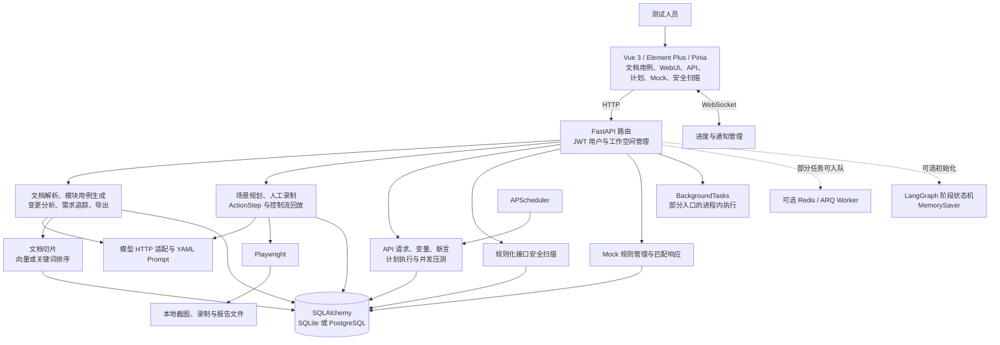

# ai_test_agent 与御策天检：源码对照分析报告

分析日期：2026-10-02。参考项目基线：`95d9f891004748e6e933e40999bbe7570ba8a3ce`；御策天检基线：`9e423bb`。本报告针对本地代码，不代表参考项目其他分支、最新在线版本或实际生产部署。

## 1. 主要结论

两个项目都把大模型用于测试资产生成和自动化执行，但核心组织方式不同：**ai_test_agent 更接近面向测试人员的测试工具平台，御策天检更接近带正式测试资产治理的会话 Agent 执行平台。** 前者以文档、用例编辑器、录制器、接口项目和测试计划为操作中心；后者同时组织会话、工具任务、审批、执行环境、用例版本、套件、运行条目、结果及证据。

新项目最值得借鉴的不是再引入一个 LangGraph，而是三组已经落在代码和界面中的产品设计：

1. **需求工程闭环**：文档变更分析 → 模块增量更新 → 需求提取 → 需求与用例映射 → 缺口分析与补充用例。
2. **录制与回放分工**：AI 提出“测什么”，人工录制关键操作，结构化步骤交给确定性执行器；配合元素别名、条件与循环编辑。
3. **测试人员工作台**：接口请求、变量提取、断言、Mock、计划编排、定时触发和导出等能力在专门页面中呈现，减少只能靠对话操作的负担。

御策天检已有的固定版本、审批、持久派发、原子领取及证据链应作为承接这些能力的基础。**不能直接用参考项目的可变用例、进程内状态和后台函数替换现有执行治理。** 参考项目也有值得审查的隔离、恢复与兼容性边界；本文区分源码观察、静态执行结果和未完成的环境验证，不给未经验证的“成熟度评分”。

## 2. 分析范围与证据等级

本轮阅读了参考项目的 README、DESIGN、后端路由、Agent、Skill、数据库模型、任务 Worker、前端路由及主要页面，并对照御策天检的应用服务、模式、数据契约和已有验收资料。未读取或复制配置密钥、用户上传数据；未安装参考项目依赖，未启动其数据库、浏览器、容器或真实模型服务，未修改两个项目的产品代码。

|证据等级|本文如何使用|
|---|---|
|源码确认|能定位到字段、函数、调用方或界面入口；说明实现存在，不等同于业务效果已验收|
|本轮实际执行|原始文件的 Python 语法解析、原有测试启动及其失败日志；只按真实输出下结论|
|待环境验证|多用户隔离、多 worker 时序、浏览器交互、真实模型、容量与部署行为；不表述为已复现事故|

静态清单中，指定目录内有 **72 个 Python 文件解析成功、1 个失败**，成功解析文件提取到 **157 个路由装饰器定义**，数据库文件声明 **23 张 ORM 表**，测试目录提取到 **251 个 `test_*` 函数定义**。这些不是完整 API 数量、部署表数量或通过测试数量：统计不含 `main.py` 路由装饰器，不含解析失败文件的路由，也不展开参数化测试。前端路由源码有 14 个页面路由项，路由项不能替代可用性测试。原始清单与文件哈希见 [source-evidence.json](source-evidence.json)。

## 3. 参考项目的实际架构

图中的虚线表示可选或部分接入。HTTP 与 WebSocket 的授权实现需分别审查，不能因为 HTTP 有 JWT 就推定实时通道已经校验了身份。

### 3.1 前端与功能组织

前端是 Vue 3、Element Plus、Pinia、Axios 和 ECharts，主要代码为 JavaScript。页面覆盖登录、任务、用例、执行、报告、AI 用例、API 测试、计划、Skill、模型、工作空间、安全扫描和 Mock。`ui/package.json` 的构建脚本为 `vite build`，未声明独立的类型检查和测试脚本。本轮未运行前端构建，不能据此声称前端构建失败。[R01]

专用页面的价值在于让请求、变量和步骤可见、可编辑，用户能够在提交执行前检查 AI 的产物。它与御策天检的会话工作台并不冲突，可以成为正式项目与测试资产页面的补充。

### 3.2 Agent 与执行器

`agent/langgraph_agent.py` 建立解析页面、生成用例、执行测试、生成报告和决策节点，决策依据是状态中的元素、用例、结果是否为空；检查点采用 `MemorySaver`。虽然建立了 `tool_node`，所读条件边没有把它接入主分支，不能仅凭导入 `ToolNode` 认定存在完整自主工具循环。[R02]

主要业务还由专门的 Skill 和路由执行：文档生成走生成器，UI 回放走 ActionRunner，接口走 ApiExecutor，安全扫描走 PentestEngine。因而其“Agent”既包含可选阶段图，也包含产品中的 AI 辅助能力。御策天检的会话编排、工具调用与后台派发是另一种执行组织，不能按共同使用 LangGraph 就认定架构相同。

### 3.3 数据与运行基础设施

数据库支持 SQLite 与 PostgreSQL；Redis/ARQ 是可选任务基础设施，APScheduler 支持测试计划定时执行。**ARQ 不是所有入口的统一执行通道**：AI 用例生成具有入队及后台回退路径，测试计划的手动、Webhook 入口仍调用 `BackgroundTasks`，定时器直接调用计划后台函数。[R07][R08]

`Project` 在参考项目中承担工作空间含义，`ApiProject` 是接口项目，`AICaseFile` 存放模块化用例 JSON、文档内容和追踪数据。它们不能与御策天检的正式 `project_id`、用例版本和套件对象逐字段直接替换。[R09]

## 4. 功能对照

表中“未找到同等专用能力”指本轮所读入口和源码，没有把名称相似或目录存在当作实现证明。

|功能|ai_test_agent 的实际实现|御策天检的实际实现与差异|建议|
|---|---|---|---|
|操作入口|专用测试页面与编辑器；支持用户、工作空间管理|会话 Agent、项目页、任务池、知识、工具、报告与设置；Vue + TypeScript，Electron 包装|借鉴测试编辑界面，不替换会话入口|
|文档生成用例|模块发现、分模块生成、文档检索、结构化 JSON 与导出|正式用例草稿包含来源、内容哈希、模型、Prompt、Skill 版本并走评审|借鉴模块划分与文档处理，落到现有版本契约|
|需求变更|新旧文档差异、模块新增/变更/移除、增量合并、父记录关系|已有用例版本与新回归运行；未找到同等专用文档变更分析页面|优先补充变更影响链路|
|需求追踪|需求提取、用例映射、矩阵、孤立用例与缺口补充|已有 `source_refs`，但不是完整的需求版本与覆盖矩阵|优先设计正式需求对象与关联关系|
|UI 测试|AI 场景、人工录制、ActionStep、if/while、别名、选择器修复|录制、审批、回放、图关系及录制转正式草稿已有实现|借鉴编辑体验与定位质量反馈|
|API 测试|请求编辑、鉴权前置、变量提取、断言、CSV 数据驱动、代码分析生成|API 模式、正式任务/运行、执行器、文档和证据链已有实现|将可视化 API 编辑与正式运行连接|
|测试计划|有序步骤、跨接口变量、手动/Cron/Webhook 触发|套件冻结版本、运行条目原子领取、新运行回归|可借鉴触发入口；必须使用固定版本与幂等派发|
|Mock|规则 CRUD、按请求匹配、状态码、延迟和响应配置|有测试目标/Mock runner 能力；未找到等价面向用户的 Mock 规则工作台|按实际需求建设独立规则产品|
|性能测试|单进程异步接口并发压测与指标|独立性能模式，包含多引擎执行、资源与报告治理|吸收轻量冒烟入口，保留正式压测引擎|
|安全测试|HTTP 规则扫描，含越权、注入、JWT、限流、SSRF、文件等模块|目标授权、环境、工具、证据和缺陷复测链路|借鉴报告与确认流程；不把扫描命中直接作为确认漏洞|
|模型与 Prompt|统一 HTTP 适配、YAML Prompt；LangGraph 另有模型包装|模型注册/配置、会话工具协议、Skill/MCP 与生成来源版本|借鉴 Prompt 可维护性，保持版本留档|
|报告与导出|Excel、Markdown、XMind、HTML/PDF 及部分 pytest 脚本导出|正式结果、工具工件、执行证据与报告|借鉴呈现层，严格区分生成报告和实际通过结论|
|后台任务|部分 ARQ，部分 BackgroundTasks 与进程内缓存|PostgreSQL 任务/attempt/Outbox、Redis 投递、租约、心跳与恢复|保持御策天检现有持久执行边界|
|其他测试模式|本轮确认重点为 WebUI、接口与安全扫描|默认、代码治理、API、性能、安全、兼容性、冒烟、UI 已有运行路径；另六种模式仍属占位|以运行器与验收结果比较，不按模式名称计能力|

参考项目来源为 [R01]–[R14]；御策天检来源为 [O01]–[O05]。上述功能“实现存在”不表示本轮已完成端到端验收。

## 5. 最值得借鉴的实现

### 5.1 文档增量更新：减少无关用例重写

生成器区分 unchanged、changed、added、removed 模块；变更模块默认保留旧用例，标记废弃项，再追加新用例。模型建议废弃过多用例时，代码有保守限制；移除模块保留废弃记录。增量结果写入新 `AICaseFile` 并关联 `parent_id`，比每次上传都覆盖旧文件更便于追溯。[R03][R04]

这适合御策天检的需求迭代，但有两点必须重新设计：一是合并过程会重新编排显示用例编号，显示编号不应承担稳定业务身份；二是父文件关系不是冻结执行版本。御策天检应让需求变更产生新的草稿版本，记录依据和变更关系，经评审启用后再创建新的套件/回归运行，保留历史结果。

保守地限制废弃数量可以减少模型误删，但固定比例也可能遗漏真实大改版。更合适的做法是把大范围删除提交给人工评审，保留模型判断与文档差异证据，而不是把阈值当作业务真相。

### 5.2 需求追踪矩阵：把“生成了很多用例”改为“能解释覆盖什么”

参考项目将需求提取、映射与补充拆为独立接口，矩阵能展示每项需求的关联用例，反向列出未关联需求的用例。这是御策天检目前来源引用能力可继续发展的方向。[R04]

但其状态规则是：关联 0 条为 `uncovered`、1 条为 `insufficient`、至少 2 条为 `covered`。**这是按数量分级的结构性指标，不是需求正确覆盖的证明。** 两条同质用例也可能漏掉权限或边界；一条高质量参数化用例也可能充分覆盖某项简单需求。

建议以需求版本、验证点、用例版本和人工确认的关联关系建模；将正向、异常、边界、权限等维度与执行证据分开统计。AI 负责提出关联和缺口候选，评审负责确认，运行结果负责证明被执行的断言。

### 5.3 场景规划、录制和结构化回放

WebUI 路由有场景规划与录制同步路径，重规划时保留已录制场景。ActionStep 统一操作描述，ActionRunner 将步骤交给 Playwright；控制流转换为内部树结构，当前实现明确支持 if/else/while，并拒绝未支持的结构。[R05][R06]

这种设计降低了“模型直接猜选择器并随意执行”的比例，但不能扩大为所有 UI 路径都不依赖模型：项目还保留 AI 生成/修复步骤和选择器的代码。

御策天检已有录制与审批回放，适合借鉴的是：场景完成度、步骤编辑、别名维护、定位候选质量、回放失败定位，以及从录制步骤提炼业务断言的界面。自动选择器修复应产生可审查的新版本与前后证据，不应无记录地改变正在执行的冻结用例。

还要区分技术提示与业务断言：参考项目加固器会自动插入等待和可见性断言，候选选择器包含成功及错误提示，且步骤可设 `optional=True`。提示出现不能证明业务成功；`optional` 在执行器中表示失败后继续执行，最终结果聚合仍统计失败步骤，不能解释成“可选失败一定忽略”。[R06]

### 5.4 接口工作台、变量与计划

接口执行器处理请求、变量替换、前置鉴权、响应提取和断言；计划共享变量，按步骤连接接口。这些功能适合形成测试人员能审查的显式流程。[R07]

参考计划存储 `case_id`，执行时读取当前 `ApiCase` 内容；它与御策天检的 `case_version_id` 冻结语义不同。借鉴时要保留正式项目归属、固定版本、运行幂等键和证据路径。变量应明确工作空间/项目/运行作用域，不能将会话凭据写入按名称共享的进程缓存。

代码与需求对照、CSV 驱动和脚本导出可以作为辅助功能。它们生成的是测试设计或可执行脚本，必须经过契约校验与实际执行，不能把“生成成功”显示为“被测系统通过”。

### 5.5 文档检索与 Prompt 管理

参考项目用文档切片检索为模块生成补上下文；没有检索结果时回退到文档片段/截断内容。YAML Prompt 有利于集中维护，但其加载函数缓存内容，虽然提供 `reload_all()`，本轮全局搜索未找到调用方，不能把“编辑立即热生效”当成已验证事实。[R10][R11]

检索当前按文档查询全部切片后，在 Python 中进行向量余弦或关键词排序。存在 PostgreSQL/pgvector 配置，不等于已经采用数据库向量索引近邻查询。御策天检可借鉴切片和检索组织方法，但应单独测大文档容量，并继续记录 Prompt、Skill 与检索来源版本。

## 6. 不能直接照搬的边界

以下不是编造的事故清单，也没有进行攻击性复现。只有第 1 项属于本轮对原始源码实际执行确认；其余为源码审查结论及待验证影响。它们说明移植前应查什么，并不要求在本轮修改参考项目。

|观察项|具体依据与准确结论|对借鉴的影响|
|---|---|---|
|1. Python 最低版本不一致|README 声明 Python 3.11+；`api/routes/pentest.py` 第 703、705 行的 f-string 表达式含反斜杠，Python 3.11.16 解析失败，错误位置第 708 行|先核对运行版本；本轮未验证 3.12、完整依赖安装或服务启动|
|2. WebSocket 授权与订阅|`websocket_endpoint` 按查询参数接入，订阅直接使用客户端 workspace_id；所读路径没有用户身份/成员校验，管理器对 workspace=0 有广泛广播分支 [R12]|HTTP 鉴权不能替代实时连接与每次订阅的权限校验；部署可达性及泄露范围未实测|
|3. 全局变量隔离|`_gvar_cache` 按 name 存取；加载全部变量，落库查询按 name，workspace_id 仅部分补归属 [R13]|数据库有工作空间列不等于缓存隔离；多工作空间同名变量影响未动态复现|
|4. 启动恢复没有执行所有权判定|主服务与 ARQ startup 都将所有 generating 记录重置为 failed [R08]|多 worker/滚动启动可能影响仍在执行的记录；需用 owner、租约及心跳识别失联任务，实际重叠时序未验证|
|5. 执行通道没有完全持久化|计划手动/Webhook 用 BackgroundTasks，Cron 直接调用后台函数 [R07]|不能把启用 Redis 等同于所有任务可恢复；移植时使用现有正式派发与 Outbox|
|6. 启动 DDL 吞错|`create_all` 后逐条 ALTER，捕获所有异常并忽略，而非只区分“列已存在” [R09]|权限、语法等错误也可能被隐藏；参考实现不能替代版本化迁移治理|
|7. TLS 校验关闭|API 请求、部分模型/检索 HTTP 客户端有 `verify=False` [R02][R07][R10]|不能将开发便利设置直接带入正式调用；真实代理和证书环境未验证|
|8. 空 JSON 请求语义|ApiExecutor 分支使用 `body_type == "json" and body` [R07]|空对象或显式假值可能被当成未提供正文；这是源码风险，未用真实服务复现|
|9. 自定义脚本与进程边界|参数解析器在当前进程执行编译后的自定义脚本，并限制导入/内建对象 [R13]|限制语言对象不能被当作已有独立进程、资源配额或容器隔离；本轮没有验证逃逸|
|10. 覆盖、断言与修复语义|需求矩阵按条数分级，自动提示断言不区分业务成败，模型还能修复选择器 [R04][R06]|必须保留业务判定标准、人工评审与修复轨迹，不能以生成量或页面可见性代替质量|

Python 官方说明 f-string 表达式的反斜杠限制在 Python 3.12 才放宽，因此第 1 项是最低版本契约的实际矛盾，不是通过修改样本制造的错误。[Python 3.12 官方更新说明](https://docs.python.org/3.12/whatsnew/3.12.html)

另一个容易误判的地方是下载鉴权：主服务的 HTTP 中间件有下载/导出例外，但所读 AI 用例下载、API 报告 PDF 路由仍有当前用户依赖。因此**不能仅凭中间件放行就宣称下载匿名可用**。公开静态截图/报告目录的权限与部署策略仍应另行评估。[R15]

## 7. 建议怎样吸收进御策天检

下面是后续设计建议，不代表本轮已经开发，也不建议整体复制项目。

|阶段|具体工作|承接现有能力|验收依据|
|---|---|---|---|
|一：需求与用例追踪|建立文档/需求稳定 ID 与版本、用例版本关联、变更影响候选和追踪矩阵|项目、source_refs、生成版本、评审、套件冻结|人工标注的真实需求样本；映射准确性、遗漏及误报；历史运行保持不变|
|二：录制与断言编辑|场景清单、已录制状态、步骤/别名编辑、业务断言补齐和修复评审|现有录制、图关系、审批回放、录制转草稿|真实页面轨迹；断言失败必须反映结论；修复有新版本和证据|
|三：API 编辑与 Mock|请求/响应/断言编辑，运行作用域变量，可控 Mock 规则|API 模式、固定用例版本、运行与工件|正式 API 契约；同名变量隔离；空值、异常、超时、并发及身份边界|
|四：计划触发与导出|定时/CI 触发固定套件，导出报告和执行脚本|任务池、Outbox、幂等键、正式运行、结果证据|重复触发、重启、排队、终态不重领；导出与保存版本一致|

第一阶段最有差异化价值：御策天检已经具备执行和资产生命周期，补上需求变更与追踪，能将“为什么需要这个用例、变更后该测什么、哪次结果证明它”连起来。其余阶段按实际使用频率推进，避免一次引入多个独立状态库和执行通道。

## 8. 对毕业论文与系统定位的帮助

论文可以将参考项目作为“AI 辅助测试平台”的本地源码样本，讨论它如何把文档理解、用例生成、录制、执行和报告产品化。御策天检的论述重点可以落在**测试资产版本治理与 Agent 执行证据的一致性**：模型负责建议与规划，正式服务负责权限和版本，运行器负责执行，结果及证据负责判定。

如果后续实现需求追踪，可研究需求变更影响到固定版本回归的闭环，但不能在论文中将本报告建议写成已实现功能。也不能因源码存在租约、断言或检查点，就声称“消除重复执行”“百分之百覆盖”“全场景自动化”。这些需要独立实验。

适合记录的实验维度包括：

- 需求关联的精确率/召回率及人工评审成本，使用脱敏真实需求与人工标注基线。
- 增量生成对比全量生成的耗时、模型用量、遗漏和无关改动数量，固定模型、Prompt、Skill 和文档版本。
- UI 回放的业务断言命中、失败原因、选择器修复前后差异；避免只统计“步骤没有抛错”。
- 中断、重复投递、审批恢复、工具超时下的任务状态及副作用证据，区分模块测试与真实环境联合验证。

这些实验建议还对照了项目本地课程：[评测工程化与 CI/CD](../../项目借鉴/llm-testing-course/评测工程化与CICD.html)关于数据集、评分与基线版本化的章节，[Agent 轨迹与协议鲁棒性](../../项目借鉴/llm-testing-course/Agent轨迹与协议鲁棒性.html)关于结果与轨迹双评估、权限和幂等的章节，以及[线上流量闭环与评测集治理](../../项目借鉴/llm-testing-course/线上流量闭环与评测集治理.html)关于脱敏、去重、补齐上下文和入库评审的章节。本地课程是测试设计参考，不替代论文需要的正式学术文献与实验数据。

参考项目有 MIT LICENSE。若复用源码，应保留相应版权与许可声明，并按论文规范注明出处；本轮未调查上游依赖完整许可证和维护历史，不能据此作出完整供应链结论。[R16]

## 9. 本轮实际验证与未验证内容

1. 对指定源码目录进行 SHA-256 留档和 AST 解析：72 成功、1 个 SyntaxError。文件清单、路由、ORM 与测试定义在 [source-evidence.json](source-evidence.json)。
2. 尝试运行参考项目已有 `test_exceptions.py` 与 `test_param_resolver.py`，使用当前共享 Python 3.11.16 环境，没有新增复现输入。**pytest 返回 2，在收集阶段停止，没有获得测试通过结果。** 导入 `api.exceptions` 经 `api/__init__.py`、全部路由初始化进入 auth，因共享环境没有 `loguru` 失败。`requirements.txt` 已声明该依赖，故这是本轮环境不匹配，不能定性为参考项目漏写依赖。[R17]
3. 该执行还揭示异常模块单元测试会经包初始化加载路由依赖，测试隔离需要关注；但没有绕过正常导入来制造“通过”结果。
4. 执行后的指纹对比显示两个项目所扫描产品源码未改变，参考项目 Git 工作区仍干净。见 [verification.json](verification.json)、[原始日志](unit-tests.log) 与 [JUnit](unit-tests.xml)。

**未执行**：参考项目完整安装、后端启动、前端构建、浏览器交互、真实模型输出/工具执行联调、多用户与多 worker、SQLite/PostgreSQL/Redis、压测与安全扫描。本轮也没有重跑御策天检历史验收；其既有记录属于另一次执行，不能混入本轮通过数量。

若后续开展参考项目验收，应使用独立依赖环境与隔离测试数据，从最小启动、登录与工作空间边界开始，再验证文档生成、录制回放、接口计划、Mock 和故障恢复；本轮不为分析报告改变产品实现。

## 10. 源码索引

相对链接均基于本报告目录；行号对应上述 commit。未启用运行时的代码只能作为实现或风险观察。

|编号|源码与定位|
|---|---|
|R01|[前端路由](../../项目借鉴/ai_test_agent/ui/src/router/index.js)、[前端脚本与依赖](../../项目借鉴/ai_test_agent/ui/package.json)|
|R02|[LangGraph](../../项目借鉴/ai_test_agent/agent/langgraph_agent.py)，第 19、98、142、282 行；[主 Agent](../../项目借鉴/ai_test_agent/agent/core.py)|
|R03|[用例生成器](../../项目借鉴/ai_test_agent/skills/ai_case_generator.py)，第 232、436、911、1615、1641 行|
|R04|[AI 用例路由](../../项目借鉴/ai_test_agent/api/routes/ai_cases.py)，第 1003、1062、1158、1330、1522、1547、1618、1923 行；[用例页面](../../项目借鉴/ai_test_agent/ui/src/views/AiCases.vue)|
|R05|[WebUI 路由](../../项目借鉴/ai_test_agent/api/routes/webui.py)，第 559、799、838、2538 行；[录制器](../../项目借鉴/ai_test_agent/skills/recorder.py)|
|R06|[步骤协议](../../项目借鉴/ai_test_agent/tools/action_schema.py)，第 15、75、125 行；[回放器](../../项目借鉴/ai_test_agent/skills/action_runner.py)，第 63、242、269、295、503 行；[控制流](../../项目借鉴/ai_test_agent/skills/control_flow.py)；[步骤加固](../../项目借鉴/ai_test_agent/skills/step_hardener.py)，第 265 行|
|R07|[接口执行器](../../项目借鉴/ai_test_agent/skills/api_executor.py)，第 229、345 行；[接口路由](../../项目借鉴/ai_test_agent/api/routes/api_test.py)，第 690、746、1114 行；[测试计划](../../项目借鉴/ai_test_agent/api/routes/test_plans.py)，第 211、248、313 行；[定时器](../../项目借鉴/ai_test_agent/api/scheduler.py)，第 25 行|
|R08|[ARQ Worker](../../项目借鉴/ai_test_agent/worker/arq_worker.py)，第 143、168 行；[主服务](../../项目借鉴/ai_test_agent/main.py)，第 188、194 行；[AI 生成入队](../../项目借鉴/ai_test_agent/api/routes/ai_cases.py)，第 339–380 行|
|R09|[数据库模型与启动 DDL](../../项目借鉴/ai_test_agent/tools/database.py)，第 222、236、514、527、628 行|
|R10|[文档检索](../../项目借鉴/ai_test_agent/skills/rag.py)，第 122、192、209、231 行|
|R11|[Prompt 加载](../../项目借鉴/ai_test_agent/skills/prompt_loader.py)，第 22、66 行|
|R12|[WebSocket](../../项目借鉴/ai_test_agent/api/websocket.py)，第 12、34 行；[广播管理](../../项目借鉴/ai_test_agent/api/websocket_manager.py)，第 129 行|
|R13|[变量与脚本](../../项目借鉴/ai_test_agent/skills/param_resolver.py)，第 30、54、58、72、84、184 行|
|R14|[Mock](../../项目借鉴/ai_test_agent/api/routes/mock.py)；[安全扫描器](../../项目借鉴/ai_test_agent/skills/pentest_engine.py)，第 355、445 行；[pytest 导出器](../../项目借鉴/ai_test_agent/skills/pytest_exporter.py)|
|R15|[HTTP 鉴权中间件与静态目录](../../项目借鉴/ai_test_agent/main.py)，第 367 行附近；[用例下载](../../项目借鉴/ai_test_agent/api/routes/ai_cases.py)，第 410 行；[报告下载](../../项目借鉴/ai_test_agent/api/routes/api_test.py)，第 1242 行|
|R16|[参考项目许可](../../项目借鉴/ai_test_agent/LICENSE)|
|R17|[参考项目最低环境要求](../../项目借鉴/ai_test_agent/README.md)，第 93 行；[依赖声明](../../项目借鉴/ai_test_agent/requirements.txt)；[解析失败文件](../../项目借鉴/ai_test_agent/api/routes/pentest.py)，第 703–708 行|
|O01|[御策天检系统说明](../system_acceptance_2026-10-02/system-guide.md)、[既有验收记录](../system_acceptance_2026-10-02/latest-report.md)、[剩余工作](../system_acceptance_2026-10-02/remaining-work.md)|
|O02|[用例版本契约](../../Agent_Server/src/schemas/case_management.py)，第 70–74 行；[套件冻结](../../Agent_Server/src/application/test_suites/suite_service.py)，第 45–68 行；[运行执行](../../Agent_Server/src/application/test_runs/execution_service.py)|
|O03|[正式任务派发](../../Agent_Server/src/application/orchestration/agent_task_dispatcher.py)、[Outbox](../../Agent_Server/src/runtime/postgres_task_outbox.py)、[Redis Worker](../../Agent_Server/src/runtime/redis_task_worker.py)|
|O04|[录制转草稿](../../Agent_Server/src/application/recorder/recording_case_draft_service.py)、[模式实现](../../Agent_Server/src/modes)、[模式注册](../../Agent_Server/src/registry/modes.py)|
|O05|[御策天检入口](../../Agent_Server/src/main.py)、[前端路由](../../agent_web/src/router/index.ts)、[前端脚本](../../agent_web/package.json)|

## 11. 留档文件

- [collect_evidence.py](collect_evidence.py)：本轮源码清单与既有测试执行工具；默认输出目录即本目录，首次证据文件采用独占创建，重复分析应复制到新目录留档，避免覆盖失败结果。
- [source-evidence.json](source-evidence.json)：基线、指定目录源文件哈希、函数/路由/ORM 清单及语法错误位置。
- [verification.json](verification.json)：实际 pytest 命令、Python 版本、退出码和源码未修改检查。
- [unit-tests.log](unit-tests.log)、[unit-tests.xml](unit-tests.xml)：原始收集失败输出。
- [validate_report.py](validate_report.py)、[交付核对](report-validation-delivery.json)：报告引用、语法检查及留档完整性核对。首次发现一处引用路径错误，修正后重新验证；[首次记录](report-validation.json)与[修正后记录](report-validation-final.json)均保留，没有覆盖。
