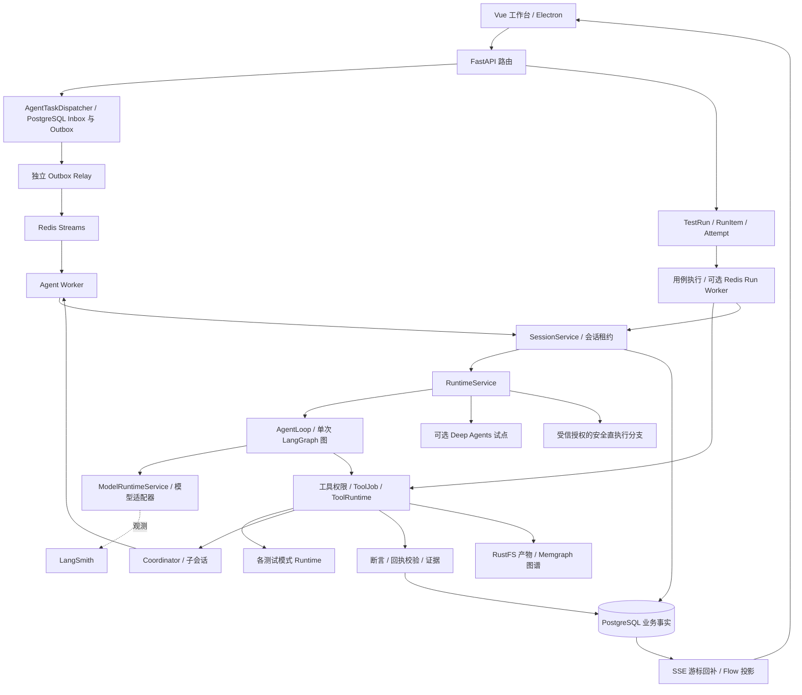

# 系统架构、模型请求与 Harness 实现审阅

日期：2026-10-25。源码基线：`3fa2b1ef2`。

## 1. 范围与结论

本次按入口、模块清单和核心调用链阅读前后端源码，核对既有设计文档，并运行针对性测试。覆盖系统结构、模型请求、Agent 编排、任务调度、业务模块边界及全部 14 个模式的 Harness 定位。没有修改业务代码、数据库或依赖，没有调用真实供应商模型，也没有启动完整服务集群。不是逐行审计全部文件。

**当前系统是一个模块化单体后端，加多个独立 Worker 和多种资源执行器。Agent 的主要控制逻辑由项目自己实现；LangGraph 承载单次图执行，LangChain 提供可选模型/工具适配，LangSmith 提供旁路观测。**

**系统有实际 Harness 能力，但没有统一的、按 `harness_key` 实例化并执行的 Harness 内核。** 能力分散在 Session、AgentLoop、权限、ToolJob、模式 Runtime、TestRun、Verification 和资源租约层。14 个模式中 8 个非占位（含默认协作和代码审批），6 个明确占位；非占位不等于具备完整测试与故障恢复闭环。

本报告将源码事实、配置观察、结构性限制和未验证事项分开描述，不复用旧调研中的测试计数。

## 2. 总体结构与事实归属



依据：[应用装配](../Agent_Server/src/main.py)、[依赖容器](../Agent_Server/src/containers.py)、[消息路由](../Agent_Server/src/api/routes/sessions.py)、[Agent 调度](../Agent_Server/src/application/orchestration/agent_task_dispatcher.py)。图中的反馈箭头不表示所有子 Agent 默认都通过独立队列，具体分支见第 5 节。

| 组件 | 当前职责和边界 |
|---|---|
| Vue / Pinia / Electron | 输入、审批、状态展示、录制桥接、事件消费；Flow 是事件和快照的投影，不是实际调度器 |
| FastAPI + application 服务 | 请求接纳、模式选择、业务校验、任务提交、状态查询；`main.py` 仍承担大量服务装配 |
| PostgreSQL | Session、消息、事件、快照、Agent 任务/Attempt、Outbox、用例/版本/套件/RunItem/结果、文档任务、资源分配和向量记忆等业务事实 |
| Redis | Streams 交付、消费组、待确认消息、重试；资源配额与租约；热记忆/向量候选等辅助数据 |
| MySQL | 模型、邮箱、渠道、工作台设置及赞助商等配置；不是测试结果主库 |
| Memgraph | UI/录制/安全及知识关系图；不是 RunItem 终态权威 |
| RustFS / 本地产物 | 截图、报告、日志、文档原件及固定请求/响应等；数据库保存关联和元数据 |
| LangSmith | 调用链与业务 ID 关联的观测旁路；失败不能替代或阻塞本地业务事实 |
| 兼容性 Runner 服务 | 特殊边界：服务端字典 + 本地 `runner_state.json`，客户端可使用 SQLite RunnerJournal；没有统一落入其他任务的 PostgreSQL 领取协议 |

注意：`Agent_Server` 是本项目自己的 FastAPI 工程名，不能据此认定正在使用 LangGraph 官方 Agent Server 的自动持久化服务。

## 3. 一次用户输入与每轮模型请求

### 3.1 先区分计数单位

- **用户输入**：一次消息提交。
- **Turn**：一次执行回合；审批与恢复通常继续原 Turn。
- **模型逻辑调用**：一次 `ModelRuntimeService.invoke`，有 `logical_call_id`。
- **HTTP Attempt**：SDK 可能对一次逻辑调用重试，实际请求次数另行记录。
- **子 Agent**：独立子 Session，拥有自己的消息、状态和模型工具循环。

因此一次输入可能产生意图识别、摘要、主 Agent 多轮调用、多个子 Agent 调用及回执修正。不能把图的 `loop_iteration`、Turn 预算、SDK 重试次数和整棵子任务总调用数混为一谈。

### 3.2 输入接纳与上下文准备

1. `POST /sessions/{id}/messages` 调用 `AgentTaskDispatcher.submit`，先做纯输入归一化。
2. 用户消息、任务、排队事件和 Outbox 在 PostgreSQL 事务内提交，API 返回 202。排队输入先标记 `context_eligible=false`，避免尚未执行的输入提前进入正在运行的上下文。
3. Relay 将任务身份发布至 Agent Stream；Agent Worker 原子领取任务、建立执行 Attempt 和 Session 租约，再进入 SessionService。
4. Worker 执行阶段调用 `InputOrchestratorService.orchestrate_async`：命令/附件处理、规则意图、条件触发的语义意图增强、安全评估、模式与 Agent/Skill 选择，形成 `ExecutionRequest`。
5. `RuntimeService` 按分支选择普通主图、Deep Agents 试点，或满足受信授权条件的安全直执行路径。

依据：[输入编排](../Agent_Server/src/application/orchestration/input_orchestrator_service.py)、[语义意图增强](../Agent_Server/src/application/intent/semantic_intent_service.py)、[任务存储](../Agent_Server/src/runtime/postgres_agent_task_store.py)、[运行服务](../Agent_Server/src/application/runtime/runtime_service.py)。

### 3.3 普通主图每次执行什么

```text
START
  → context_builder
  → router
  → planner
  → permission_gate
  → prompt_assembler
  → model_invoker
      ├─ 请求工具 → tool_executor
      └─ 无工具 ─────────────────┐
                   → finalizer → responder → END
```

`AgentLoop.run_turn` 在图外用 `while` 重复 `graph.ainvoke(current_state)`。所以每次工具循环重新进入时，又经过 context_builder/router/planner 等节点，并非 LangGraph 图内部的回边。

各节点的真实边界：

- `context_builder`：准备会话/模式/迭代上下文，检索历史 observation，形成时间线。
- `router`：解析 Agent 和数据库中的有效模型，合并模式/Skill/请求工具，按能力与用例范围过滤；检索记忆及允许检索的项目用例，加载 MCP 描述。
- `planner`：当前写入一组固定的通用执行说明，**不是由模型动态生成并调度业务 DAG 的 Planner**。真正的业务任务拆分在各模式和规划服务中。
- `permission_gate`：预判工具 allow/ask/deny，实际工具参数仍需在执行边界检查。
- `prompt_assembler`：生成系统提示分段，维护完整消息序列。
- `model_invoker`：预算检查、构造 DTO、调用模型、记录响应与工具请求。
- `tool_executor`：遍历本批工具调用，做 Schema、权限、安全、审批、ToolJob 等处理，收集输出。该层当前是顺序 `for` 执行；子任务或测试引擎可在下层并行。
- `finalizer`：决定终止、等待审批/子任务、预算终止或继续循环。

依据：[图定义](../Agent_Server/src/graph/builder.py)、[AgentLoop](../Agent_Server/src/application/runtime/agent_loop.py)、[图节点目录](../Agent_Server/src/graph/nodes/)。

### 3.4 系统提示、历史、工具分别如何组装

**系统提示**由 `PromptAssemblyService` 按 `PromptSection.priority` 排序并渲染，主要内容为：

1. Agent 身份、输出语言、执行纪律。
2. 当前模式/模型、意图路由与安全约束、Coordinator 或模式/Worker 专属契约。
3. 已加载 Skill 的完整指令和可用 Skill 目录。
4. 历史 observation、持久记忆。
5. 用例执行时的固定版本、准备数据、步骤、预期、执行关系和回执契约；普通检索路径则可以注入项目用例命中。
6. MCP 运行时描述。

记忆、检索文档等外部内容带不可信来源包装；Section 记录 source/cache_scope/priority。**这里的 cache_scope 是应用元数据，不能直接等同于供应商前缀缓存命中。**

**历史消息**由 `TranscriptHygieneService` 构建：已有摘要 + 摘要覆盖点之后最近的消息；默认 tail 为 24 条。普通跨 Turn 重建主要保留 user/assistant/system，不直接保留数据库中的 tool 展示消息；完整工具事实仍在 ToolJob、事件、快照等处，后续可检索。

**重要分支**：若 `runtime_messages` 已非空，PromptAssemblyService 直接使用该完整序列；只有为空时，才将 user_request、normalized_input、意图、执行计划、工具权限、上下文概况、附件等 runtime sections 渲染成 user 消息。不能描述为“每次都会把上述字段重新拼成一条 user 消息”。

**同一 Turn 第 N+1 次工具循环**：

```text
system: 当前重新组装的系统提示
user/assistant: 当前 Turn 起始历史
assistant: 第 1 次工具调用，含 call_id
tool: 对应 call_id 的工具结果
...
assistant: 第 N 次工具调用
tool: 第 N 次工具结果
```

`prompt_assembler` 用返回的完整 transcript 替换状态中的序列，避免重复 append 全部历史。工具输出进入下一轮前有消息体预算；完整原始证据与供模型阅读的短输出职责分开。审批时先保存 assistant 工具调用批次，恢复时补齐对应结果。

依据：[提示组装](../Agent_Server/src/application/prompting/prompt_assembly_service.py)、[transcript hygiene](../Agent_Server/src/application/context/transcript_hygiene_service.py)、[组装节点](../Agent_Server/src/graph/nodes/prompt_assembler.py)、[工具节点](../Agent_Server/src/graph/nodes/tool_executor.py)。

### 3.5 从应用 DTO 到供应商请求

`model_invoker` 构造 `ModelInvocationRequest`：

```text
system_prompt
messages / structured_messages
tools: 本轮可见工具的名称、描述、input_schema
system_prompt_sections / runtime_message_sections
trace_context: session_id / turn_id / trace_id / project_id
               / run_item_id / attempt_id / logical_call_id / thread_id
```

`ModelRuntimeService` 负责：查 MySQL 有效模型配置 → 必要时检查固定参数/SDK 配置是否漂移 → 请求能力映射 → 取得凭据 → 选适配器 → 统一响应、usage、完整结束状态和 HTTP Attempt 观测。

- OpenAI Chat：原生 SDK `chat.completions.create`；消息、工具名、token 参数、输出格式等按配置映射。
- 开启且满足条件的 LangChain Chat：转换成 SystemMessage/HumanMessage/AIMessage/ToolMessage，`bind_tools` 后调用；共享工厂已显式 `use_responses_api=False`。
- 配置要求显式 `max_tokens` 的 Chat 路径使用原生客户端。
- Responses、Anthropic Messages、Google GenerateContent 有独立原生客户端分派，不能把整个系统称作仅支持 Chat，也不能认为所有 Provider 都经过 ChatOpenAI。

依据：[模型服务](../Agent_Server/src/application/models/model_runtime_service.py)、[DTO](../Agent_Server/src/schemas/model_config.py)、[原生分派](../Agent_Server/src/application/model_clients/registry.py)、[LangChain 模型适配](../Agent_Server/src/application/model_adapters/langchain_model_adapter.py)、[消息适配](../Agent_Server/src/application/model_adapters/message_adapter.py)。

### 3.6 主图之外的模型请求

| 调用类型 | 组装方式 |
|---|---|
| 语义意图 | 专属 system + 用户输入/规则判定 JSON；tools 为空；条件触发，失败保留规则结果并记日志 |
| 上下文摘要 | 摘要 system + 旧摘要/新增历史片段；通过默认模型调用，记录覆盖点，不删除原历史 |
| 用例生成 | 生成 Prompt + 固定来源/目标/覆盖信息；固定生成路径冻结 Prompt/Skill/模型等元数据 |
| 用例规划 | 固定规划 Prompt + 来源证据、前轮结果/反馈；请求/响应 checkpoint，模型参数与运行配置漂移检查，阶段拒绝工具执行 |
| 文档影响分析 | 固定分析上下文和选定批次；独立字节/token/输出预留预算，先保存响应再解析候选 |
| Agent 用例回执修正 | 固定用例、实际 ToolJob 证据、验证反馈；只读、无工具、在原 Turn 预算内保留一次修正，不能重跑业务操作 |
| 模型设置探测 | `SettingsService` 直接调用客户端探测，属于配置检查入口 |
| Deep Agents | 接收已配置模型和初始 messages/system/tools 后，内部后续循环由框架 Harness 组织 |

依据：`semantic_intent_service.py`、`context_compaction_service.py`、`test_cases/generation_pipeline.py`、`test_cases/planning_workflow.py`、`documents/impact_calls.py`、`test_runs/agent_case_receipt.py`、`deep_agents/runtime_adapter.py`。

**上下文治理现状**：摘要默认 70% watermark，另有无 usage 时的消息数触发；主循环依据已返回的 prompt usage 在 90% 处停止继续请求，并有模型调用上限。它们不是对每次新拼装请求统一进行完整输入估算与输出预留。文档影响分析已经有专用预算，但尚未成为所有入口共享的预算内核。

## 4. 执行状态、审批与恢复

需要区分至少六种记录：

| 记录 | 表达什么 |
|---|---|
| Session / Turn | 用户交互和一次 Agent 执行上下文 |
| AgentTask / Agent Attempt | 排队的会话执行命令、Worker 所有权和执行尝试 |
| ToolJob | 具体工具调用的输入、输出、审批和执行状态 |
| 模式状态 | API campaign、安全 campaign、性能 phase、冒烟 plan 等领域阶段 |
| TestRun / RunItem / Run Attempt | 固定用例版本的正式执行、领取、尝试和终态 |
| Verification / Result / Artifact | 校验结论、最终测试结果及其证据 |

**主图恢复**：`build_agent_graph` 最终是 `graph.compile()`，没有传入 checkpointer。主链使用 `pending_turn`、`SessionSnapshot`、租约和恢复方法重建状态。不能把它称为 LangGraph 自动逐节点 checkpoint，也不能由此推断“完全没有恢复”。

**Deep Agents 恢复**：可选适配器注入独立 checkpointer，`thread_id=request.turn_id`；审批继续使用 `Command(resume=...)`，业务工具经应用治理包装。其默认开关关闭，不能代表主图的运行方式。官方对原生 interrupt 的要求是 checkpointer、thread_id 和 interrupt 调用：[LangGraph Interrupts](https://docs.langchain.com/oss/python/langgraph/interrupts)；checkpoint 与跨线程 memory store 的职责也不同：[Persistence](https://docs.langchain.com/oss/python/langgraph/persistence)。

### 4.1 LangGraph、LangChain 和 Deep Agents 的审批关系

**三者都能参与审批，它们是分层关系。** 上文“主图没有使用原生 interrupt”仅描述本项目接入现状，不表示 LangGraph 没有审批能力。

| 层次 | 框架提供的机制 | 本项目的使用方式 |
|---|---|---|
| LangGraph | `interrupt(payload)` 暂停，checkpointer 保存执行状态；同一 `thread_id` 下以 `Command(resume=...)` 恢复 | 主图未接入这套原生暂停机制；可选 Deep Agents 适配器使用它 |
| LangChain Agent | `HumanInTheLoopMiddleware` 按工具调用策略触发 interrupt，并解释人工决定 | 主图是自建 StateGraph，没有因为引入 LangChain 依赖就自动挂上此中间件 |
| Deep Agents | `create_deep_agent(interrupt_on=..., checkpointer=...)` 配置工具审批，内部使用上述 HITL 中间件 | 试点将官方 interrupt 转成本系统 Approval，再将人工决定映射回官方 resume |

官方依据：[LangGraph Interrupts](https://docs.langchain.com/oss/python/langgraph/interrupts)、[LangChain HITL](https://docs.langchain.com/oss/python/langchain/human-in-the-loop)、[Deep Agents HITL](https://docs.langchain.com/oss/python/deepagents/human-in-the-loop)。这些机制管理执行暂停与恢复；本项目的业务审批记录、前端、执行范围与任务调度仍由应用负责。

原生 interrupt 恢复会从所在节点开头重跑，因此中断前的副作用需要幂等处理。安装一个 checkpointer 并不能替代 ToolJob 的执行对账。

### 4.2 主链审批：应用记录、持久任务和恢复方法

1. **决定是否询问**：PermissionService 先计算工具权限；具体调用还经过 ExecutionSafetyPolicy / SafetyGate。工具权限要求询问、调用风险要求询问或安全判定要求审批时，进入等待。明确拒绝与安全授权缺失也有独立拒绝分支。
2. **创建待审批事实**：`tool_executor._resolve_tool_call` 创建并标记等待的 ToolJob，生成 Approval，保存原始 `call_id`、工具参数、ToolJob 身份及 `approval_scope_hash`。此分支不执行该工具。
3. **保存待续跑回合**：保存 assistant 工具调用批次、已有结果和 `pending_approval_ids` 到 `pending_turn` / 快照，结束本轮循环并展示待审批卡片。这里的 `graph_state` 是应用序列化状态，不是 LangGraph saver 自动产出的 checkpoint。
4. **用户决定**：ApprovalPanel / Session Store 提交 `approved` 或 `denied`，附可选理由、客户端请求标识。普通会话走 `POST /sessions/{session_id}/approvals/{approval_id}`。
5. **持久化并排队**：主应用注入 AgentTaskDispatcher 后，PostgreSQL 事务锁定会话和审批，记录决定、创建 `approval_resume` 任务、事件及 outbox；API 返回 202。之后 relay / Redis Stream / Worker 负责续跑，不在 HTTP 请求中直接调用模型。未注入 dispatcher 的兼容路径则使用 continuation 租约和后台协程。
6. **执行或跳过工具**：`RuntimeService._resume_after_approval` 从应用状态重建回合，重新核对范围哈希和调用安全策略。批准且校验通过才执行原工具，并设置服务端审批标记；拒绝、范围不一致或安全策略拒绝时生成 denied 结果。范围哈希覆盖模式、工具、参数、环境及租户/工作区/项目字段。
7. **补结果再继续模型**：当前批准的工具可先执行并保存结果；同批仍有审批时重建等待快照。全部决定处理完后，普通工具恢复链补齐匹配 `tool_call_id` 的结果消息，再进入 Agent 循环。安全工具 bootstrap 另有直接结算报告分支。

依据：[审批创建与暂停](../Agent_Server/src/graph/nodes/tool_executor.py)、[权限策略](../Agent_Server/src/application/permissions/permission_service.py)、[会话审批分流](../Agent_Server/src/application/sessions/session_service.py)、[审批事务与 outbox](../Agent_Server/src/runtime/postgres_agent_task_store.py)、[恢复执行](../Agent_Server/src/application/runtime/runtime_service.py)、[范围绑定](../Agent_Server/src/application/security/approval_scope_service.py)、[前端提交](../agent_web/src/stores/session.ts)。

### 4.3 Deep Agents 试点审批：官方 HITL 与应用治理桥接

- `_build_deep_agent_business_tools` 为业务工具配置 `interrupt_on`，通过 `when` 查询应用治理策略；允许的决定明确为 `approve` / `reject`。
- 适配器传入独立 checkpointer，以 `request.turn_id` 为框架 `thread_id`，接收 `__interrupt__`。CheckpointProvider 使用独立 PostgreSQL schema，业务 Session / Approval / TestRun 表仍保有其职责。
- `_record_deep_agent_interrupts` 按原顺序匹配 action 与工具调用，创建本系统 Approval / ToolJob，并记录 interrupt ID 和 action index，因此复用现有前端审批。
- `_resume_deep_agent_after_approval` 先收齐本批决定，再按 interrupt ID 和原 action 顺序构建 decisions，将 `approved` / `denied` 映射为 `approve` / `reject`，交给 `Command(resume=...)`。
- 获批业务调用仍经过 ToolGovernanceService 的范围、权限、ToolJob 身份和领取检查。终态结果复用已有证据；已启动却无终态的未知执行结果要求对账，不直接重试。

**当前接入没有开放编辑工具参数，也没有开放人工代答工具结果。** 官网当前 HITL 文档还列有 `edit` / `respond`，不能据此宣称本系统已实现这些操作；本地还缺少 `deepagents` 包，相关原生集成测试跳过。

依据：[官方适配器](../Agent_Server/src/application/deep_agents/runtime_adapter.py)、[审批桥接](../Agent_Server/src/application/runtime/runtime_service.py)、[业务工具治理](../Agent_Server/src/application/runtime/tool_governance_service.py)、[checkpoint 提供器](../Agent_Server/src/application/deep_agents/checkpoint_provider.py)、[默认关闭配置](../Agent_Server/src/core/config.py)。

### 4.4 其他审批入口与正式执行

审批记录复用不代表续跑语义相同：UI 录制审批调用录制服务启动/拒绝；父会话代理审批向子会话转发决定；正式 TestRun 审批要求通过运行条目专用入口处理，前端按审批 source 分流，通用 Session 接口拒绝直接处理这些 TestRun 审批。

**正式用例执行**：草稿 → 评审/启用固定版本 → 套件/计划冻结 → RunItem 原子领取 → Attempt/租约/checkpoint → 执行 → 证据校验 → Result。失败回归创建新运行，不能重置原终态。

正式执行有两条适配路径：

- `CaseExecutionAdapter`：将旧格式用例编译成模式 Runner 参数，依据 Verification 生成结果。
- `AgentCaseExecutionAdapter`：将固定业务 JSON 和准备项交给 Agent，工具调用绑定执行项/操作身份，实际 ToolJob 输出进入 evidence manifest，再由 `AgentCaseAssessmentService` 校验回执及引用、输出与预期、清理/关系等协议。

旧适配器 `_result_status` 明确：工具失败/拒绝 → error；断言失败 → failed；存在且全部 Verification passed → passed；否则 blocked。Agent 回执也必须核对持久工具证据。这个边界已有实际代码，不只是 Prompt 要求。

依据：[Run 执行](../Agent_Server/src/application/test_runs/execution_service.py)、[旧用例适配](../Agent_Server/src/application/test_runs/case_execution.py)、[Agent 用例适配](../Agent_Server/src/application/test_runs/agent_case_execution.py)、[回执评估](../Agent_Server/src/application/test_runs/agent_case_assessment.py)、[依赖规则](../Agent_Server/src/application/test_runs/dependencies.py)。

## 5. 多 Agent 编排与基础调度

### 5.1 业务编排：谁做什么

模型通过注册的 `subagent-dispatch` 或模式专属编排入口提出 Worker 任务。`CoordinatorRuntimeService` 承担实际动作：

1. 校验父 Session/Turn，检查深度和失败保护。
2. 标准化 Worker 描述、Agent、模型、Skill、Prompt 和 context；生成稳定任务标识/请求指纹。
3. 持久化 dispatch claim；重复请求对账并返回既有回执。
4. 创建子 Session，登记父子关系和项目范围，按并发槽位启动。
5. 追踪完成、失败、等待审批、中断；代理子审批至父会话。
6. 投影 Worker 通知；按模式启动后续轮次、汇总 Worker 或恢复等待中的原工具。

代码审批使用首轮独立审查 → 后续交叉评审 → 汇总 Agent；轮次屏障和可用槽位由 Coordinator 控制。API 另有 ApiTaskPool/ApiSubagentCoordinator 管依赖与执行批次；安全和性能也有领域编排，因此没有一张覆盖所有模式的统一动态业务 DAG。

### 5.2 调度：在哪里、何时执行

| 层 | 机制 |
|---|---|
| 普通 API 消息 | PostgreSQL Inbox/Outbox → 独立 Relay → Agent Redis Stream → Agent Worker；会话队列与执行租约 |
| TestRun 异步执行 | 开启 Run dispatch 后，由 RedisExecutionDispatcher 交付；Worker 每次领取满足依赖的 RunItem，执行时持有 lease_token |
| Redis 交付 | consumer group、reclaim、heartbeat、超时、退避、死信；**至少一次交付**，业务幂等/fencing 在 PostgreSQL 边界保证 |
| Coordinator 子任务 | durable_children 开启且找到有效父任务时提交持久子 AgentTask；否则仍有 `asyncio.create_task` 进程内路径 |
| 本地并发保护 | AgentControl / WorkerPool、父会话锁、Coordinator 槽位 |
| 资源并发保护 | RedisResourceLeaseManager、资源配额和 PostgreSQL 分配/清理事实；Agent、浏览器、Docker 等独立资源生命周期 |
| 兼容性执行 | 环境 selector 匹配 Runner、poll 领取、heartbeat、报告和产物；服务端本地 JSON 与客户端 SQLite journal |

因此“用了 Redis”不等于业务操作恰好执行一次；“有 WorkerPool”也不等于子 Agent 默认跨进程持久运行。旧 Worker 的写入需要 lease/fencing 拒绝，未知外部副作用需要对账。

`coordinator_max_workers` 默认 4；应用 AgentControl 深度默认 3，持久 AgentTaskStore 另有最大深度 5。两层均有自己的约束，不能用一个数字概括全部路径。

依据：[Coordinator](../Agent_Server/src/application/orchestration/coordinator_runtime_service.py)、[Redis Worker](../Agent_Server/src/runtime/redis_task_worker.py)、[Run dispatcher](../Agent_Server/src/application/orchestration/redis_execution_dispatcher.py)、[资源租约](../Agent_Server/src/runtime/resource_lease_manager.py)、[兼容性服务](../Agent_Server/src/application/compatibility/runner_service.py)、[Runner journal](../Agent_Server/src/application/compatibility/runner_journal.py)。

### 5.3 SSE 与 Flow

当前公开 SSE 从 PostgreSQL 事件分页读取，按 Last-Event-ID 回补并发 keepalive；不是单纯依赖进程内 asyncio.Queue 广播。FlowProjectionService 和前端 `useFlowSession.ts` 将事件、快照、Worker、ToolJob 和产物投影成轨迹。可视化节点和状态映射在前后端各维护一份，需要同步。

## 6. 全部模式的 Harness 判定

判定口径来自项目《Harness Engineering 开发规范》的八层能力：Context、Task、Tool、Execution、Verification、Evaluation、Observability、Cleanup / Entropy；中断恢复同时属于执行可靠性检查。不能仅凭有 `harness_key`、Skill、Prompt 或名为 verification.py 的文件判定完整。

| Harness 层 | 当前实际承载 | 边界或待验证事项 |
|---|---|---|
| Context | PromptSection、transcript、记忆/observation/用例检索、固定业务版本 | 各模型入口预算与来源快照尚不统一 |
| Task | 模式 phase/Campaign、规划、Coordinator、RunItem DAG | 通用 planner 是固定说明，各领域拆分各自实现 |
| Tool | Registry、Schema、Permission、Safety、Approval、ToolJob | 老图与 Deep Agents 治理路径并存 |
| Execution | AgentLoop、Session/RunItem lease、Worker、checkpoint、资源分配 | 自有快照与框架 checkpoint 不同；进程内子任务与持久任务并存 |
| Verification | 公共 VerificationService、模式规则、AgentCaseAssessment | 以模式/执行策略和断言支持范围为准；无证据不应通过 |
| Evaluation | API/安全 EvaluationPolicy、性能 SLA/基线、冒烟分析、代码评审 | 不是所有模式共用一套版本化评测集和评分器 |
| Observability | 本地事件/Flow、日志、metrics、可选 LangSmith | Trace 成功不代替业务结果；跨进程交付未在本轮验证 |
| Cleanup / Entropy | 资源清理 Worker、租约回收、用例副作用清单与 cleanup coverage 等 | 这些机制存在不代表所有模式已完成知识 stale 清理、补偿和未知副作用对账 |

| 模式 | 用例策略 | 已落地的模式控制 | 验证/评估与限制 | 判定 |
|---|---|---|---|---|
| default | exempt | Coordinator、通用图、权限、ToolJob、快照与事件 | `DEFAULT_MODE_VERIFICATION` 是 best_effort 常量；通用协作不天然形成测试结果 | 通用 Harness，非专用测试闭环 |
| code_review | exempt | 源码/差异读取、治理执行、时间预算、评审团、交叉评审、总结与报告 | verification.py 是契约常量；实际治理和评审在工具服务/Coordinator，代码审查意见不证明测试通过 | 有专用编排，非统一可执行 Harness 插件 |
| api_testing | required | 项目/文档/端点/鉴权选择、Campaign、依赖任务池、真实子 Worker、checkpoint | Runtime 实际调用 ApiTestingVerificationPolicy 和 EvaluationPolicy；正式用例另走 RunItem 证据链 | 专用 Harness 能力较完整 |
| security_testing | optional | 场景/范围/授权、Campaign、发现/验证/子任务、执行环境、漏洞证据/复测 | Runtime 实际调用 Verification/Evaluation；报告 approved 表示报告证据门通过，不等于系统无漏洞 | 专用 Harness 能力较完整 |
| performance_testing | optional | intake → 文档/端点 → plan/script → guard → smoke → load → collect → analyze → report；k6/JMeter 引擎、指标与基线 | verification.py 虽为 placeholder 常量，实际 SLA/阈值/证据判定在 parser/report_builder 与公共 VerificationService | 有真实领域 Harness；核对实际裁决位置 |
| smoke_testing | required | 来源解析、计划/版本、服务端审批、方案冻结、选中用例执行、报告/回归候选 | verification.py 为 placeholder 常量，但实际有 ResultAnalyzer 和公共 VerificationService；不能据文件名否认现有校验 | 有计划与执行 Harness，恢复需分执行路径验证 |
| compatibility_testing | required | 多环境计划、Runner 能力匹配、poll/heartbeat、重排、产物、报告 | 专用 runner_service 承担控制；Runtime 派发通常返回 partial/dispatching，不能当作执行完成；JSON 状态不是分布式数据库领取 | 有专用 Harness，持久化与调度边界特殊 |
| ui_automation | required | 正式项目、三源资源检查、录制审批、页面探索、录制/回放；正式用例可走 Agent 执行 | 公开 UIAutomationModeRuntime 的 browser/test_execution 员工仍未实现，只开放 information_exploration；公共校验无断言时 not_run。AgentCase 链是另一条真实执行路径 | 部分落地，必须分探索/录制/正式 Agent 用例看 |
| unit_component_testing | optional | 注册 Skill，public entry=skill | manifest 明示无专用 Agent/Runner/执行工具 | 占位，无专用测试 Harness |
| accessibility_testing | optional | 注册 Skill，public entry=skill | 无专用 Runner/合规认证能力 | 占位，无专用测试 Harness |
| visual_regression_testing | optional | 注册 Skill，public entry=skill | 无专用视觉差异 Runner | 占位，无专用测试 Harness |
| mobile_testing | optional | 注册 Skill，public entry=skill | 无设备/模拟器/移动 Runner | 占位，无专用测试 Harness |
| reliability_testing | optional | 注册 Skill，public entry=skill | 无专用执行编排 | 占位，无专用测试 Harness |
| integration_testing | optional | 注册 Skill，public entry=skill | 无专用 Runner/依赖环境编排 | 占位，无专用测试 Harness |

依据：[模式注册](../Agent_Server/src/registry/modes.py)、[模式契约](../Agent_Server/src/schemas/mode.py)、[各模式实现](../Agent_Server/src/modes/)、[公共验证](../Agent_Server/src/application/testing/verification_service.py)。

`harness_key` 当前主要进入 `test_route`、上下文和 harness_flags。全局引用搜索未发现一个 HarnessRegistry 据此解析执行器并统一运行生命周期；工具执行主要按 ToolRuntime handler 分派。placeholder_testing_harness 也不是已经实现的一套专用测试引擎。

UI 录制另有明确恢复限制：RecorderSessionService 注释及实现说明内存运行时承担即时控制；进程重启丢失运行时后，未终态录制会话控制会拒绝。PG 有录制事件不表示可以无缝接管正在录制的浏览器。

## 7. 功能模块边界

以下按领域职责划分，而不是把每个 Python 文件当独立模块。

| 模块 / 路径（相对 src） | 拥有什么 | 应如何理解边界 |
|---|---|---|
| `api/routes` | HTTP/SSE 入参、返回和路由 | 接纳/查询/命令提交入口，业务状态由应用服务维护 |
| `registry` + `schemas` + `contracts` | Agent/Tool/Model/Skill/MCP/Mode 描述及跨层 DTO | 注册描述不代表执行或恢复能力已实现 |
| `application/intent`、`orchestration/input_orchestrator_service` | 任务意图、模式选择、归一化输入、安全上下文 | 识别用户要做什么；不负责最终测试裁决 |
| `application/sessions`、`runtime/postgres_session_store` | Session/消息/审批/事件/快照/会话租约 | 管交互执行事实；与正式用例 RunItem 不是同一状态机 |
| `graph`、`application/runtime/agent_loop` | 单次执行图和模型工具循环 | 不直接拥有所有业务 Campaign 和调度队列 |
| `application/orchestration` | Agent 命令、Coordinator 父子关系、Worker 通知、Run dispatch | 同时存在持久交付和进程内执行分支 |
| `application/models`、`model_clients`、`model_adapters` | 模型配置解析、鉴权、协议、请求/响应/usage | 不决定测试 passed；LangChain 类型被限制在适配边界 |
| `application/prompting`、`context` | Prompt、摘要、记忆/observation/向量、消息卫生 | 原始历史、摘要、知识、用例检索是不同来源 |
| `application/capabilities`、`permissions`、`security` | 工具暴露、风险、安全策略、执行环境、权限 | 通用执行护栏与 security_testing 领域模式职责不同 |
| `application/runtime/tool_*` | Schema/权限后执行、ToolJob、结果/产物、工具分派 | 老图和 Deep Agents 治理存在两条实现路径；尚未完全统一 |
| `application/skills`、`SKILLS`、`application/mcp` | Skill 目录/按需加载；MCP 连接、传输、工具桥 | Skill 是指令和能力绑定，MCP 是协议执行入口；二者都不是最终测试裁决 |
| `application/projects` | 正式 project_id、环境、适用性、项目概况 | 项目环境与部署适用性不同于“需求已批准” |
| `application/documents` | 文档原件、解析、Git、差异、影响分析、需求证据 | 解析完成不等于影响分析完成或需求被完整覆盖 |
| `application/test_cases` | 草稿/评审/启用/版本、导入、生成、规划、来源与模型元数据 | 生成不自动等于评审通过或可执行 |
| `application/test_suites`、`test_runs` | 冻结版本、RunItem DAG、原子领取、Attempt、结果/回归 | 真正的测试事实与不可重领终态在此 |
| `application/testing`、`modes` | 公共验证、探索和模式领域阶段/Planner/Analyzer | 模式间能力与结果词汇不同，不能只看通用 status=completed |
| `application/recorder`、`exploration` | 录制状态机/driver、事件、回放、场景图、草稿 | 录制/探索成功不构成用例断言成功 |
| `runtime/*resource*`、`application/resources` | 资源配额、租约、分配事实、心跳、清理 | 资源占用与任务执行状态分别管理 |
| `application/artifacts`、`report_service`、`reporting` | 原件/证据对象、结果聚合、报告模板/导出 | 报告展示依赖上游证据，不能反向替代断言 |
| `application/flow`、`observability`、前端 flow/session store | 业务轨迹、指标、LangSmith、SSE 去重与回补 | 属于观测/投影，不是第二套执行权威 |
| `settings`、`model_providers`、`mail`、`integrations` | 配置、OAuth、邮件和渠道接入 | 外围集成复用运行能力，不天然拥有测试质量门 |

## 8. 当前配置与 LangChain 生态实际启用情况

在 Agent_Server 工作目录，使用根 `.venv/Scripts/python.exe` 导入 `get_settings()`，仅打印无敏感信息的开关；没有读取或输出凭据。

| 开关 | 本次进程加载值 |
|---|---|
| model.langchain_model_adapter_enabled | false |
| orchestration.langchain_tool_adapter_enabled | false |
| orchestration.langchain_middleware_enabled | false |
| orchestration.redis_task_dispatch_enabled | false |
| orchestration.coordinator_durable_children | false |
| deep_agents.enabled / checkpoint_enabled | false / false |
| deep_agents.pilot_mode_keys | code_review |
| langsmith.enabled | true |

安装版本：langchain 1.4.0、langchain-core 1.6.2、langchain-openai 1.6.2、langgraph 1.2.11、langsmith 0.12.2。Deep Agents 原生测试因 `No module named 'deepagents'` 跳过。

这只是本次命令加载的配置，不代表已经连接运行中服务并检查其环境覆盖，也不证明 LangSmith 上报成功。特别是 redis_task_dispatch_enabled 为 false **不会把公开消息 API 自动切回同步执行**：消息路由固定提交 AgentTask；仍需 Relay 和 Agent Worker。该开关在部分 Run/文档任务路径控制异步分派。

源码搜索还显示两个 langchain 工具/中间件开关只在配置声明处出现；存在 MiddlewareRegistry 并不证明它已挂接在主图上。Deep Agents 业务工具有自己的应用包装路径，应以实际调用方为准。

## 9. 结构性判断与建议优先级

以下是架构观察和后续建议，不是本轮已实施的重构。

1. **先明确执行归属，再扩模式。** Session Turn、AgentTask Attempt、ToolJob、Run Attempt、模式 phase、兼容性 JSON 各自有状态。需要文档化父子 ID、终态、恢复点和写入所有权，防止展示 completed 被误解成测试 passed。
2. **把模式描述与实际 Harness 契约对齐。** 当前 harness_key 不能验证一个模式是否实现八层能力。可在现有 registry 上补明确的 planner/executor/verifier/recovery 能力声明与可执行验收；不必为此立即重写全部模式。
3. **统一工具治理入口。** 老图 `_resolve_tool_call` 和 Deep Agents ToolGovernanceService 仍各走一条，Schema、权限、审批范围、ToolJob 对账需要同一套契约测试，避免能力升级时漂移。
4. **收敛模型请求的上下文与预算证据。** 主图、生成、规划、影响分析、回执各自构造请求。需要统一可追踪的 section/source/version、输入估算、输出预留和消费统计；现有专用固定快照与预算实现可作为模板。
5. **单独治理兼容性与录制恢复边界。** 兼容性服务的进程内锁/JSON 不能视为多 API 实例的原子调度；录制的即时内存状态也没有默认跨进程接管。这些需要独立验收，不能用其他模块的 PG 恢复能力代替。
6. **以跨进程故障测试确认分布式能力。** 对父子任务、审批、多次领取、未知副作用、旧 lease 写入、SSE 回补分别验证；本次集成跳过项尚不支持生产恢复结论。
7. **减少集中服务中的模式耦合。** 当前 ToolRuntimeService 6052 行、CoordinatorRuntimeService 3588 行、SessionService 3241 行、main.py 1101 行；结合直接导入/构造各模式和领域分支，说明插件目录边界尚未完全变成依赖边界。行数是佐证，不是单独判罪标准。

课程依据已查阅本地 `Agent轨迹与协议鲁棒性.html`、`Agent测试专项.html`、`评测工程化与CICD.html`：结果与轨迹应分别验证，重试/幂等/权限/状态迁移是执行协议的一部分，评分标准和基线应版本化。未据此宣称本系统已经覆盖全部轨迹与评测场景。

## 10. 本次实际验证

工作目录 `Agent_Server`，解释器 `../.venv/Scripts/python.exe`。以下均为本次运行，批次含重复文件，不相加为独立测试总数。

### 批次 A：请求、审批和证据边界

```text
python -m pytest tests/test_prompt_history_http.py tests/test_prompt_assembly_service.py tests/test_model_chat_protocol_boundary.py tests/test_case_driven_mode_policy.py tests/test_case_execution_verification.py tests/test_approval_model_budget.py tests/test_browser_resource_harness.py tests/test_runtime_interrupt_tool_calls.py tests/test_memory_vector_retrieval.py tests/test_deep_agent_runtime_adapter.py -q --tb=short
```

结果：**97 passed, 23 skipped，17.07s，退出码 0**。

### 批次 B：模式绑定、Run 生命周期、Coordinator 和 Deep Agents

```text
python -m pytest tests/test_api_mode_skills.py tests/test_security_mode_skills.py tests/test_smoke_mode_skills.py tests/test_ui_mode_skills.py tests/test_compatibility_mode_skills.py tests/test_performance_mode_skills.py tests/test_redis_execution_dispatcher.py tests/test_test_run_lifecycle.py tests/test_coordinator_claim_snapshot_save.py tests/test_deep_agent_runtime_adapter.py -q -rs --tb=short
```

结果：**89 passed, 21 skipped，7.33s，退出码 0**。跳过为 Deep Agents 包未安装和需显式启用的 live PostgreSQL 用例。

### 批次 C：交付、事件、摘要及工具回放

```text
python -m pytest tests/test_agent_task_dispatch.py tests/test_session_event_delivery.py tests/test_redis_task_worker.py tests/test_context_compaction.py tests/test_deep_agent_tool_replay.py -q -rs --tb=short
```

结果：**40 passed, 34 skipped，7.83s，退出码 0**。主要跳过项为真实 PostgreSQL/Redis、事务顺序和跨进程事件交付；未开启 live 环境门禁。

曾有一次命令引用不存在的 `tests/test_tool_governance_service.py`，pytest 返回 `ERROR: file or directory not found`、`no tests ran`；随后核对文件清单，改为存在的 `test_deep_agent_tool_replay.py`，结果即批次 C。该命令错误不作为产品失败。

### 审批机制追问的补充验证

```text
python -m pytest tests/test_approval_checkpoint_consistency.py tests/test_approval_model_budget.py tests/test_deep_agent_tool_replay.py tests/test_deep_agent_runtime_adapter.py tests/test_agent_task_dispatch.py -q --tb=short
```

结果：**43 passed, 42 skipped，10.77s，退出码 0**。通过项包含应用审批状态/工具消息一致性、审批后的模型预算以及工具结果回放等；跳过项涉及未安装的 Deep Agents 和未启用的真实 PostgreSQL/Redis 环境。此结果不证明官方 Deep Agents 审批集成或跨进程审批恢复已经在真实环境验收。本次仅补充本文，未修改运行代码；47 个本地文档链接均存在，`git diff --check` 通过。

未执行：全量后端测试、前端构建/浏览器验收、真实模型供应商、真实数据库/Redis 跨进程 kill-recovery、真实浏览器/压测/安全目标、LangSmith 上报。原因：本轮为架构阅读，使用本地受控测试验证关键判断；未扩展为完整系统验收。

最终结论：**本系统已有较多真实 Harness 基础，但仍是多条执行链与领域状态机协作的架构。理解和后续治理应沿“输入事实 → 执行所有权 → 每次模型请求 → 工具副作用 → 证据 → 裁决 → 恢复”追踪，不能以生态依赖、模式名称或 harness_key 代替实现和验收。**
