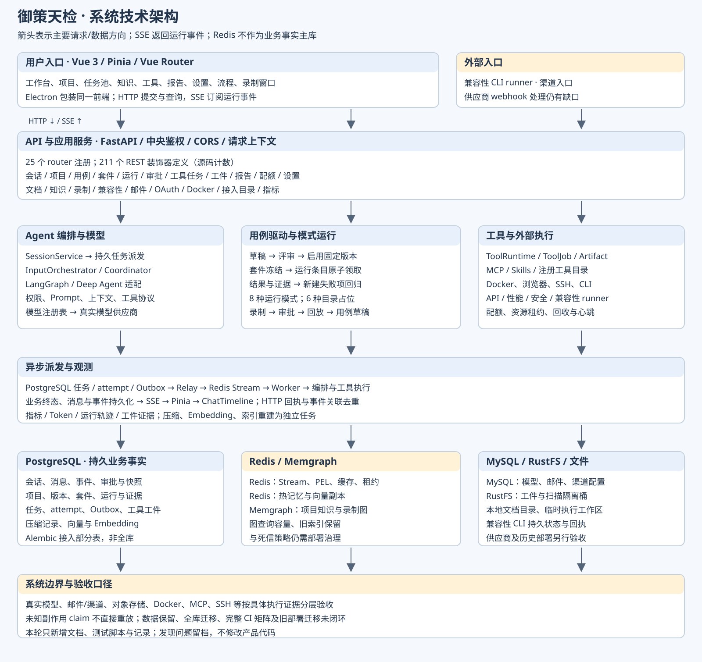
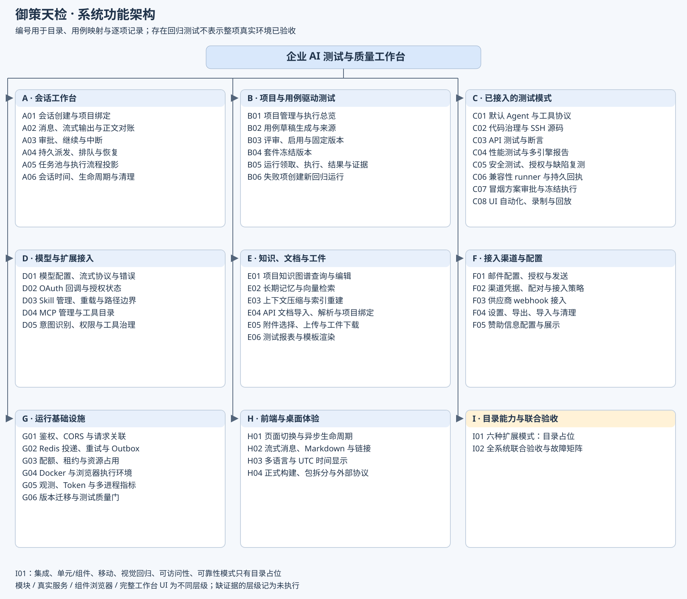

# 系统功能说明与验收计划

[系统说明](system-guide.md) · [剩余工作](remaining-work.md) · [实际验收报告](latest-report.md)

源码基线：e614856；完整事实快照见 [inventory.json](inventory.json)。

系统以项目、用例固定版本和运行结果为业务事实；会话 Agent 负责理解任务、调用工具、审批与协作。前端提供工作台，后端通过持久任务、Outbox 与 Redis Worker 执行，结果及事件落库后通过 SSE 展示。

正式用例流程：生成草稿 → 评审 → 启用固定版本 → 套件冻结版本 → 运行条目原子领取 → 结果与证据入库 → 失败项创建新回归运行。完成项不可重置复用；项目关联使用正式 project_id。

源码计数：25 个 router 注册、211 个 REST 装饰器定义、12 个前端 path 项（含两个重定向及项目详情）、14 个模式 manifest、54 个磁盘 Skill。计数不代表线上健康或可用功能数量。

8 种运行模式：默认、代码治理、API、性能、安全、兼容性、冒烟、UI 自动化。6 种扩展模式见 I01，目前没有独立完整运行器。

## 两张图

SVG 是可编辑源文件，使用显式颜色及纯 SVG 图形，无 foreignObject 和外部资源。PNG 为渲染版；边界和视觉结果另行检查。

## 执行与判定

1. diagnostic 全集保存每个测试的 setup/call/teardown、跳过原因、依赖、commit 和源码哈希；默认跳过外部服务，不能作为发布通过。
2. 隔离 PostgreSQL、Redis、MCP、迁移、API、SQL 清理、浏览器与真实模型分组，只验证组内断言。
3. 运行前端 Vitest 与正式 build；真实 SessionService/HTTP/SSE 和生产构建页面验证三种时区。真实模型组件探针单列层级。
4. 每项记录完整 case nodeid 与原报告。组内通过不等于供应商或完整 UI 通过；未执行业务按钮明确列为覆盖缺口。
5. 只新增验收资料及脚本，发现问题留档；比较产品源码指纹确保没有产品修复。

测试设计依据：项目既有 tests、run_test_quality_gate.py，以及本地课程《评测工程化与CICD》《Agent轨迹与协议鲁棒性》的版本化证据与工具轨迹评估。使用既有版本及样本，不新增未经评审的模型生成用例。

## 功能与回归映射

|编号|功能|后端回归文件数|
|---|---|---|
|A01|会话创建与项目绑定|3|
|A02|消息、流式输出与正文对账|3|
|A03|审批、继续与中断|3|
|A04|持久派发、排队与恢复|3|
|A05|任务池与执行流程投影|2|
|A06|会话时间、生命周期与清理|3|
|B01|项目管理与执行总览|3|
|B02|用例草稿生成与来源|1|
|B03|评审、启用与固定版本|1|
|B04|套件冻结版本|1|
|B05|运行领取、执行、结果与证据|4|
|B06|失败项创建新回归运行|2|
|C01|默认 Agent 与工具协议|3|
|C02|代码治理与 SSH 源码|2|
|C03|API 测试与断言|4|
|C04|性能测试与多引擎报告|4|
|C05|安全测试、授权与缺陷复测|4|
|C06|兼容性 runner 与持久回执|3|
|C07|冒烟方案审批与冻结执行|3|
|C08|UI 自动化、录制与回放|5|
|D01|模型配置、流式协议与错误|5|
|D02|OAuth 回调与授权状态|1|
|D03|Skill 管理、重载与路径边界|3|
|D04|MCP 管理与工具目录|2|
|D05|意图识别、权限与工具治理|3|
|E01|项目知识图谱查询与编辑|2|
|E02|长期记忆与向量检索|3|
|E03|上下文压缩与索引重建|4|
|E04|API 文档导入、解析与项目绑定|4|
|E05|附件选择、上传与工件下载|3|
|E06|测试报表与模板渲染|2|
|F01|邮件配置、授权与发送|4|
|F02|渠道凭据、配对与接入策略|3|
|F03|供应商 webhook 接入|1|
|F04|设置、导出、导入与清理|3|
|F05|赞助信息配置与展示|1|
|G01|鉴权、CORS 与请求关联|3|
|G02|Redis 投递、重试与 Outbox|4|
|G03|配额、租约与资源占用|4|
|G04|Docker 与浏览器执行环境|4|
|G05|观测、Token 与多进程指标|4|
|G06|版本迁移与测试质量门|3|
|H01|页面切换与异步生命周期|0|
|H02|流式消息、Markdown 与链接|1|
|H03|多语言与 UTC 时间显示|0|
|H04|正式构建、包拆分与外部协议|0|
|I01|六种扩展模式：目录占位|0|
|I02|全系统联合验收与故障矩阵|2|

真实 RustFS、Memgraph 容量、邮件/渠道写入、完整业务 UI、Electron GUI 及重启/供应商故障组合仍需独立验收。
