# 御策天检 —— 企业级 AI 自动化测试智能体平台 · 毕业设计答辩材料

> 文档定位：面向毕业设计答辩的完整项目材料。包含选题背景、需求分析、技术选型、系统架构（含架构图/时序图/状态图/流程图/ER 图）、详细设计、数据库设计、核心创新点、测试验证、答辩问答预案。
>
> 文档生成日期：2026-09-20（所有数字实测日期见附录 F 口径说明）
>
> 文中所有数据均来自本仓库当前代码实测（命令见附录 F），非估算。
>
> 图表渲染说明：正文统一嵌入 `docs/diagrams/` 下的静态 SVG。SVG 由同一套生成器输出，并经过路径填充、画布边界和文字碰撞检查；这样在 Typora、VitePress、浏览器和后续 Word/PDF 转换中不依赖 Mermaid 运行时，避免因渲染器版本差异导致图形截断或解析错误。

---

## 目录

- [第一章 项目概述](#第一章-项目概述)
- [第二章 背景与意义](#第二章-背景与意义)
- [第三章 需求分析](#第三章-需求分析)
- [第四章 技术选型与理由](#第四章-技术选型与理由)
- [第五章 系统总体设计](#第五章-系统总体设计)
- [第六章 核心机制详细设计](#第六章-核心机制详细设计)
- [第七章 数据库设计](#第七章-数据库设计)
- [第八章 API 接口设计](#第八章-api-接口设计)
- [第九章 前端设计](#第九章-前端设计)
- [第十章 工程化与 Harness Engineering](#第十章-工程化与-harness-engineering)
- [第十一章 测试与质量验证](#第十一章-测试与质量验证)
- [第十二章 核心创新点与答辩要点](#第十二章-核心创新点与答辩要点)
- [第十三章 已知不足与改进方向](#第十三章-已知不足与改进方向)
- [第十四章 答辩问答预案](#第十四章-答辩问答预案)
- [附录 A 模块规模统计](#附录-a-模块规模统计)
- [附录 B 目录结构说明](#附录-b-目录结构说明)
- [附录 C 系统启动顺序](#附录-c-系统启动顺序)
- [附录 D 模式（Mode）清单](#附录-d-模式mode清单)
- [附录 E 工具与技能清单摘录](#附录-e-工具与技能清单摘录)
- [附录 F 验证命令与实测输出](#附录-f-验证命令与实测输出)
- [附录 G 命名事件全表（98 个）](#附录-g-命名事件全表98-个)
- [附录 H 论文写作资料来源与证据索引](#附录-h-论文写作资料来源与证据索引)

---

## 第一章 项目概述

### 1.1 项目名称与定位

**项目中文名：御策天检**
**项目英文名：Enterprise AI QA Agent**

一句话定位：**面向企业软件测试团队的、以大语言模型为决策核心、以状态机与持久化任务调度为骨架的自动化测试智能体平台。**

它不是"一个会调用 AI 的脚本集合"，而是一套**可运行、可恢复、可审计、可扩展**的智能体基础设施。核心能力链条：

```
需求/接口/代码 → 智能体规划 → 工具调用（浏览器、CLI、HTTP、容器）→ 结构化验证
→ 证据留存 → 用例沉淀（带版本）→ 测试套件 → 执行调度 → 回归与报告
```

### 1.2 系统要解决的真实问题

在真实企业测试场景中，现有自动化测试工具链存在四个断层：

| 断层 | 现状 | 本项目做法 |
| --- | --- | --- |
| **理解断层** | case 用 Excel 维护，写 case 靠人肉读需求 | LLM 从需求/接口文档生成 case，且生成过程可追溯 |
| **执行断层** | 脚本用 Selenium/Playwright 硬编码选择器，UI 一改就崩 | 7 级定位链 + 图谱化元素关系，执行失败可归因 |
| **治理断层** | 危险操作（登录、删除、支付）没有门禁 | 9 节点状态机内置 `permission_gate` 审批门禁 |
| **运行断层** | 测试任务跑一半进程挂了，只能重跑 | 持久任务 + 快照 + 断点恢复，任务不因进程重启丢失 |

### 1.3 项目规模速览（实测）

| 指标 | 数值 |
| --- | --- |
| REST API 端点数 | **207**（分布在 23 个路由文件、24 个 `APIRouter` 实例） |
| Agent 角色数 | **45**（协调者、规划者、执行者、评审者等） |
| 静态工具数 | **57**（另支持动态 MCP 工具发现） |
| 测试模式（Mode）数 | **14**（8 个已实现完整逻辑，6 个为占位 manifest） |
| 内置技能（Skill）数 | **15** 个代码内置定义 + **54** 个 `SKILLS/*/SKILL.md` 技能包（合并后注册表暴露 54 个，其中 15 个由内置定义与磁盘包叠加） |
| 内置 MCP Server 数 | **4**（browser / filesystem / knowledge / tracker） |
| 后端 Python 代码 | **542 个文件 / 129,091 行** |
| 后端测试代码 | **157 个文件 / 42,173 行** |
| 前端 TS/Vue 代码 | **117 个文件 / 54,924 行** |
| LangGraph 状态机节点 | **9 个**（外层循环最大 8 轮） |
| 后端测试通过情况 | **1039 passed / 221 skipped** |
| 前端测试通过情况 | **6 个测试文件 / 45 个用例全部通过** |

---

## 第二章 背景与意义

### 2.1 行业背景

1. **大模型已具备工具调用能力，但工程化落地仍需显式约束。** ReAct 研究展示了推理与行动交替的智能体范式 [R1]；本项目把模型决策放入可观测、可中断的状态机，避免把研究范式直接等同于生产可靠性。
2. **企业环境对"可控性"的要求远高于 Demo。** 本项目把权限、审计、恢复和证据留存作为系统约束；风险治理的背景依据可参考 NIST AI RMF 1.0 [R2]，具体指标仍以本仓库实测为准。
3. **多模型、多模态、多工具生态碎片化。** MCP 规范把外部数据源与工具接入定义为开放协议能力 [R3]，但不同模型、测试引擎（k6 / JMeter / 自研）和基础设施仍有各自契约，需要注册中心做适配。

### 2.2 学术与技术价值

本项目的核心贡献不在"用了大模型"，而在于**把不确定性的大模型决策，约束在确定性工程骨架里**。具体体现为四条设计主线：

1. **状态机约束（可控的 LLM 决策）**：LLM 只负责"判断"，流转逻辑、权限判定、终止判定由显式状态机完成；这与 LangGraph 对检查点、人工介入和故障恢复的持久化模型相衔接 [R4]。
2. **持久任务调度（Durable Execution）**：所有用户请求以 202 回执 + Transactional Outbox + Redis Stream + 独立 Worker 落地。Outbox 用同一事务保存业务状态与待投递事件，解决双写不一致 [R5]；请求生命周期因此与进程生命周期解耦。
3. **资源租约治理（Lease-based Concurrency）**：容器、浏览器、会话执行权、运行项都带租约和 fencing token。租约机制的理论依据是分布式系统中的 leases [R6]；本项目还要求下游写入校验令牌，不能把"有令牌"表述成脱离校验的绝对保证。
4. **图谱化测试资产（Graph-based Test Assets）**：UI 元素、实体关系、需求-用例-执行结果以图结构沉淀；语义树部分以 WAI-ARIA 规范 [R7] 和 Playwright `aria_snapshot()` 接口 [R8] 为依据，支撑影响分析与回归选择。

### 2.3 论文写作的专业资料来源

下表把外部依据与仓库内证据分开，便于后续论文按学校要求转换为脚注或 GB/T 7714 参考文献。外部资料用于解释概念、协议和标准，项目证据用于证明本系统确实实现了相应机制；二者不能互相替代。

| 编号 | 类型 | 资料 | 建议支撑的论述 |
| --- | --- | --- | --- |
| [R1] | 学术论文 | Yao et al., *ReAct: Synergizing Reasoning and Acting in Language Models*, ICLR 2023 | 智能体的推理—行动交替范式与工具调用背景 |
| [R2] | 官方框架 | NIST, *Artificial Intelligence Risk Management Framework (AI RMF 1.0)*, 2023 | AI 系统的风险识别、治理、可度量与可信性 |
| [R3] | 开放协议 | Model Context Protocol Specification 2026-07-28 | 外部工具、资源、提示与能力协商的协议边界 |
| [R4] | 官方文档 | LangGraph Persistence | 检查点、人工介入、故障恢复与线程级状态 |
| [R5] | 架构指南 | AWS Prescriptive Guidance, *Transactional outbox pattern* | 数据库状态与消息投递的双写一致性 |
| [R6] | 学术论文 | Gray & Cheriton, *Leases: An Efficient Fault-Tolerant Mechanism for Distributed File Cache Consistency*, SOSP 1989 | 租约、续期、过期和故障接管 |
| [R7] | W3C 标准 | *Accessible Rich Internet Applications (WAI-ARIA) 1.2* | 页面语义、角色与可访问性树的标准定义 |
| [R8] | 官方 API | Playwright Python `Locator.aria_snapshot()` | 本项目 UI Explorer 的语义快照来源 |
| [R9] | 官方数据库文档 | PostgreSQL `SELECT` locking clause | `FOR UPDATE SKIP LOCKED` 的并发认领语义 |
| [R10] | 官方组件文档 | Redis Streams 与 consumer groups | Stream、消费者组、确认和 pending entries |
| [R11] | Web 标准 | WHATWG HTML Living Standard, Server-sent events | SSE 帧、断线重连与 `Last-Event-ID` |
| [R12] | 官方组件文档 | Redis Lua scripting | 服务端脚本的原子执行与多键条件更新 |
| [R13] | 国际标准 | ISO/IEC/IEEE 29119-1:2022, Software testing — General concepts | 测试过程、证据和结果的规范化表达 |
| [P1] | 仓库证据 | `Agent_Server/src/graph/`、`application/runtime/`、`runtime/` | 状态机、循环、任务、快照和租约的实现位置 |
| [P2] | 仓库证据 | `Agent_Server/tests/` 与附录 F 的测试命令及输出 | 正常、异常、并发、恢复和真实中间件验证结果 |
| [P3] | 仓库证据 | `databases/1、MySQL/QA_Agent.sql`、`databases/2、PSQL/public.sql` | 表、约束、索引和领域边界的实际定义 |
| [P4] | 仓库证据 | `docs/diagrams/*.svg` 与本材料正文 | 设计图与实现证据的对应关系 |

引用时建议采用“外部依据 + 项目证据”的成对写法，例如：先用 [R9] 说明 `SKIP LOCKED` 的标准语义，再用 [P1] / [P2] 说明本项目在哪里实现、如何测试。所有网页资料均应在论文定稿时重新核对版本和访问日期。

### 2.4 答辩建议表述

> "我的毕设不是把大模型接到测试工具上，而是回答一个工程问题：**当决策者是一个概率模型时，如何让整个系统依然满足确定性、可恢复、可审计这三条企业级底线**。御策天检给出的答案是：状态机管流程、持久化管生命周期、租约管并发、图谱管资产。"

---

## 第三章 需求分析

### 3.1 用户角色

| 角色 | 核心诉求 | 系统对应能力 |
| --- | --- | --- |
| **测试工程师** | 自然语言指挥智能体跑测试，随时打断、随时审批 | 会话工作台 + 审批门禁 + 中断/恢复 |
| **测试负责人** | 用例怎么来的、结论凭什么成立、改了会不会影响别的用例 | 用例版本链 + 结构化验证报告 + 图谱影响分析 |
| **测试开发工程师** | 扩展新工具、新 Agent、新技能，不动核心代码 | 六大注册中心 + 模式 manifest + MCP 协议 |
| **运维 / 安全人员** | 哪个 agent 连了什么、容器有没有泄漏、配额是否超限 | MCP 连接管理 + 资源租约监管 + 配额服务 |

### 3.2 功能需求

按子系统归类：

**F1 智能体会话系统**
- 创建会话（绑定项目、测试模式、偏好模型、指定 Agent）
- 发送消息 / 追加输入 / 打断中断 / 审批后恢复
- SSE 实时事件流，支持断线重连与游标回放
- 会话快照、回放、历史查询

**F2 智能体内核**
- LangGraph 9 节点状态机
- 外层 AgentLoop 多轮循环（最多 8 轮），支持工具调用后再决策
- 上下文构建（记忆检索、测试用例检索、观测检索、MCP 能力注入）
- 权限门禁（approval-required / denied 判定）
- 模型调用与 token 用量统计

**F3 六大注册中心**
- Agent / Tool / Model / Skill / MCP / Mode 六套注册表统一发现
- Model 注册表由 MySQL 驱动，运行时可变
- Skill 支持懒加载（deferred → available）
- MCP 动态工具以 `mcp__<server>__<tool>` 命名空间暴露

**F4 测试资产生命周期**
- 项目 → 草稿用例 → 评审 → 激活固定版本（内容哈希）→ 套件冻结
- 测试运行：运行项原子认领、结构化验证、证据留存、回归运行

**F5 UI 录制与回放**
- 三种驱动：嵌入式自动打开 / CDP 接入已有浏览器 / Playwright 托管
- PG 事件幂等写入 → Memgraph 子图 → 7 级定位链回放 → 用例草稿

**F6 UI 探索（Explorer）**
- 以 Playwright `aria_snapshot()` 作为唯一事实来源
- 抽取 页面 / 元素 / 实体 三类节点，建立 CONTAINS、BELONGS_TO、TRIGGERS_NAVIGATION、REVEALS 四类关系

**F7 资源治理**
- 容器（Docker）、浏览器、会话执行权三类资源的租约生命周期
- 资源配额、占用查询、清理回收

**F8 平台能力**
- 邮件（Agently Mail 多操作）
- Docker 镜像与容器管理
- 报告生成、附件管理、知识库检索
- OAuth 登录、15 语言前端国际化

### 3.3 非功能需求

| 需求 | 设计对策 |
| --- | --- |
| **可靠性**：任务不能因进程重启丢失 | Transactional Outbox + 独立 Worker + 快照恢复 |
| **一致性**：同一会话不能两个进程同时执行 | 会话执行租约 + `FIRST_COMPLETED` 心跳竞争 |
| **幂等性**：网络重试不能重复执行 | `idempotency_key` 唯一约束 + 任务身份字段校验（9 字段） |
| **安全性**：危险工具必须有人工确认 | `permission_gate` 节点 + 审批状态机 |
| **安全性**：不能泄漏密钥/PII | Harness 红线：日志、注释、提交、示例代码均禁密 |
| **可观测性**：每一步都要可追溯 | 98 个命名事件 + `event_sequence` 单调递增 + 快照 |
| **可扩展性**：新工具不动核心 | 六大注册中心 |
| **可恢复性**：长任务可中断 | 中断事件 + 待恢复快照 + 审批续跑 |

### 3.4 核心用例图

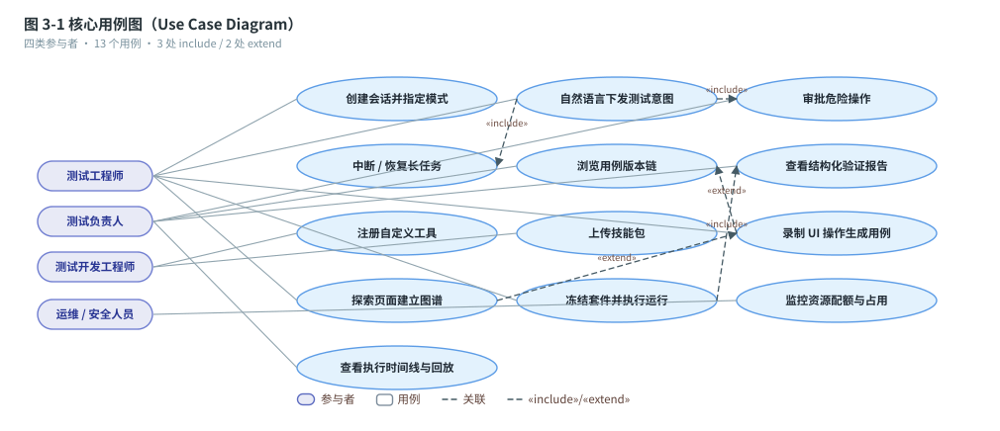

---

## 第四章 技术选型与理由

### 4.1 技术栈总表

| 分层 | 技术 | 选型理由 |
| --- | --- | --- |
| 后端语言 | Python ≥ 3.11 | AI 生态事实标准，异步能力成熟 |
| Web 框架 | FastAPI + Pydantic v2 | 原生 async、自动 OpenAPI、强类型校验 |
| 编排内核 | **LangChain 1.4.0 + LangGraph 1.2.11** | 显式状态机优于自由 ReAct 循环；可编译、可观测、可中断（持久化依据 [R4]） |
| 观测 | LangSmith 0.12.2 | 链路追踪与 prompt 评估 |
| ORM / 驱动 | SQLAlchemy + psycopg + PyMySQL | 多库异构（PG 主库 + MySQL 模型配置） |
| 主数据库 | **PostgreSQL** | JSONB 复合索引、`FOR UPDATE SKIP LOCKED`、`BIGSERIAL` 事件序列（语义依据 [R9]） |
| 缓存 / 队列 / 锁 | **Redis（Stream + Lua）** | Stream 消费组 + Lua 原子租约（组件依据 [R10][R12]） |
| 图数据库 | **Memgraph（neo4j 协议）** | 图谱查询快，兼容 Bolt 协议与 openCypher |
| 对象存储 | **RustFS / 兼容 S3（boto3）** | 证据与产物大文件外置 |
| 浏览器自动化 | **Playwright** | `aria_snapshot` 提供语义级快照，天然适配可访问性断言（API 依据 [R8]，语义依据 [R7]） |
| 进程守护 | psutil 7.2.2 | 容器/浏览器健康探测与资源占用统计 |
| MCP | MCP SDK | 工具生态标准协议（协议依据 [R3]） |
| 前端框架 | Vue 3.5 + Vite 6 + TypeScript | 组合式 API + 类型安全 |
| UI 组件库 | Naive UI | 中文友好、按需引入 |
| 状态管理 | Pinia | 轻量、TS 友好 |
| 路由 | vue-router 4 | 嵌套路由满足 workbench / blankShell 双布局 |
| 图表编排 | @vue-flow/core | 前端直接渲染执行流程图 |
| 文档渲染 | markdown-it + texmath + katex + highlight.js | 智能体输出含公式与代码 |
| 桌面端 | Electron 31 | 内嵌浏览器的本地一键启动桌面版 |
| 文档站 | VitePress 1.6 + 静态 SVG | 架构图与文档同源维护，跨渲染器显示稳定 |
| 测试 | pytest（后端）+ vitest 4.1.11（前端） | 双端一致测试体验 |

### 4.2 关键技术决策对比

**决策 1：为什么用 LangGraph 而不是裸 ReAct 循环？**

| 方案 | 优点 | 致命缺点 |
| --- | --- | --- |
| 裸 ReAct while 循环 | 实现快 | 无法中断、无法插入审批门禁、无法产出可观测结构 |
| LangGraph 显式状态机 | 节点可插拔、边可条件路由、状态是 TypedDict 可序列化 | 学习成本高 |

本系统需要"审批门禁 + 中断恢复 + 快照"，**必须**让流程结构显式可见，故选 LangGraph。

**决策 2：为什么请求要 202 回执 + Outbox，而不是直接同步执行？**

一次测试运行可能持续数十分钟（浏览器操作、容器启停）。如果用同步 HTTP：
- 网关超时必然断开
- 客户端刷新即丢失
- 无法做优雅中断

因此本系统把"提交"和"执行"彻底分离：**提交 = 写持久任务 + 投递；执行 = 独立 Worker 异步进行**。其中 Outbox 的选择依据 [R5]。

**决策 3：为什么资源要用租约 + fencing token 而不是分布式定时锁？**

| 方案 | 问题 |
| --- | --- |
| `SETNX` 定时锁 | 锁过期后旧持有者仍在跑，出现双写 |
| Redisson 看门狗 | GC 暂停期间可能误判，且无法区分"我真持有"与"我以为我持有" |

**fencing token（单调递增令牌）** 让下游存储能拒绝过期令牌的写入；只有在下游确实执行令牌校验时，才能阻断旧持有者的写入，本项目的实现和测试见 [P1][P2]。

---

## 第五章 系统总体设计

### 5.1 五层架构图（核心架构图，答辩主图）

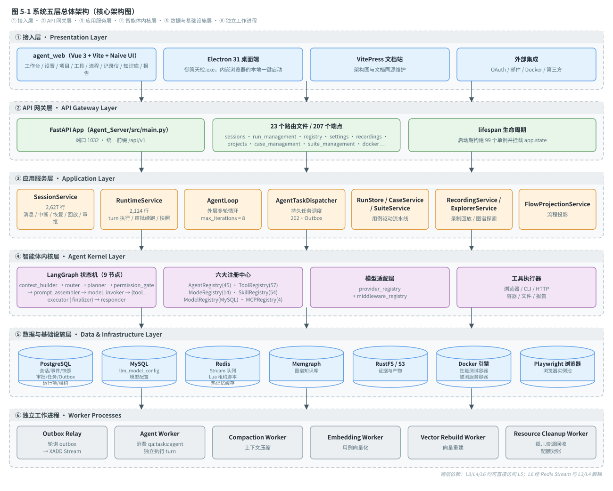

### 5.2 部署架构图

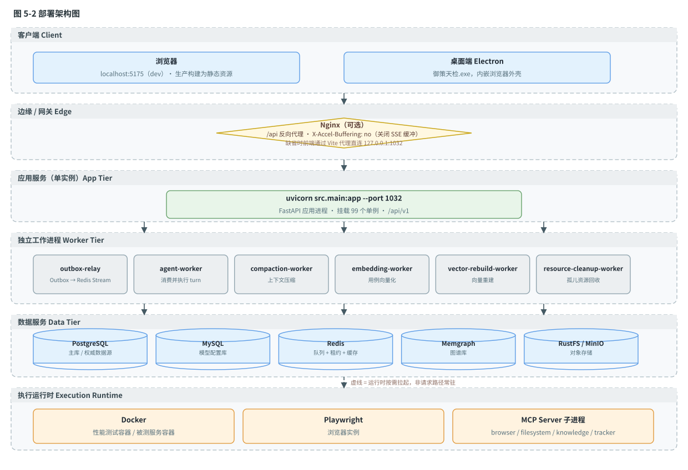

### 5.3 数据流全景：一次请求的完整旅程

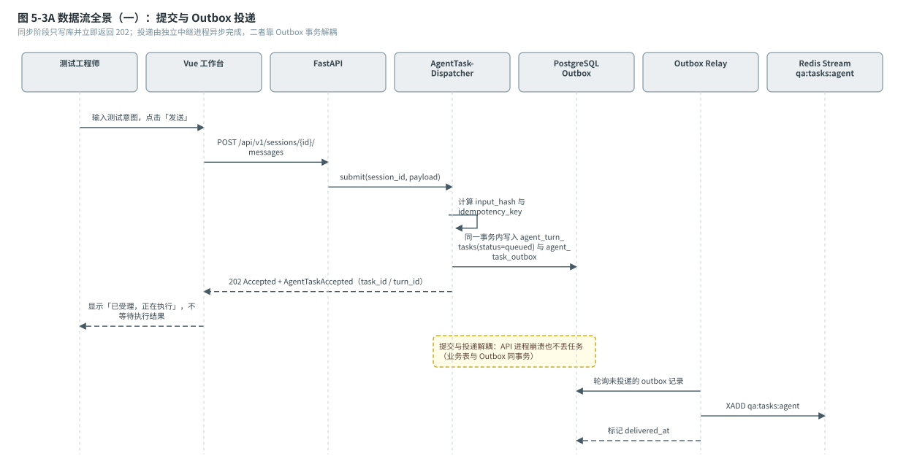

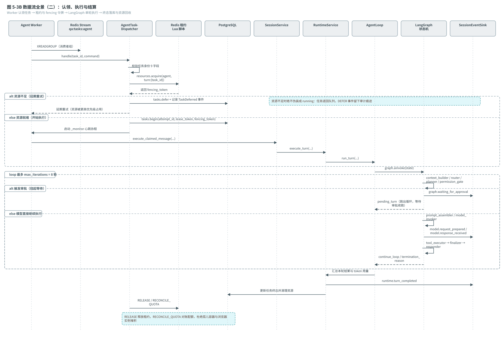

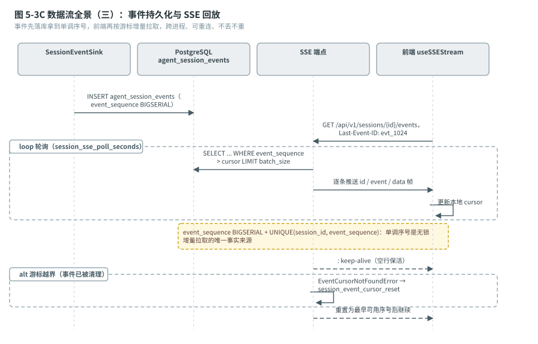

---

## 第六章 核心机制详细设计

### 6.1 六大注册中心

系统的所有可扩展点都收敛到六个注册表，这是"新能力不动核心代码"的制度保证。

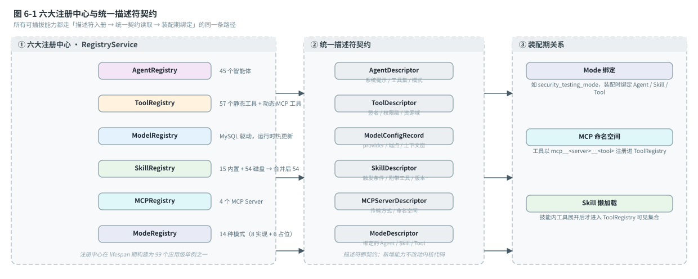

**设计要点与答辩话术：**

- **Agent 注册表（45 个）**：不是 45 个平级助手，而是**按测试类型组织的团队**。以安全测试模式为例，包含 `security-doc-analyst`（读文档）、`attack-surface-planner`（攻击面规划）、`security-recon-worker`（侦察）、`security-auth-worker`（认证测试）、`security-web-verifier` / `security-api-verifier` / `security-host-verifier`（三类验证者）、`security-exploit-coder`（PoC 编写）、`security-failure-analyst`（失败归因）——**规划者与执行者分离**，这正是 Harness Engineering 的"执行者与评审者分离"原则。
- **Tool 注册表（57 个静态）**：覆盖路由（`workflow-router`、`subagent-dispatch`）、检索（`knowledge-rag`、`session-history`、`observation-search`）、执行（`browser-automation`、`cli-executor`、`api-tester`、`security-scan-runner`、`performance-test-runner`、`smoke-suite-runner`）、治理（`code-governance-runner`）、产出（`report-writer`、`file-artifact-manager`）。
- **Model 注册表**：唯一由 MySQL 驱动的注册表，支持运行时切换模型而无需重启。采用"应用维度隔离激活"策略：`llm_model_config` 表含 `applications`（JSON）与 `active_application`（VARCHAR(64)）两个字段，区分 `task_execution`（任务执行模型）与 `embedding_retrieval`（向量化模型）——**删除一个执行模型不会连带禁用嵌入模型**。
- **Skill 注册表**：代码内置 15 个技能定义（如 `playwright-cli`、`owasp-security-testing`、`k6-load-testing`、`tdd-review`），并扫描 `src/SKILLS/*/SKILL.md` 加载 54 个技能包。合并策略是"内置定义提供 `summary` / `recommended_agents` / `tool_keys`，磁盘包提供 `description` 与 `tools` 列表"，因此最终注册表暴露 **54 个**技能（15 个内置名与磁盘包同名，叠加而非重复计数）。
- **Mode 注册表（14 个）**：以 manifest 声明模式绑定的 Agent、Skill、提示词契约，新增测试模式 = 加一个 manifest 文件。

### 6.2 LangGraph 九节点状态机（核心内核）

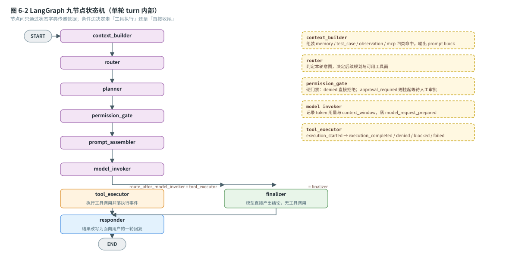

**节点职责明细：**

| 节点 | 输入 | 输出（写入 state） | 产出事件 |
| --- | --- | --- | --- |
| `context_builder` | user_message, session_id | `context_bundle`, `memory_hits`, `test_case_hits`, `observation_hits`, `mcp_hits`, 对应 prompt blocks | `graph.context_built` / `graph.context_budget_exhausted` |
| `router` | normalized_input | `selected_agent_key`, `selected_model_key`, `session_mode` | `graph.route_selected` |
| `planner` | route + context | `plan_steps` | `graph.plan_built` |
| `permission_gate` | resolved tool keys | `permission_decisions`, `allowed_tool_keys`, `approval_required_tool_keys`, `denied_tool_keys`, `pending_approvals` | `graph.permission_evaluated` / `graph.waiting_for_approval` |
| `prompt_assembler` | 上一步全部产物 | `system_prompt_sections`, `runtime_prompt_sections`, `model_request_payload` | `graph.prompt_assembled` |
| `model_invoker` | model_request_payload | `model_response_summary`, `model_response_text`, `turn_token_usage`, `model_tool_calls` | `model.request_prepared` / `model.response_received` / `model.tool_calls_received` / `model.invocation_interrupted` |
| `tool_executor` | model_tool_calls | `tool_results`, `tool_messages` | `tool.execution_requested/started/completed/denied/blocked/skipped/failed` |
| `finalizer` | tool_results / model text | `final_response`, `tool_messages` | `graph.response_ready` / `graph.execution_completed` |
| `responder` | final_response | 对外输出 | `graph.execution_completed` |

**为什么这里是答辩重点：** 大部分毕设的"智能体"是一个 while 循环 + prompt。这里把它拆成**可观测、可插入权限、可快照的 9 个显式节点**，每个节点都有命名事件落库。老师问"你怎么保证 AI 不会乱来"，答案就是 `permission_gate` 这个节点——它不是提示词里的"请不要执行危险操作"，而是代码里的一个判断分支。

### 6.3 AgentLoop 外层循环与中断恢复

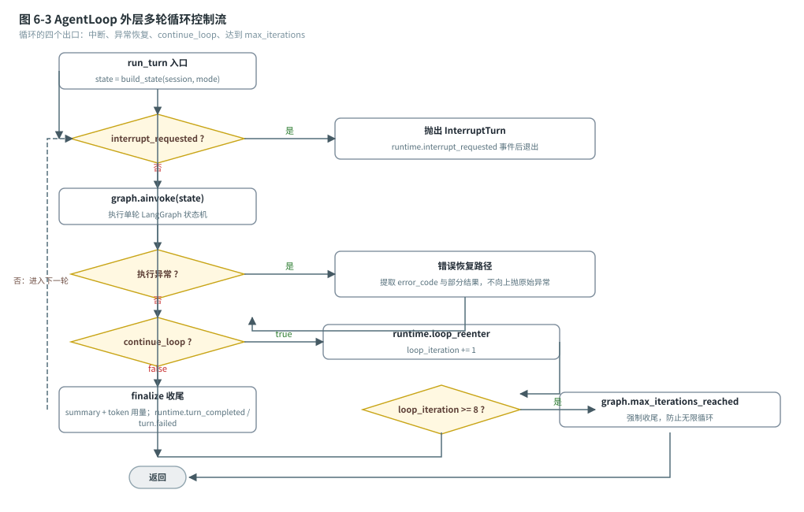

**关键设计：**

- `continue_loop` 是**图自己给出的信号**，不是外层硬编码。模型选择继续调工具就继续，模型给出结论就结束。
- `max_iterations = 8` 是**兜底保险丝**：即使模型陷入"反复调错工具"的死循环，系统也一定会收尾，不会无限烧 token。
- 中断是**可抢占**的：每轮循环开始时检查 `interrupt_requested`，中断不需要等当前轮结束才有机会生效。
- `pending_turn` 允许图在审批门禁处挂起，读入 `_state_from_snapshot` 恢复。

### 6.4 持久任务调度（本系统最核心的工程机制）

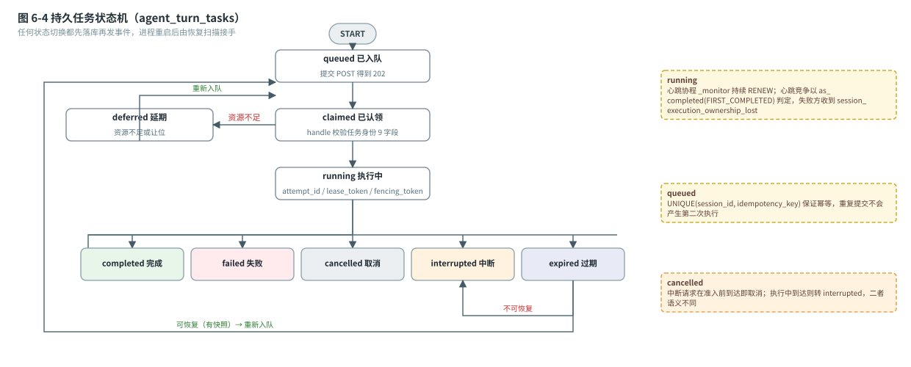

**Transactional Outbox 模式解决"双写不一致"（模式依据 [R5]）：**

```
问题：先写任务表再发 MQ，中间崩溃 → 任务存在但无人执行
     先发 MQ 再写任务表，中间崩溃 → 任务被执行但无记录

方案：同一本地事务内写入 agent_turn_tasks + agent_task_outbox
     Relay 进程单独轮询 outbox → XADD Redis Stream → 标记 delivered
     崩溃恢复后 Relay 会重扫未投递记录，天然幂等
```

**任务表关键字段（已核实 DDL）：**

| 字段 | 作用 |
| --- | --- |
| `sequence BIGSERIAL` | 每会话内单调序号，保证 FIFO 有序性 |
| `idempotency_key` + `UNIQUE(session_id, idempotency_key)` | 幂等提交 |
| `input_hash` | 识别重复提交 |
| `fencing_token BIGINT` | 资源租约令牌，防脑裂 |
| `lease_token` / `attempt_id` / `worker_id` | 执行身份三元组 |
| `interrupt_requested BOOLEAN` | 准入门禁：已请求中断的任务不予准入 |
| `waiting_reason` | `waiting_resource` 与 `running` 严格区分，绝不伪造 |
| `priority DEFAULT 50` | 优先队列 |
| `result_status` / `error_code` | 终态可判定 |

### 6.5 审批门禁与续跑

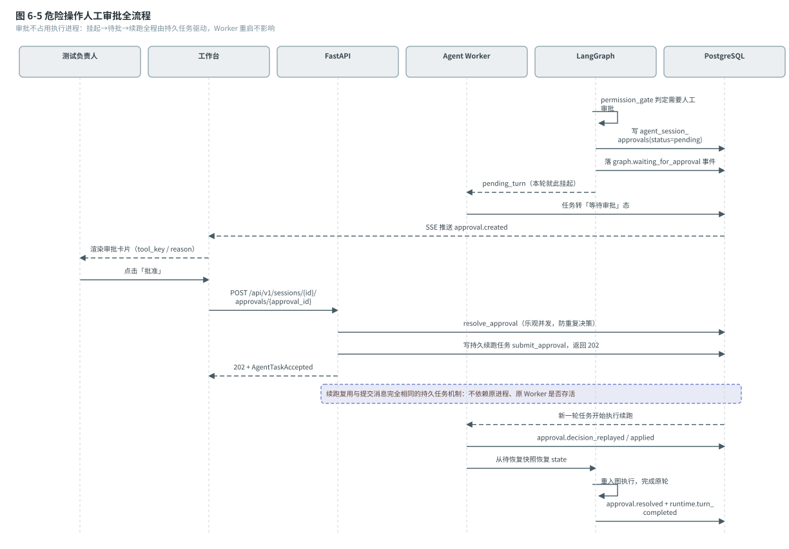

**要点：** 审批通过后的续跑**不是**在原协程里 `await`，而是**创建新的持久任务**。这意味着：如果审批时服务已重启，续跑依然能发生。

### 6.6 跨进程 SSE 事件回放

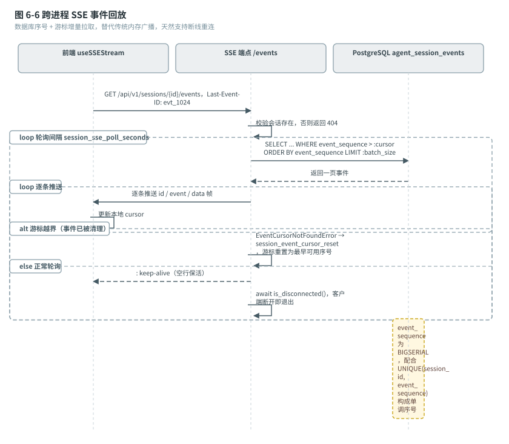

**为什么不用 WebSocket / Redis Pub-Sub？** 因为**执行进程与订阅进程不是同一个**。Pub-Sub 天然丢消息（无持久化）。SSE 的重连和 `Last-Event-ID` 语义由 WHATWG 标准定义 [R11]；本项目用 PG 的 `event_sequence` 做主序列，任何进程都能凭游标精确续传，支持"刷新页面后继续看"。

### 6.7 资源租约治理（Lua 原子脚本）

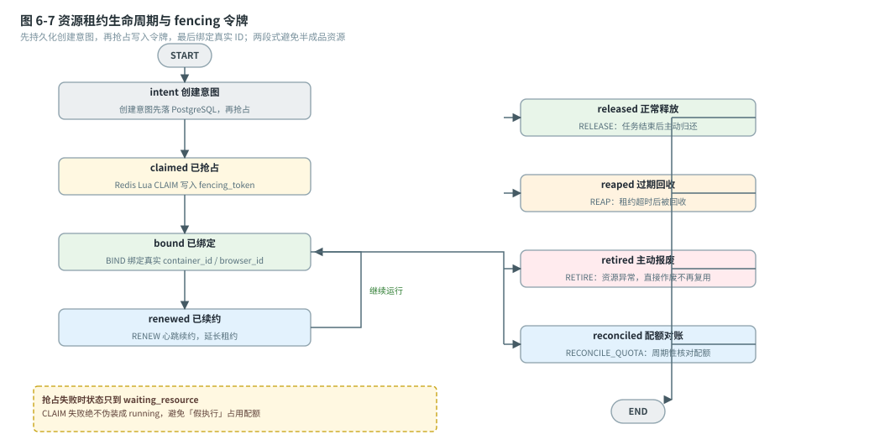

**九条 Lua 脚本的语义（Redis 脚本原子执行依据 [R12]）：**

| 脚本 | 语义 |
| --- | --- |
| `CLAIM` | 原子抢占资源，分配单调递增 `fencing_token` |
| `BIND` | 把"创建意图"绑定到真实容器/浏览器 ID |
| `RENEW` | 心跳续约 |
| `RELEASE` | 正常释放 |
| `REAP` | 回收过期租约（持有者可能已崩溃） |
| `RETIRE` | 主动报废 |
| `RECONCILE_QUOTA` | 与配额账本对账，防止配额泄漏 |
| `COMPLETE_CLEANUP` | 清理完成后落地收尾 |
| `ENQUEUE_ORPHAN` | 把孤儿资源投递到清理队列 |

**生命周期两段式设计的价值：** **先持久化创建意图，再绑定真实 ID**。这样进程在"起了容器但还没写库"之间崩溃时，Resource Cleanup Worker 能凭 PG 里的意图记录知道"有一个孤儿容器需要杀"。

### 6.8 会话执行租约与心跳竞争

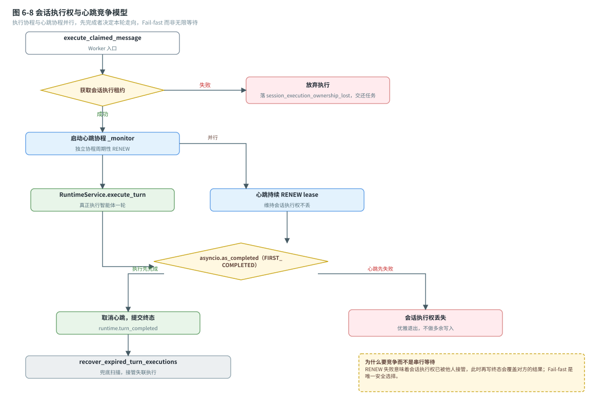

**要点：** 用 `asyncio.wait(..., return_when=FIRST_COMPLETED)` 让"执行业务"和"保活心跳"两个协程**赛跑**。谁先结束就裁决——执行完成则取消心跳；心跳丢失则立刻停止业务并放弃写入权。这避免了"执行完了但续约失败，把别人的结果覆盖掉"。

### 6.9 用例驱动流水线

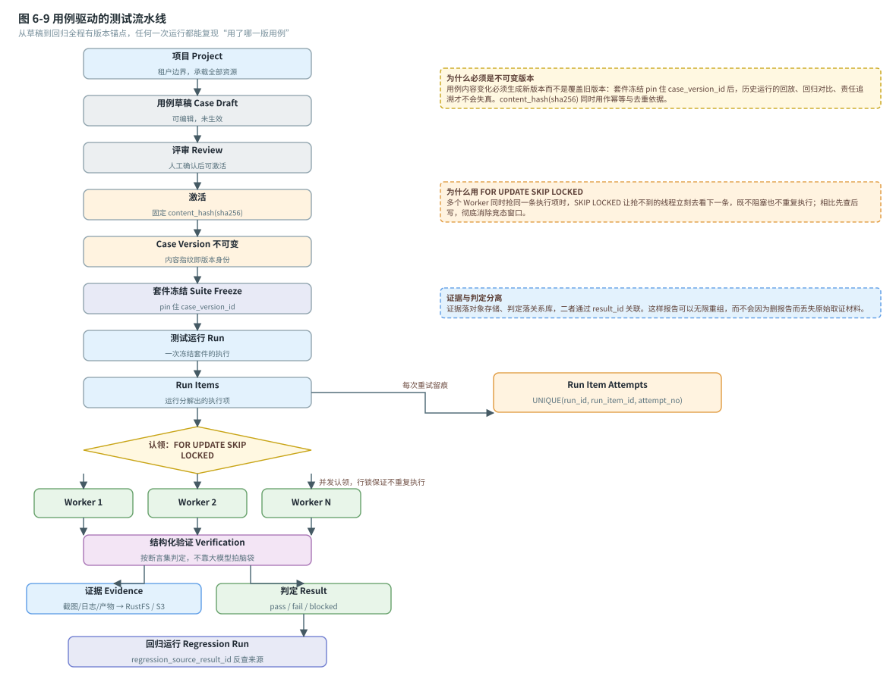

**设计亮点：**
1. **内容哈希固定版本**：用例一旦激活，版本号与 `sha256` 绑定，事后改内容必须产生新版本，历史结论永远可复现审计。
2. **套件冻结 pin 版本号**：套件不是引用"最新用例"，而是引用**特定版本 ID**。这样"上周跑过的套件"和"今天改过的套件"不会混淆。
3. **`FOR UPDATE SKIP LOCKED` 原子认领**：多 Worker 并发取任务时，跳过被锁行而不是阻塞等待；PostgreSQL 官方文档明确说明它适用于队列式并发消费 [R9]。
4. **三层记录体系**：run → run_item → run_item_attempt，每次重试都有独立记录，失败可精确归因到第几次尝试。

### 6.10 UI 录制链

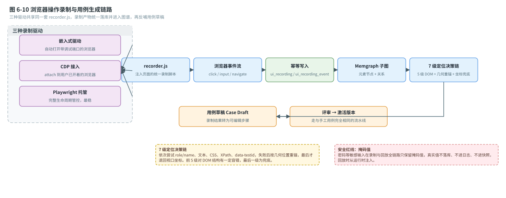

**"七级定位决策链"的确切含义（`application/recorder/replay_executor.py:41-201`）：**

采集端 `recorder.js` 为每个元素记录 **6 个定位字段**——`id`、`testid`、`role_name`（ARIA role + accessible name）、`css`、`xpath`、`text`；回放端把它展开成 **7 级降级策略**，逐级重试直到命中：

| 级别 | strategy | 说明 |
| --- | --- | --- |
| 1 | `id` | 最稳，但前端框架常动态生成 |
| 2 | `testid` | 团队约定的稳定标识 |
| 3 | `role_name` | **Playwright `get_by_role(role, name=...)`，ARIA 语义定位** |
| 4 | `css` | 无 id 时用 `nth-of-type` 生成 |
| 5 | `xpath` | 最后的结构化手段 |
| 6 | `geometry` | 前 5 级全失效时，用 `bbox + rel_offset` 找"几何位置最近的元素"**重锚定** |
| 7 | `viewport_point` | 绝对坐标兜底，**Canvas 类页面的唯一可行手段** |

**这个设计的价值：** UI 漂移（DOM 结构变、class 名变、元素被挪位置）在前 5 级失败后，仍能靠几何关系恢复定位。这让回放成功率与"前端重构频率"**解耦**。

**一条硬性的安全红线（`recorder.js` 采集端 + 回放端双重落实）：**

- 采集端：密码字段与"名字暗示敏感"的普通字段**只记录 `{"length": n}`**，不记录明文；
- 回放端：`build_replay_plan` 检测到 `_is_masked_value` 时直接把该步标记为 `sensitive_value_masked` 跳过——**安全红线优先于回放完整度**。

这条有专门的前端测试覆盖（`agent_web/tests/recorder/recorder.test.mjs` 的「密码字段只记长度不记明文（安全红线）」用例），不是一句口头承诺。

### 6.11 UI Explorer 图谱

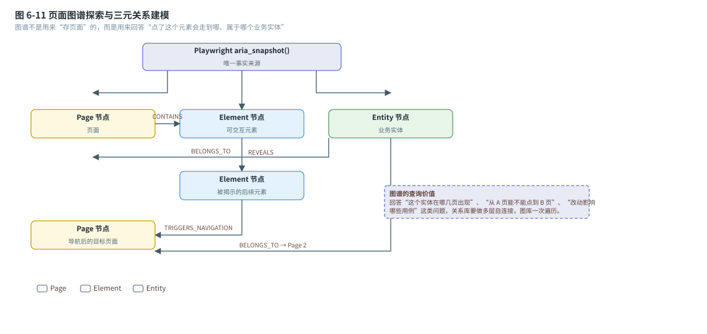

**为什么不解析 DOM？** DOM 结构随前端框架重构而剧变，`aria_snapshot` 反映的是**可访问性语义树**，稳定性远高于 CSS 选择器，同时天然产出"可访问性测试"副产品。

### 6.12 技能懒加载与 MCP 桥接

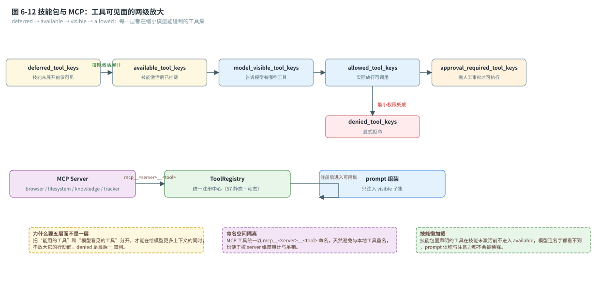

**六级工具可见性链是权限模型的精妙处：** 技能未展开时只有 `deferred`（占位提示）；展开后进入 `available`（已挂载）；再经三道分类——`model_visible`（模型看得见）→ `allowed`（允许调）→ 其中再分 `approval_required`（须人工批准）与 `denied`（禁止）。"模型看得见"不等于"允许调"，"允许调"不等于"可以直接调"，而 `deferred → available` 的懒展开同时解决了上下文预算问题。

---

## 第七章 数据库设计

### 7.1 多库分工

| 数据库 | 承担职责 | 理由 |
| --- | --- | --- |
| **PostgreSQL** | 会话、事件、快照、审批、任务、运行项、租约、录制事件 | 权威主库。JSONB + `FOR UPDATE SKIP LOCKED` + `BIGSERIAL` 恰好覆盖"结构化 + 高并发 + 有序事件"三个需求 |
| **MySQL** | `llm_model_config` 模型配置 | 模型配置需要被外部运维系统/管理台直接维护，独立于测试业务库 |
| **Redis** | 任务队列（Stream）、资源租约（Lua）、热记忆缓存 | 原子操作 + 低延迟 |
| **Memgraph** | UI 图谱、知识图谱 | 图遍历性能远超关系型递归查询 |
| **RustFS / S3** | 证据、报告、产物大文件 | 不入库，避免拖垮主库 |

### 7.2 总体 ER 图

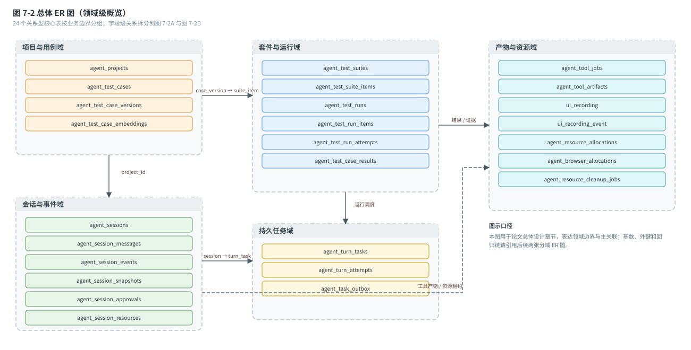

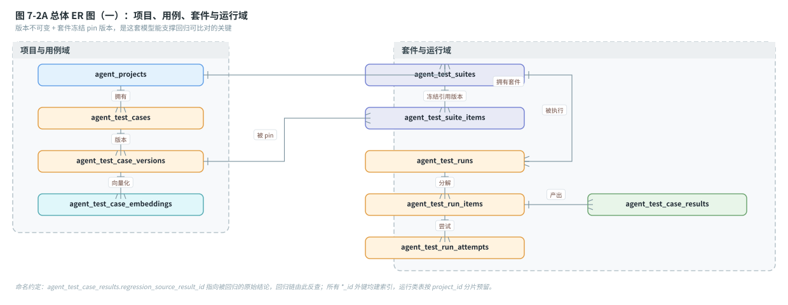

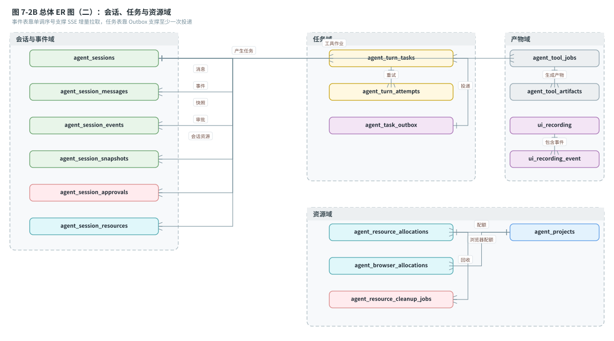

### 7.3 会话域表结构（逐字摘录自 `runtime/postgres_session_store.py:347-470`）

```sql
-- 会话主表
CREATE TABLE IF NOT EXISTS agent_sessions (
    id             TEXT PRIMARY KEY,
    title          TEXT NOT NULL,
    status         TEXT NOT NULL,
    session_mode   TEXT NOT NULL,
    runtime_mode   TEXT NOT NULL,
    mode_key       TEXT NOT NULL DEFAULT 'default',
    project_id     UUID NULL REFERENCES agent_projects(id),
    created_at     TIMESTAMPTZ NOT NULL,
    updated_at     TIMESTAMPTZ NOT NULL,
    preferred_model TEXT NULL,
    selected_agent TEXT NULL,
    metadata       JSONB NOT NULL DEFAULT '{}'::jsonb,
    event_count    INTEGER NOT NULL DEFAULT 0,
    snapshot_count INTEGER NOT NULL DEFAULT 0
);
-- 额外兜底：老库缺列时补列
ALTER TABLE agent_sessions
    ADD COLUMN IF NOT EXISTS project_id UUID NULL REFERENCES agent_projects(id);

-- 消息表
CREATE TABLE IF NOT EXISTS agent_session_messages (
    id         TEXT PRIMARY KEY,
    session_id TEXT NOT NULL,
    role       TEXT NOT NULL,
    content    TEXT NOT NULL,
    created_at TIMESTAMPTZ NOT NULL,
    metadata   JSONB NOT NULL DEFAULT '{}'::jsonb
);

-- 事件表（跨进程 SSE 的基石）
CREATE TABLE IF NOT EXISTS agent_session_events (
    id             TEXT PRIMARY KEY,
    event_sequence BIGSERIAL NOT NULL,
    session_id     TEXT NOT NULL,
    type           TEXT NOT NULL,
    timestamp      TIMESTAMPTZ NOT NULL,
    payload        JSONB NOT NULL DEFAULT '{}'::jsonb
);

-- 快照表（中断恢复的基石）
CREATE TABLE IF NOT EXISTS agent_session_snapshots (
    id          TEXT PRIMARY KEY,
    session_id  TEXT NOT NULL,
    version     INTEGER NOT NULL,
    stage       TEXT NOT NULL,
    created_at  TIMESTAMPTZ NOT NULL,
    graph_state JSONB NOT NULL,
    UNIQUE(session_id, version)
);

-- 审批表
CREATE TABLE IF NOT EXISTS agent_session_approvals (
    id            TEXT PRIMARY KEY,
    session_id    TEXT NOT NULL,
    tool_key      TEXT NOT NULL,
    tool_name     TEXT NOT NULL,
    reason        TEXT NOT NULL,
    status        TEXT NOT NULL,
    created_at    TIMESTAMPTZ NOT NULL,
    resolved_at   TIMESTAMPTZ NULL,
    decision_note TEXT NULL,
    metadata      JSONB NOT NULL DEFAULT '{}'::jsonb
);
```

**为会话域建立的索引（8 个）：**

| 索引 | 列 | 服务什么查询 |
| --- | --- | --- |
| `..._updated` | `(updated_at DESC)` | 默认按最近更新排序 |
| `..._project_updated` | `(project_id, updated_at DESC)` | **项目维度分页列表**（`list_sessions_page(limit, offset, mode_key)` 的实际查询路径） |
| `..._mode_updated` | `(mode_key, updated_at DESC)` | 按测试模式筛选 |
| `..._status` | `(status)` | 按状态筛选 |
| `messages_..._session_created` | `(session_id, created_at ASC)` | 会话历史顺序拉取 |
| **`events_..._session_sequence`** | `(session_id, event_sequence)` **UNIQUE** | **SSE 游标续传的唯一性保证** |
| `events_..._session_timestamp` | `(session_id, timestamp ASC)` | 按时间兜底查询 |
| `events_..._session_timestamp_id` | `(session_id, timestamp ASC, id ASC)` | 时间相同时的确定性排序（消除翻页抖动） |
| `snapshots_..._session_version` | `(session_id, version DESC)` | 取最近快照 |
| `approvals_..._session_created` | `(session_id, created_at ASC)` | 审批列表 |

**设计解读（答辩加分点）：**

- **`event_sequence BIGSERIAL` + `CREATE UNIQUE INDEX (session_id, event_sequence)`**：全局自增保顺序，联合唯一索引保"每会话内单调无重复"。**注意这里是 UNIQUE INDEX 而不是表级 CONSTRAINT**——因为它是通过 `ADD COLUMN IF NOT EXISTS event_sequence` 增量补到老表上的，用索引比改表约束更容易幂等。
- **`(session_id, timestamp ASC, id ASC)` 三列索引**很少有人会建，但它解决了一个真实问题：同一毫秒内插入多条事件时，单纯按 `timestamp` 排序在分页场景下会出现"记录被跳过或重复"。加上 `id ASC` 作决胜列，翻页才真正稳定。
- **`event_count` / `snapshot_count` 是冗余计数器**：列表页不 `COUNT(*)`，直接读主表字段，避免大会话列表的全表扫描。
- **`agent_sessions.mode_key DEFAULT 'default'`**：模式是会话的一等属性，与 `session_mode` / `runtime_mode` 三者并存，分别承担"测试模式 key""会话形态""运行形态"。
- **诚实说明**：`messages` / `events` / `snapshots` / `approvals` 四张表**没有声明外键到 `agent_sessions`**，靠应用层保证一致性。这是为写入性能做的取舍（事件表写入频率最高，外键检查会放大开销），代价是删会话需应用层显式清理。

### 7.4 用例驱动运行表结构（逐字摘录自 `application/test_runs/run_store.py:1488-1560`）

```sql
CREATE TABLE IF NOT EXISTS agent_test_runs (
    id            UUID PRIMARY KEY,
    project_id    UUID NOT NULL REFERENCES agent_projects(id),
    suite_id      UUID NOT NULL REFERENCES agent_test_suites(id),
    status        TEXT NOT NULL,
    mode_key      TEXT NOT NULL,
    session_id    TEXT NULL,
    parent_run_id UUID NULL,   -- 回归运行指回源运行
    created_at    TIMESTAMPTZ NOT NULL,
    updated_at    TIMESTAMPTZ NOT NULL,
    record        JSONB NOT NULL
);

CREATE TABLE IF NOT EXISTS agent_test_run_items (
    id                          UUID PRIMARY KEY,
    run_id                      UUID NOT NULL REFERENCES agent_test_runs(id),
    case_id                     UUID NOT NULL REFERENCES agent_test_cases(id),
    case_version_id             UUID NOT NULL REFERENCES agent_test_case_versions(id),
    position                    INTEGER NOT NULL,
    status                      TEXT NOT NULL,
    attempt_no                  INTEGER NOT NULL DEFAULT 0,
    lease_owner                 TEXT NULL,
    lease_token                 TEXT NULL,
    lease_expires_at            TIMESTAMPTZ NULL,
    result_id                   UUID NULL,
    regression_source_result_id UUID NULL,
    updated_at                  TIMESTAMPTZ NOT NULL,
    record                      JSONB NOT NULL,
    UNIQUE(run_id, position),
    UNIQUE(run_id, case_id, case_version_id)
);

CREATE TABLE IF NOT EXISTS agent_test_run_attempts (
    id          UUID PRIMARY KEY,
    run_id      UUID NOT NULL REFERENCES agent_test_runs(id),
    run_item_id UUID NOT NULL REFERENCES agent_test_run_items(id),
    attempt_no  INTEGER NOT NULL,
    lease_token TEXT NOT NULL,
    status      TEXT NOT NULL,
    record      JSONB NOT NULL,
    UNIQUE(run_item_id, attempt_no),
    UNIQUE(lease_token)
);

CREATE TABLE IF NOT EXISTS agent_test_case_results (
    id                          UUID PRIMARY KEY,
    run_id                      UUID NOT NULL REFERENCES agent_test_runs(id),
    run_item_id                 UUID NOT NULL REFERENCES agent_test_run_items(id),
    case_id                     UUID NOT NULL REFERENCES agent_test_cases(id),
    case_version_id             UUID NOT NULL REFERENCES agent_test_case_versions(id),
    attempt_id                  UUID NOT NULL REFERENCES agent_test_run_attempts(id),
    status                      TEXT NOT NULL,
    payload_hash                TEXT NOT NULL,
    regression_source_result_id UUID NULL,
    created_at                  TIMESTAMPTZ NOT NULL,
    record                      JSONB NOT NULL,
    UNIQUE(run_item_id)
);
```

**四个索引（含两个 PostgreSQL 部分索引）：**

| 索引 | 定义 | 服务什么查询 |
| --- | --- | --- |
| `..._project_created` | `(project_id, created_at DESC)` | 项目运行历史 |
| `..._parent_run` | `(parent_run_id) WHERE parent_run_id IS NOT NULL` | 只索引回归运行，普通运行不在索引里，**索引体积减半** |
| `..._run_status_position` | `(run_id, status, position ASC)` | Worker 认领时按"状态 + 顺序"取下一批 |
| **`..._lease_expiry`** | `(run_id, lease_expires_at) WHERE status IN ('claimed','running','waiting_resource')` | **只索引还在跑的项**，已完成的项不进索引，超时回收扫描极快 |
| **`..._approval_recovery`** | `(updated_at, id) WHERE status = 'waiting_approval'` | 审批恢复扫描同样只覆盖待审批项 |

**关键设计：**

- `case_version_id` 是**外键直接钉在运行项上**的。这意味着一个运行开始后，即使源用例被修改，本运行仍然忠实执行它开始时的那个版本。
- `lease_owner / lease_token / lease_expires_at` 三字段内嵌在运行项上，让"谁在跑、有没有超时"一条 SQL 就能查出来，无需 join 租约服务。
- `UNIQUE(run_id, position)`：保证运行项顺序稳定，前端展示的执行进度条不会因为并发插入而错乱。
- **`UNIQUE(run_item_id)` 在结果表上**：一个运行项只有一份"当前结论"，重试产生新 attempt 但结果是**覆盖更新**而非追加——结论唯一，历史靠 attempt 表追溯。
- **`payload_hash` 在结果表上**：结构化验证产物的内容摘要，用于判定"两次回归结果是否真的相同"，避免把"换了行号但逻辑没变"误判为回归。
- **两个部分索引（`WHERE status IN (...)`）是 PostgreSQL 特有的优化**：把索引范围收缩到"还有生命周期的行"。运行项状态是单向收敛的（claimed → running → terminal），已终态的行永远不会再被扫描，却一直占着索引空间；用部分索引把它们排除，索引大小与"待处理量"成正比而不是与"历史总量"成正比。这也是最终选 PostgreSQL 而不用 MySQL 的原因之一。

### 7.5 持久任务表结构（逐字摘录自 `runtime/postgres_agent_task_store.py:179-229`）

```sql
CREATE TABLE IF NOT EXISTS agent_turn_tasks (
    id                 TEXT PRIMARY KEY,
    sequence           BIGSERIAL NOT NULL,
    session_id         TEXT NOT NULL REFERENCES agent_sessions(id) ON DELETE CASCADE,
    operation          TEXT NOT NULL DEFAULT 'message',
    turn_id            TEXT NOT NULL,
    project_id         TEXT,
    request_id         TEXT NOT NULL,
    trace_id           TEXT NOT NULL,
    run_id             TEXT,
    run_item_id        TEXT,
    priority           INTEGER NOT NULL DEFAULT 50,
    idempotency_key    TEXT NOT NULL,
    input_hash         TEXT NOT NULL,
    input_payload      JSONB NOT NULL,
    user_message_id    TEXT,
    reference_id       TEXT,
    status             TEXT NOT NULL DEFAULT 'queued',
    attempt_id         TEXT,
    attempt_no         INTEGER NOT NULL DEFAULT 0,
    worker_id          TEXT,
    lease_token        TEXT,
    resource_id        TEXT,
    fencing_token      BIGINT,
    waiting_reason     TEXT,
    result_status      TEXT,
    error_code         TEXT,
    interrupt_requested BOOLEAN NOT NULL DEFAULT FALSE,
    created_at         TIMESTAMPTZ NOT NULL DEFAULT NOW(),
    updated_at         TIMESTAMPTZ NOT NULL DEFAULT NOW(),
    UNIQUE(session_id, idempotency_key)
);

CREATE INDEX IF NOT EXISTS agent_turn_tasks_session_idx      ON agent_turn_tasks (session_id, sequence);
CREATE INDEX IF NOT EXISTS agent_turn_tasks_session_turn_idx ON agent_turn_tasks (session_id, turn_id);

-- 开发期遗留的 turn_id 唯一约束被显式移除：
-- 同一 turn 允许有多个任务（提交 → 中断 → 恢复 → 审批续跑），不应互相排斥
ALTER TABLE agent_turn_tasks DROP CONSTRAINT IF EXISTS agent_turn_tasks_turn_id_key;

-- TaskEnvelope 字段是后加的，靠这些 ALTER 幂等补列
ALTER TABLE agent_turn_tasks ADD COLUMN IF NOT EXISTS run_id TEXT;
ALTER TABLE agent_turn_tasks ADD COLUMN IF NOT EXISTS run_item_id TEXT;
ALTER TABLE agent_turn_tasks ADD COLUMN IF NOT EXISTS priority INTEGER NOT NULL DEFAULT 50;
ALTER TABLE agent_turn_tasks ADD COLUMN IF NOT EXISTS resource_id TEXT;
ALTER TABLE agent_turn_tasks ADD COLUMN IF NOT EXISTS fencing_token BIGINT;
ALTER TABLE agent_turn_tasks ADD COLUMN IF NOT EXISTS operation TEXT NOT NULL DEFAULT 'message';
ALTER TABLE agent_turn_tasks ADD COLUMN IF NOT EXISTS reference_id TEXT;
ALTER TABLE agent_turn_tasks ALTER COLUMN user_message_id DROP NOT NULL;

CREATE TABLE IF NOT EXISTS agent_turn_attempts (
    id          TEXT PRIMARY KEY,
    task_id     TEXT NOT NULL REFERENCES agent_turn_tasks(id) ON DELETE CASCADE,
    attempt_no  INTEGER NOT NULL,
    worker_id   TEXT NOT NULL,
    lease_token TEXT NOT NULL,
    status      TEXT NOT NULL,
    error_code  TEXT,
    started_at  TIMESTAMPTZ NOT NULL DEFAULT NOW(),
    finished_at TIMESTAMPTZ,
    UNIQUE(task_id, attempt_no)
);
```

**关键字段（已核实）：**

| 字段 | 作用 |
| --- | --- |
| `sequence BIGSERIAL` | 全表单调序号；配合 `(session_id, sequence)` 索引让"会话内第 N 个任务"是 O(log n) 查找 |
| `idempotency_key` + `UNIQUE(session_id, idempotency_key)` | 幂等提交，网络重试不会双跑 |
| `input_hash` | 识别"同一个键、不同内容"的冲突提交 |
| `fencing_token BIGINT` | 资源租约令牌，防脑裂 |
| `lease_token` / `attempt_id` / `worker_id` | 执行身份三元组 |
| `interrupt_requested BOOLEAN` | 准入门禁：已请求中断的任务不予准入 |
| `waiting_reason` | `waiting_resource` 与 `running` 严格区分，绝不伪造 |
| `priority DEFAULT 50` | 优先队列 |
| `result_status` / `error_code` | 终态可判定 |
| `run_id` / `run_item_id` | 任务可溯源到具体运行项，智能体任务与测试运行打通 |

**这段 DDL 里有三处特别值得在答辩时讲：**

1. **`ALTER TABLE ... DROP CONSTRAINT agent_turn_tasks_turn_id_key`**：代码主动**删掉**一个唯一约束。原因是设计演进——最初一个 turn 只对应一个任务，后来引入"中断后恢复""审批后续跑"，同一个 turn 会衍生出多个任务。若不显式移除老约束，恢复流程在已有数据的环境下会直接违反唯一性而失败。**这是"设计演进时如何处理历史包袱"的典型案例。**
2. **一批 `ADD COLUMN IF NOT EXISTS` 补列**：`run_id` / `run_item_id` / `priority` / `resource_id` / `fencing_token` / `operation` / `reference_id` 七个字段都是后加的，代码用幂等 ALTER 兜底。这正是第十三章"缺乏正式迁移链路"债的具体形态——功能没被挡住，但 schema 演进靠的是散落的 ALTER 而非统一 migration。
3. **`agent_turn_attempts` 的 `UNIQUE(task_id, attempt_no)`**：任务可重试，每次重试一条 attempt 记录（哪个 worker、什么租约、何时开始结束、什么错误码）。这让"这个任务为什么失败了三次"有据可查，而不是只有一个笼统的 `status='failed'`。

### 7.6 表清单总览与 SQL 文件覆盖范围

代码中声明的 PostgreSQL 表共 **40 张**（35 张通过 `core/config.py` 的 `database.postgres_*_table` 字段集中声明，另 5 张由冒烟测试模块 `modes/smoke_testing_mode/catalog_store.py` 独立声明），按域划分：

| 域 | 表 |
| --- | --- |
| **会话域（6）** | `agent_memories`, `agent_sessions`, `agent_session_messages`, `agent_session_events`, `agent_session_snapshots`, `agent_session_approvals` |
| **工具与产物（3）** | `agent_tool_jobs`, `agent_tool_artifacts`, `agent_session_resources` |
| **安全域（1）** | `agent_security_bugs` |
| **项目与接口域（2）** | `agent_projects`, `agent_api_docs` |
| **用例域（2）** | `agent_test_cases`, `agent_test_case_versions` |
| **套件域（2）** | `agent_test_suites`, `agent_test_suite_items` |
| **运行域（4）** | `agent_test_runs`, `agent_test_run_items`, `agent_test_run_attempts`, `agent_test_case_results` |
| **MCP 域（1）** | `agent_mcp_servers` |
| **录制域（2）** | `ui_recording`, `ui_recording_event` |
| **性能域（1）** | `agent_perf_runs` |
| **任务调度域（3）** | `agent_task_outbox`, `agent_turn_tasks`, `agent_turn_attempts` |
| **上下文压缩域（1）** | `agent_compaction_records` |
| **向量与检索域（3）** | `agent_vector_rebuild_jobs`, `agent_embedding_jobs`, `agent_test_case_embeddings` |
| **资源治理域（4）** | `agent_resource_quotas`, `agent_resource_cleanup_jobs`, `agent_resource_allocations`, `agent_browser_allocations` |
| **冒烟专项（5，硬编码表名）** | `agent_smoke_plan_catalog`, `agent_smoke_plan_versions`, `agent_smoke_regression_candidates`, `agent_smoke_run_history`, `agent_smoke_project_scope_bindings` |

`databases/2、PSQL/public.sql` 提供 **17 张基线表**：

```
agent_mcp_servers          agent_session_approvals
agent_memories             agent_session_events
agent_perf_runs            agent_session_messages
agent_session_resources    agent_session_snapshots
agent_sessions             agent_smoke_plan_catalog
agent_smoke_plan_versions  agent_smoke_regression_candidates
agent_smoke_run_history    agent_tool_artifacts
agent_tool_jobs            ui_recording
ui_recording_event
```

> **诚实说明（答辩时如被追问可以正面回应）：** 项目当前采用**"运行时 DDL 兜底 + 基线 SQL 优先"**的混合策略。代码中共有 **45 处 `CREATE TABLE IF NOT EXISTS`，散布在 29 个文件**（用于冷启动可用性），而 Alembic `versions/` 目录为空、`OrmBase` 未声明模型，因此**尚不存在严格的增量迁移链路**——这是本系统最明确的工程债（详见第十三章）。
>
> 该策略的**可辩护之处**在于：项目定位为"自部署平台"，冷启动时不存在可用数据库，运行时 DDL 让 `docker compose up` 一步到位成为可能；同时 40 张表的真实 schema **全部由代码声明且可被 Git 追溯**，比"一个手改过无数次、和生产不一致的 migration 目录"在早期更可靠。但规模上来之后必须还这笔债。

---

## 第八章 API 接口设计

### 8.1 端点分布

| 路由文件 | 端点数 | 职责 |
| --- | --- | --- |
| `settings.py` | 34 | 系统设置、偏好、各类配置项 |
| `registry.py` | 34 | 六大注册中心的查询与热更新 |
| `sessions.py` | 22 | 会话生命周期、消息、事件、审批、任务、快照、产物 |
| `run_management.py` | 19 | 测试运行调度与结果查询 |
| `compatibility.py` | 16 | 兼容性测试专用接口 + 历史兼容路由 |
| `recordings.py` | 11 | UI 录制会话与事件 |
| `projects.py` | 9 | 项目管理 |
| `docker.py` | 8 | 镜像与容器管理 |
| `case_management.py` | 8 | 用例 CRUD 与版本管理 |
| `integrations.py` | 7 | 外部集成 |
| `api_docs.py` | 7 | 接口文档导入与解析 |
| `oauth.py` | 6 | OAuth 认证 |
| `mail.py` | 6 | 邮件收发 |
| `security_bugs.py` | 5 | 安全漏洞记录 |
| `suite_management.py` | 4 | 套件冻结与管理 |
| `knowledge.py` | 3 | 知识库检索 |
| `resource_quotas.py` | 2 | 配额策略 |
| `task_pool.py` / `sponsors.py` / `resource_occupancy.py` / `reports.py` / `health.py` / `attachments.py` | 各 1 | 任务池 / 赞助 / 资源占用 / 报告 / 健康检查 / 附件 |
| **合计** | **207** | — |

### 8.2 关键接口契约

**（1）异步任务提交通用契约**

所有"会触发长耗时执行"的接口统一返回 `202 Accepted` + `AgentTaskAccepted`：

```
POST /api/v1/sessions/{session_id}/messages       → 202 AgentTaskAccepted
POST /api/v1/sessions/{session_id}/resume         → 202 AgentTaskAccepted
POST /api/v1/sessions/headless/execute            → 202 AgentTaskAccepted
POST /api/v1/sessions/{session_id}/approvals/{id} → 202 AgentTaskAccepted
```

**统一语义：202 = "已受理，未完成"。** 客户端拿到 `task_id` 后，靠 SSE 观察进度，而不是阻塞等待。这是本系统最重要的接口约定。

**（2）错误码约定**

| 状态码 | 触发条件 |
| --- | --- |
| 202 | 任务已受理 |
| 400 | 参数非法 / 状态机拒绝（如会话已归档） |
| 404 | 会话 / 审批 / 工件不存在 |
| 409 | **会话已归档**（通过 `"archived" in str(exc)` 判定）或 **任务冲突**（`AgentSubmissionConflict`，幂等键已存在且内容不同） |

**（3）SSE 契约**

```
GET /api/v1/sessions/{session_id}/events
Header: Last-Event-ID: <event_uuid>
Query : ?last_event_id=<event_uuid>

Response: text/event-stream
  Cache-Control: no-cache
  X-Accel-Buffering: no

帧格式: id / event / data
保活: ": keep-alive\n\n"
游标越界: 记录 session_event_cursor_reset 并从最早可用事件重放
```

> `X-Accel-Buffering: no` 是生产环境必配项——Nginx 默认开启响应缓冲，会让 SSE 事件积压到缓冲区满才下发，实时性完全丧失。

---

## 第九章 前端设计

### 9.1 路由与视图结构

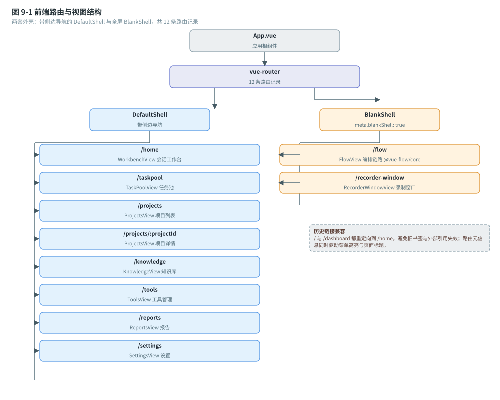

设计说明：路由表共 12 条记录——2 条重定向（`/` 与 `/dashboard` 均指向 `/home`，保证历史链接不失效）+ 1 条 `/home`（即 WorkbenchView，会话工作台同时承担首页职责）+ 7 条常规视图 + 2 条 `blankShell` 视图。流程图视图与录制窗口用 `blankShell: true` 走独立布局，因为它们是**被弹出的画布型界面**，套侧边导航反而干扰。`/projects` 与 `/projects/:projectId` 复用同一个 `ProjectsView.vue`，由组件内部读取 `route.params.projectId` 切换"列表 / 详情"两种形态，少一层路由嵌套。

### 9.2 前端代码组织

```
agent_web/src/
├── views/            9 个页面级视图
├── components/
│   ├── chat/         15 个组件（消息列表、输入框、审批卡片、工具调用卡片…）
│   ├── common/       1 个通用组件
│   └── layout/       3 个布局组件
├── services/         9 个 API 客户端（sessions / settings / models / mcp /
│                     projects / docker / tools / system / compatibility）
│                     + api.ts · http.ts · i18n.ts · desktopNotifications.ts
├── stores/           Pinia：app（全局）/ generalSettings / session
├── composables/      useSSEStream / useApprovalManager / useMessageReconciler /
│                     useSessionWatcher（4 个组合式函数）
├── features/         flow / projects / recorder / settings / tools / workbench
├── utils/            datetime / markdown / toolOutput / useTypewriterText
├── locales/          15 语言（zh-CN zh-TW en-US ja-JP ko-KR de-DE fr-FR es-ES
│                     pt-BR ru-RU ar-SA hi-IN id-ID th-TH vi-VN）
└── types/            TypeScript 类型定义
```

### 9.3 SSE 客户端设计要点

`composables/useSSEStream.ts` 承担三件事：

1. **建立 `EventSource` 连接并传递 `Last-Event-ID`**：刷新页面后从服务端返回的最后一个事件 ID 继续，不重头拉全量。
2. **消息对账（`useMessageReconciler`）**：SSE 是增量推送，但乐观 UI 在发送瞬间就渲染了"用户消息 + 加载中"。对账器负责把流式增量合并到正确消息上，避免重复或错位。
3. **审批接管（`useApprovalManager`）**：收到 `approval.created` 时渲染审批卡片，把"是否允许执行"这个决策权交还给人。

### 9.4 渲染能力

- **Markdown 渲染链**：`markdown-it` + `texmath` + `katex` + `highlight.js`，智能体回答中的公式、代码块、表格均可正确渲染。
- **`remove-markdown`**：用于列表摘要、通知栏标题等需要纯文本的场景。
- **`useTypewriterText`**：打字机效果，增强流式输出的可读性。
- **`@vue-flow/core`**：前端流程可视化，直接渲染 `/flow` 视图。

---

## 第十章 工程化与 Harness Engineering

### 10.1 为什么要有"开发规范"文档

本仓库自带两份规范：`AGENTS.md`（163 行，AI 协作全景规则）与 `docs/HARNESS_ENGINEERING_开发规范.md`。这不是形式主义，而是本项目的第二大方法论产出。

**Harness Engineering 三条核心原则：**

| 原则 | 在本项目的落地 |
| --- | --- |
| **先设计 Harness，再接入 Agent** | 先有 9 节点状态机、注册中心、租约管理，才接入 LLM。LLM 是可替换的决策部件，不是系统的地基 |
| **执行者与评审者分离** | Agent 表中同一模式内明确区分 planner / worker / verifier / analyst 四类角色。例如安全模式：`attack-surface-planner`（规划）→ `security-web-verifier`（执行）→ `security-failure-analyst`（归因），互相不兼任 |
| **关键行为结构化 + 长任务必须可中断恢复** | 98 个命名事件 + 每会话快照链 + 审批续跑任务 + 心跳竞争 + `FOR UPDATE SKIP LOCKED` |

### 10.2 安全红线（`AGENTS.md` 规定）

1. 日志、注释、提交信息、示例代码中**禁止**出现 API Key、密码、Token、证书、PII
2. **禁止**硬编码任何密钥
3. 数据库访问**必须参数化**，禁止字符串拼接 SQL
4. **禁止**执行破坏性命令，除非用户明确要求
5. **禁止吞错**（except 后不处理不抛出不记录）
6. 不主动提交 / 推送 / 建 PR；提交前必须 `git status` + 看 diff
7. 提交信息格式：`【类型】中文描述`
8. 只做被要求的改动，不夹带无关变更

### 10.3 质量门禁

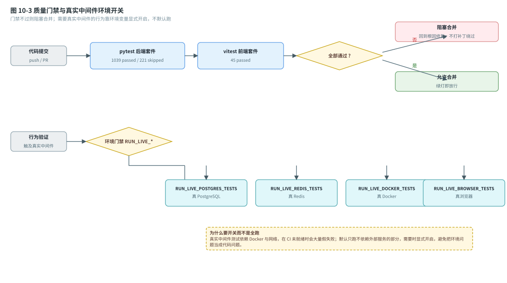

设计意图：**默认跑快（mock/跳过），CI 或本地按需开真（环境变量控制）**。这样日常开发 41 秒跑完 1260 个测试，同时保留对真实基础设施的验证能力。

---

## 第十一章 测试与质量验证

### 11.1 测试规模

| 维度 | 数值 |
| --- | --- |
| 后端测试文件 | 157 个 |
| 后端测试代码行数 | 42,173 行 |
| 后端测试用例总数（采集） | 1,260 |
| 后端通过 | **1,039** |
| 后端跳过 | 221（占 17.5%，全部是需真实中间件的集成用例，靠 `RUN_LIVE_*` 门禁控制） |
| 后端实际耗时 | 41.47 秒 |
| 前端测试文件 | 6 个（`src/` 下 5 个 + `tests/recorder/` 下 1 个） |
| 前端测试用例 | 45 个，**全部通过** |
| 前端耗时 | 3.51 ~ 4.04 秒 |

### 11.2 真实实测输出

后端（在 `Agent_Server` 目录用仓库本地解释器执行）：

```
1039 passed, 221 skipped, 1 warning in 41.47s
```

前端：

```
Test Files  6 passed (6)
     Tests  45 passed (45)
  Duration  3.51s
```

前端 6 个测试文件的分布：

| 文件 | 覆盖对象 |
| --- | --- |
| `src/features/flow/flow.test.ts` | Flow 投影、worker 下钻、inspector 长内容渲染、flow 窗口导航与跨窗口通信（10 个用例） |
| `src/features/flow/FlowCanvas.test.ts` | `@vue-flow` 画布滚轮手势：垂直平移 / shift 水平平移 / ctrl 光标缩放 |
| `src/features/flow/wheelViewport.test.ts` | viewport 变换纯函数：三种滚轮修饰键的数学正确性 |
| `src/features/projects/ProjectExecutionDashboard.test.ts` | 项目执行仪表盘的权威口径、竞态响应拒绝、Redis 故障降级、卸载后停止轮询、配额原因区分（6 个用例） |
| `src/stores/sessionQueue.test.ts` | 持久输入队列的两种阻塞态：等待中不回退到上一轮完成态、执行与审批优先于排队输入 |
| **`tests/recorder/recorder.test.mjs`** | **注入脚本 `recorder.js` 的全部采集语义（23 个用例）** |

> **`recorder.test.mjs` 是项目里最"工程味"的前端测试**：它在 jsdom 里模拟真实浏览器环境，逐条验证——
> - locator 链完整性与 `nth-of-type` CSS / 带序号 xpath 的合成
> - **密码字段只记 `{"length": n}` 不记明文（安全红线）**；名字暗示敏感的普通字段同样脱敏
> - input 500ms debounce 合并为一次 `fill` 且保留最终值；普通字符键不采集、功能键采集
> - 滚动 300ms 节流合并；跨窗口只记最新位置
> - `history.pushState` / `popstate` 产生 navigate 事件并触发 `page_scan`
> - `seq` 单调递增、整页导航后从 `sessionStorage` 续号
> - sha1 DOM 指纹与 Node crypto 一致性（含中文 / emoji UTF-8）、同 DOM 两次扫描 hash 相同
> - iframe 事件桥：跨域子 frame 经 `postMessage(targetOrigin='*')` 送达 top（修复前传自身 origin 会被静默丢弃）；无 `__qaRecorderBridge` 标记的协议外消息被忽略
> - MutationObserver 变更计数在事件发出后正确重置

### 11.3 测试策略说明

| 层次 | 手段 |
| --- | --- |
| **单元层** | 各服务、注册表、schema 校验、工具函数 |
| **集成层** | 真 PostgreSQL / Redis / Docker / Browser（环境变量门禁控制，默认跳过） |
| **契约层** | Pydantic v2 schema 严格校验，207 个端点全部有 response_model |
| **状态机层** | LangGraph 图的节点流转、条件分支、审批门禁、中断恢复 |
| **并发层** | 租约 Lua 脚本、`SKIP LOCKED` 认领、心跳竞争的并发场景 |
| **前端层** | stores / composables 逻辑单测 + canvas 手势 + 注入脚本采集语义 |

### 11.4 为什么跳过率 17.5% 是合理的

221 个跳过的用例全部是**需要真实中间件的集成测试**：真连 PostgreSQL 验证 `SKIP LOCKED`、真连 Redis 验证 Lua 脚本原子性、真启 Docker 验证租约回收、真开浏览器验证录制回放。这些测试：

- 在无环境机器上会假失败（噪声）
- 执行慢
- CI 中作为单独 stage 打开门禁执行

把它们做成 opt-in 而非 opt-out，是为了保证"任何开发者、任何机器上 `pytest` 都能绿"。

---

## 第十二章 核心创新点与答辩要点

> 答辩时不必全讲，建议挑 3~4 条深挖，其余作为"还能这样扩展"的口头补充。

### 创新点 1：把概率性 LLM 决策约束在确定性状态机内

- **问题**：常见 AI 应用是 `while True: llm(...)`，行为不可预测，无法插入权限控制，出错无法定位。
- **方案**：LangGraph 9 节点显式状态机（`context_builder → router → planner → permission_gate → prompt_assembler → model_invoker → tool_executor|finalizer → responder`），LLM 只填 state 字段（"选哪个 agent""调哪个工具""结论是什么"），**流转权完全在代码里**。
- **效果**：98 个命名事件全量落库，每个节点行为可回放审计。
- **可讲亮点**：`permission_gate` 是"代码里的门禁"，不是"提示词里的劝告"。

### 创新点 2：Transactional Outbox + Redis Stream 的持久任务调度

- **问题**：测试运行动辄数十分钟，同步 HTTP 必被网关切断；直接发 MQ 有双写不一致。
- **方案**：同事务写 `agent_turn_tasks` + `agent_task_outbox` → Relay 进程投递 → Redis Stream `qa:tasks:agent` → 独立 Worker 消费 → 租约准入 → 心跳监控。
- **效果**：请求生命周期与进程生命周期完全解耦。202 回执语义 + 幂等键 + 9 字段身份校验。
- **可讲亮点**：`waiting_resource` 状态绝不伪装成 `running`——这是工程诚信，也是可观测性正确性的底线。

### 创新点 3：fencing token 资源租约治理

- **问题**：分布式锁过期后旧持有者仍在写 → 双开容器、双跑用例、数据错乱。
- **方案**：9 条 Redis Lua 脚本（CLAIM / BIND / RENEW / RELEASE / REAP / RETIRE / RECONCILE_QUOTA / COMPLETE_CLEANUP / ENQUEUE_ORPHAN）+ 单调递增 fencing token + "先持久化创建意图再绑定真实 ID"两段式生命周期。
- **效果**：下游严格校验 fencing token 后可阻断过期持有者的写入，降低脑裂风险；进程崩溃后 Cleanup Worker 凭 PG 意图记录能回收孤儿容器。

### 创新点 4：跨进程事件溯源 SSE

- **问题**：执行进程与订阅进程不同一，Pub/Sub 丢消息，无法支撑"刷新页面继续看"。
- **方案**：`event_sequence BIGSERIAL` + `UNIQUE(session_id, event_sequence)` 作主序列，每连接独立游标，`Last-Event-ID` 精确续传，游标越界显式降级并记录 `session_event_cursor_reset`。
- **效果**：断线重连不丢事件、不重复事件、顺序稳定。

### 创新点 5：心跳竞争驱动的会话执行所有权

- **方案**：`asyncio.wait(..., return_when=FIRST_COMPLETED)` 让执行业务协程与保活心跳协程赛跑，谁先结束谁裁决；失败方收到 `session_execution_ownership_lost` 优雅退出。
- **效果**：执行完成但续约失败时，绝不覆盖他人结果。

### 创新点 6：用例版本链 + 套件冻结

- **问题**：测试结论不可复现——"上周跑过是好的，这周为什么挂了？因为用例被人改了。"
- **方案**：激活即固化 `content_hash(sha256)` 版本；套件冻结 pin `case_version_id`；运行项外键直钉版本 ID。
- **效果**：任何历史结论都能精确复现到当时的用例内容。

### 创新点 7：图谱化 UI 测试资产

- **问题**：CSS 选择器随前端重构失效；元素间关系（点这个会展开那个）无法表达。
- **方案**：以 `aria_snapshot()` 为唯一事实来源（语义树比 DOM 稳定），抽取 Page / Element / Entity 三类节点 + CONTAINS / BELONGS_TO / TRIGGERS_NAVIGATION / REVEALS 四类关系，落 Memgraph。
- **效果**：7 级定位链回放；顺带产出可访问性测试副产品。

### 创新点 8：四级工具权限模型

- **方案**：`model_visible_tool_keys` → `allowed_tool_keys` → `approval_required_tool_keys` / `denied_tool_keys` 四级分离。
- **效果**："提示词里看不到"与"看到了也调不动"双重保险；审批走持久任务而非原协程 await，服务重启后续跑仍可发生。

### 创新点 9：技能懒加载协议

- **方案**：`deferred_tool_keys`（未激活不可见）→ 技能挂载 → `available_tool_keys`，避免 54 个技能全量塞爆上下文窗口。
- **效果**：上下文预算可控，`graph.context_budget_exhausted` 事件让预算耗尽可见。

### 创新点 10：多模型应用维度隔离（本次会话中的实际改动）

- **问题**：原逻辑把"激活模型"和"模型支持的应用"耦合，删除一个执行模型可能连带禁用嵌入模型。
- **方案**：MySQL 增列 `active_application VARCHAR(64)`，`is_active` 只对 `task_execution` 生效，其余应用看 `active_application` 精确匹配；增量迁移用 `SHOW COLUMNS ... LIKE` 探测 + 回填。
- **效果**：任务执行模型与向量化模型激活策略彻底解耦。

---

## 第十三章 已知不足与改进方向

> **主动展示已知问题，是答辩加分的强力手段**，它证明你真的理解自己的系统，而不是只会演示 happy path。

| # | 问题 | 影响 | 改进方案 |
| --- | --- | --- | --- |
| 1 | **无严格迁移链路**：约 30 处运行时 `CREATE TABLE IF NOT EXISTS`，Alembic `versions/` 为空，`OrmBase` 未声明模型 | 无法做 schema 版本演进，生产升级有风险 | 引入 Alembic 正式迁移链，ORM 模型与 DDL 单一事实来源统一 |
| 2 | **14 个模式中 6 个为占位 manifest**（accessibility / visual_regression / mobile / reliability / integration / unit_component） | 部分测试类型当前不可用 | 按 manifest 补齐 Agent 团队与工具链 |
| 3 | **`npm run build` 未接 `vue-tsc`** | 类型错误不会阻断构建 | 改为 `vue-tsc -b && vite build`，并把 `tsc --noEmit` 加入 CI |
| 4 | **`.env.example` 配置风格不统一**：混用扁平 `POSTGRES_*` 与嵌套 `DATABASE__POSTGRES_*` | 部署时易配错 | 统一为 pydantic-settings 嵌套风格，扁平写法标记 deprecated |
| 5 | **`prompt_assembly_service.py:29-47` 语言映射被静默覆盖** | 用户语言偏好可能不生效 | 显式优先级策略 + 单测覆盖 |
| 6 | **`trae_custom.py` 为 NotImplemented 占位** | 该 provider 不可用 | 补实现或从注册表摘除 |
| 7 | **`MCPManagerService.list_providers` 返回空** | 前端无法展示已连接 MCP | 接通注册中心真实数据 |
| 8 | **套件冻结无独立快照表** | 冻结时刻的用例内容快照只在 run_item 上间接体现 | 增加 `suite_freeze_snapshot` 表，冻结时物化完整内容 |
| 9 | **221 个集成用例默认跳过** | 日常开发不验证真实中间件行为 | CI 增加 nightly 全量 live 测试 stage |

---

## 第十四章 答辩问答预案

### Q1：你这个项目和"用 ChatGPT 帮我写测试用例"有什么区别？

> ChatGPT 是一次性对话，没有状态、没有权限、没有恢复、没有审计。我做的是一个**测试智能体平台**：它有 6 套注册中心保证能力可扩展；有 9 节点状态机保证行为可控；有持久任务调度保证运行不被进程重启打断；有资源租约保证并发下不重复执行；有用例版本链保证结论可复现。前者是工具，后者是基础设施。

### Q2：大模型输出不确定，你怎么保证系统行为确定？

> 把"判断"和"执行"分开。大模型只负责往 TypedDict 里填字段——选哪个 agent、调哪个工具、结论是什么。而**流程怎么走、权限怎么判、什么时候终止，全部是代码里的显式逻辑**。比如工具要不要审批，是 `permission_gate` 节点里的 if 分支，不是提示词里的请求。最坏情况模型乱来，`max_iterations=8` 的保险丝也会强制收尾。

### Q3：测试任务跑很久，页面刷新/断网了怎么办？

> 两个机制叠加。第一，提交即返回 202，执行在独立 Worker 里进行，跟浏览器连接无关。第二，事件用 PostgreSQL 的 `event_sequence` 做主序列，前端靠 `Last-Event-ID` 精确续传。所以刷新页面后不是从头拉全量，而是接着看。同理，如果服务端进程挂了，任务在 `agent_turn_tasks` 里有记录，快照在 `agent_session_snapshots` 里，恢复后能从断点继续。

### Q4：危险操作（比如删除生产数据）怎么防？

> 三道防线。第一道：`permission_gate` 把工具分成 `allowed` / `approval_required` / `denied` 三类，denied 的直接不执行。第二道：`approval_required` 的走审批门禁，必须有人工确认，而且审批通过是**创建新的持久任务**，不是原协程 await——所以即使审批时服务重启了，续跑照样发生。第三道：所有工具调用都落 `agent_session_approvals` 表，谁批的、什么时候批的、批的是什么工具，全程可查。

### Q5：多 Worker 并发会不会跑重？

> 三层防重。第一层：任务表 `UNIQUE(session_id, idempotency_key)`，重复提交直接冲突。第二层：Worker 认领时校验 9 个身份字段，任务身份不符不予执行。第三层：运行项用 `FOR UPDATE SKIP LOCKED` 原子认领，两个 Worker 不会拿到同一行；资源和会话执行权还有 fencing token 租约，过期令牌的写入会被下游拒绝。所以"锁过期了但旧持有者还在跑"这个经典脑裂场景，被 fencing token 从根上消掉了。

### Q6：为什么用 PostgreSQL 而不是只用 Redis 做队列？

> Redis 是优秀的队列和原子锁载体，但不是权威数据源。任务状态、审批记录、用例版本、执行证据都是**不能丢的业务数据**，必须落 PG。Redis 只承担它擅长的两件事：任务分发（Stream）和租约原子操作（Lua）。这也是为什么用 Outbox 而不是直接往 Redis 写——先把任务落到权威库，再可靠地分发出去。

### Q7：goroutine/协程心跳怎么设计的？会不会自己把自己挂死？

> 用 `asyncio.wait([execution, heartbeat], return_when=FIRST_COMPLETED)` 让两个协程赛跑。执行先完成，就取消心跳并提交终态；心跳先失败（租约丢了），就立刻停止业务、放弃写入权，并发出 `session_execution_ownership_lost` 事件。关键点是**失败方不许写数据**——执行做完了但续约失败，也不能覆盖别人的结果。还有一个独立的 `recover_expired_turn_executions` 兜底扫描，处理连"放弃写入"都没来得及做的崩溃场景。

### Q8：为什么用 aria_snapshot 而不是解析 DOM？

> 因为 DOM 是**实现细节**，`aria_snapshot` 是**语义契约**。前者随前端框架重构剧变（React 改 Vue、class 名混淆），后者以可访问性角色和名称表达交互语义 [R7][R8]。用语义树做定位可以减少对 CSS 结构的耦合，但稳定性仍需结合真实页面回归测试验证；语义树还可作为一部分可访问性断言的数据来源。

### Q9：新增一种测试类型要改多少代码？

> 理想情况下不改核心代码：加一个 Mode manifest 声明绑定的 Agent 列表、Skill 列表和提示词契约；在 Agent 注册表加对应角色；在 Tool 注册表挂对应 runner（如果已有通用 runner 则直接用）。注册中心和状态机都是插件化的。目前 14 个模式里有 8 个已经这么跑通了，这也是我下一步要把剩下 6 个占位补齐的理由。

### Q10：项目最大的工程债务是什么？

> 迁移链路。现在有大约 30 处运行时 `CREATE TABLE IF NOT EXISTS` 兜底，Alembic 目录是空的。好处是冷启动一定能用，坏处是没有 schema 版本演进能力，生产升级时我只能靠手工比对 DDL。这是典型的"先跑起来再说"的选择，但正式上线必须还——我的方案是把 ORM 模型单一事实来源立起来，Alembic 只做增量迁移。

### Q11：测试覆盖率多少？

> 我不拿覆盖率数字当主要指标，因为它会被刷。我的指标是**结构覆盖**：207 个端点全部有 response_model 契约约束；状态机的每个节点、每条条件分支、审批门禁、中断恢复都有专门用例；租约 Lua 和 `SKIP LOCKED` 有真中间件集成测试；后端 1039 个用例通过、前端 45 个用例通过。221 个集成用例默认跳过，靠 `RUN_LIVE_*` 环境变量按需打开，CI nightly 阶段全量跑。

---

## 附录 A 模块规模统计

| 子系统 | 关键文件 | 规模 |
| --- | --- | --- |
| 应用服务 | `session_service.py` 2,627 行 · `runtime_service.py` 2,124 行 | 会话与运行核心 |
| 智能体内核 | `graph/builder.py`（9 节点编译）· `graph/state.py`（68 行 TypedDict）· `application/runtime/agent_loop.py` 411 行 | 循环 + 状态机 |
| 任务调度 | `application/orchestration/agent_task_dispatcher.py` ~520 行 · `runtime/postgres_agent_task_store.py` | 持久调度 |
| 注册中心 | `registry/` 6 个文件共 3,655 行 | 扩展制度 |
| API 层 | `api/routes/` 24 个文件 / 207 端点 | 接口 |
| 测试运行 | `application/test_runs/run_store.py` | 用例驱动流水线 |
| 后端总计 | 542 个 Python 文件 / 129,091 行 | — |
| 后端测试 | 157 个文件 / 42,173 行 | 测试:源码 ≈ 1:3 |
| 前端 | 117 个 TS/Vue 文件 / 54,924 行 | — |

## 附录 B 目录结构说明

```
Enterprise_AI_QA_Agent/
├── Agent_Server/                 # 后端（FastAPI + LangGraph）
│   ├── src/
│   │   ├── main.py               # 应用入口，813 行，lifespan 构建 99 个 app.state 单例
│   │   ├── api/routes/           # 23 个路由文件 / 207 端点
│   │   ├── application/          # 应用服务层（sessions / test_runs / orchestration / runtime…）
│   │   ├── graph/                # LangGraph 状态机（builder / state / nodes / edges）
│   │   ├── registry/             # 六大注册中心
│   │   ├── modes/                # 14 个测试模式
│   │   ├── runtime/              # PG 存储 / 租约 / 队列 / 流式
│   │   ├── infrastructure/       # 模型配置存储 / 外部客户端
│   │   ├── schemas/              # Pydantic v2 契约
│   │   ├── SKILLS/               # 54 个文件系统技能包
│   │   ├── containers.py         # 依赖注入容器
│   │   └── core/ contracts/ domain/ data/ cli/
│   └── tests/                    # 157 个测试文件
├── agent_web/                    # 前端（Vue 3 + Vite）
│   └── src/{views,components,services,stores,composables,features,locales,utils,types}
├── databases/
│   ├── 1、MySQL/QA_Agent.sql     # 模型配置库（5 张表）
│   └── 2、PSQL/public.sql        # PG 基线（17 张表）
├── docs/                         # VitePress 文档站 + 开发规范 + 全景说明
├── AGENTS.md                     # AI 协作规则与安全红线
└── README.md                     # 913 行权威项目说明
```

## 附录 C 系统启动顺序

启动顺序有依赖，不能乱：

```bash
# 0. 安装依赖（锁文件保证可复现）
uv sync --locked

# 1. 先起 PostgreSQL / MySQL / Redis / Memgraph / RustFS

# 2. API 服务（承载 207 端点 + 注册中心）
uvicorn src.main:app --host 0.0.0.0 --port 1032

# 3. Outbox Relay（把 PG outbox 投递到 Redis Stream）
#    必须先于 Agent Worker 有意义地运行

# 4. Agent Worker（消费 qa:tasks:agent，真正执行测试）
#    可水平扩展多个实例，SKIP LOCKED + 租约保证不跑重

# 5. Compaction Worker（上下文压缩持久事件回源）
# 6. Embedding Worker（向量化）
# 7. Vector Rebuild Worker（向量索引重建）
# 8. Resource Cleanup Worker（孤儿容器/浏览器回收 + 配额对账）
```

## 附录 D 模式（Mode）清单

| Mode key | 实现状态 | 说明 |
| --- | --- | --- |
| `default` | ✅ 已实现 | 通用助手模式（Agent / 评估 / 验证 / 工具 / 提示词契约齐备） |
| `code_review` | ✅ 已实现 | 代码评审团队（含 governance 子模块 + 编排器 + 提示词契约） |
| `ui_automation` | ✅ 已实现 | UI 自动化（12 个模块文件） |
| `api_testing` | ✅ 已实现 | 接口测试（27 个模块文件，规模最大） |
| `compatibility_testing` | ✅ 已实现 | 兼容性测试（15 个文件） |
| `security_testing` | ✅ 已实现 | 安全测试（41 个文件，团队角色最完整） |
| `performance_testing` | ✅ 已实现 | 性能测试（21 个文件） |
| `smoke_testing` | ✅ 已实现 | 冒烟测试（17 个文件） |
| `accessibility_testing` | ⚠️ 占位 manifest | 仅有 manifest + skills |
| `visual_regression_testing` | ⚠️ 占位 manifest | 同上 |
| `mobile_testing` | ⚠️ 占位 manifest | 同上 |
| `reliability_testing` | ⚠️ 占位 manifest | 同上 |
| `integration_testing` | ⚠️ 占位 manifest | 同上 |
| `unit_component_testing` | ⚠️ 占位 manifest | 同上 |

## 附录 E 工具与技能清单摘录

**57 个静态工具（按职能分组）：**

| 分组 | 工具 |
| --- | --- |
| 编排 | `skill`, `workflow-router`, `subagent-dispatch` |
| 检索 | `knowledge-rag`, `web_search`, `session-history`, `session-timeline`, `observation-search`, `api-docs-library` |
| 用例 | `test-case-generator`, `test-case-xlsx-exporter` |
| 浏览器 | `browser-automation`, `browser-control`, `ui-page-explorer`, `dom-inspector` |
| 接口 | `api-tester`, `api-test-runner`, `api-docs-ingest` |
| 通用执行 | `cli-executor`, `attachment-reader` |
| 产出 | `file-artifact-manager`, `report-writer` |
| 代码治理 | `project-source-loader`, `project-tree-scanner`, `project-file-reader`, `project-diff-reader`, `code-governance-runner`, `code-review-orchestrator` |
| UI 自动化 | `ui-automation-runner` |
| 安全 | `security-scan-runner`, `security-tool-bootstrap`, `network-recon-runner`, `web-scan-runner`, `service-audit-runner`, `credential-attack-runner`, `traffic-analysis-runner`, `exploit-workbench-runner` |
| 性能 | `performance-test-runner`, `perf-plan-compiler`, `perf-container-manager`, `perf-result-analyzer`, `perf-engine-select`, `performance-engine-runner`, `http-probe-runner`, `mock-target-runner` |
| 其他模式 | `compatibility-test-runner`, `smoke-suite-runner` |
| 邮件（10） | `mail-status`, `mail-send`, `mail-confirm`, `mail-list`, `mail-read`, `mail-search`, `mail-reply`, `mail-forward`, `mail-trash`, `mail-download-attachment` |

**15 个内置技能：** `playwright-cli`, `ci-pipeline-review`, `test-coverage-review`, `flaky-test-analysis`, `tdd-review`, `test-data-strategy`, `owasp-security-testing`, `api-contract-testing`, `api-test-generation`, `playwright-e2e-testing`, `k6-load-testing`, `jmeter-load-testing`, `auth-security-testing`, `input-validation-security-testing`, `smoke-test-planning`

**54 个合并后技能摘录：** `agently-mail`, `api-mocking-msw`, `angular-component-testing`, `accessibility-testing`, …

**4 个内置 MCP Server：** `browser-mcp`, `filesystem-mcp`, `knowledge-mcp`, `tracker-mcp`

**45 个 Agent 角色：**

| 团队 | 角色 |
| --- | --- |
| 核心（6） | `coordinator`, `qa-planner`, `ops-executor`, `ui-executor`, `api-verifier`, `report-analyst` |
| 代码评审（7） | `code-review-agent`（编排）+ `code-architecture-reviewer` / `code-correctness-reviewer` / `code-security-reviewer` / `code-testability-reviewer` / `code-maintainability-reviewer`（5 位专职评审）+ `code-review-synthesizer`（综合） |
| UI 自动化（1） | `ui-automation-agent` |
| 兼容性测试（1） | `compatibility-testing-agent` |
| 接口测试（7） | `api-testing-agent`, `api-executor-worker`, `api-project-clarifier`, `api-doc-analyst`, `api-suite-planner`, `api-precondition-planner`, `api-failure-analyst` |
| 安全测试（10） | `security-testing-agent`, `security-doc-analyst`, `attack-surface-planner`, `security-recon-worker`, `security-auth-worker`, `security-web-verifier`, `security-api-verifier`, `security-host-verifier`, `security-exploit-coder`, `security-failure-analyst` |
| 性能测试（7） | `performance-testing-agent`, `perf-planner`, `perf-script-builder`, `perf-runner`, `perf-container-operator`, `perf-analyst`, `perf-failure-analyst` |
| 冒烟测试（6） | `smoke-testing-agent`, `smoke-source-analyst`, `smoke-plan-designer`, `smoke-plan-reviewer`, `smoke-executor`, `smoke-result-analyst` |

## 附录 F 验证命令与实测输出

> **测量口径说明**
>
> 1. 本文档所有规模数字、测试结果均于 **2026-09-20** 在仓库工作树上实测。
> 2. 仓库当前存在**未提交的进行中改动**（`git status` 可见约 5 个后端文件 / +800 行）。因此重跑下列命令得到的行数、事件数会**略高于**本文数字——这不是文档错误，而是工作树在持续演进的正常现象。若答辩前需要数字严格对齐，建议先确认 `git status` 是否干净。
> 3. 以下命令在 `Enterprise_AI_QA_Agent` 仓库根目录执行；Python 用仓库自带 `.venv`。

```bash
# 1. 后端测试（必须在 Agent_Server 目录下执行，否则 src 包无法导入）
cd Agent_Server
"G:/Code_Warehouse/Ai_Test_Agent/Enterprise_AI_QA_Agent/.venv/Scripts/python.exe" -m pytest

# 实测输出
# ============================= warnings summary =============================
# starlette/testclient.py:53: DeprecationWarning: The anyio.abc.BlockingPortal
#   alias is deprecated, use anyio.from_thread.BlockingPortal instead.
# -- Docs: https://docs.pytest.org/en/stable/how-to/capture-warnings.html
# 1039 passed, 221 skipped, 1 warning in 41.47s

# 2. 前端测试
cd agent_web
npm run test

# 实测输出
#  RUN  v4.1.11 G:/Code_Warehouse/Ai_Test_Agent/Enterprise_AI_QA_Agent/agent_web
#  Test Files  6 passed (6)
#       Tests  45 passed (45)
#    Duration  4.04s

# 3. 代码规模统计
find Agent_Server/src -name "*.py" | wc -l                       # 542
find Agent_Server/src -name "*.py" -exec cat {} + | wc -l        # 129091
find Agent_Server/tests -name "*.py" | wc -l                     # 157
find Agent_Server/tests -name "*.py" -exec cat {} + | wc -l      # 42173
find agent_web/src \( -name "*.ts" -o -name "*.vue" \) | wc -l   # 117
find agent_web/src \( -name "*.ts" -o -name "*.vue" \) -exec cat {} + | wc -l  # 54924

# 4. 端点统计
for f in Agent_Server/src/api/routes/*.py; do
  grep -cE '^@router\.(get|post|patch|put|delete)' "$f"
done | awk '{s+=$1} END {print s}'                          # 207

# 5. 命名事件统计（含 security.* 共 98 个，必须限定 *.py，
#    否则 src/SKILLS 下的 .md 技术文档会把 "input.csv" 之类字符串误算进去）
find Agent_Server/src -name "*.py" -exec grep -hoE '"(graph|runtime|model|tool|turn|input|session|approval|assistant|snapshot|verification|message|queue|agent_task|security)\.[a-z_]+(\.[a-z_]+)*"' {} + \
  | tr -d '"' | sort -u | wc -l                      # 98

# 6. 服务单例统计
grep -cE "app\.state\.[a-zA-Z_]+ =" Agent_Server/src/main.py  # 99
```

---

## 附录 G 命名事件全表（98 个）

> 这张表是答辩"可观测性"章节最硬的证据。**每一个事件都落 PostgreSQL `agent_session_events`，带 `event_sequence` 单调序号，可回放。**
>
> 统计口径：`grep -rhoE '"(graph|runtime|model|tool|turn|input|session|approval|assistant|snapshot|verification|message|queue|agent_task|security)\.[a-z_]+(\.[a-z_]+)*"' --include="*.py" | tr -d '"' | sort -u`

### 分布概览

| 前缀 | 数量 | 归属域 |
| --- | --- | --- |
| `security.*` | 21 | 安全测试专项 |
| `graph.*` | 15 | LangGraph 状态机 |
| `runtime.*` | 11 | 外层循环与运行时 |
| `turn.*` | 10 | 用户轮次生命周期 |
| `tool.*` | 9 | 工具执行 |
| `approval.*` | 8 | 审批门禁 |
| `session.*` | 7 | 会话与消息 |
| `model.*` | 4 | 模型调用 |
| `assistant.*` | 4 | 流式输出 |
| `input.*` | 3 | 输入队列 |
| `agent_task.*` | 2 | 持久任务认领 / 失败 |
| `queue.*` / `snapshot.*` / `verification.*` / `message.*` | 各 1 | 边界事件 |
| **合计** | **98** | — |

### 图与内核（`graph.*`，15 个）

| 事件 | 含义 |
| --- | --- |
| `graph.context_built` | 上下文组装完成 |
| `graph.context_budget_exhausted` | 上下文预算耗尽 |
| `graph.route_selected` | 路由决策完成（选定 agent / model） |
| `graph.plan_built` | 计划生成完成 |
| `graph.permission_evaluated` | 权限门禁判定完成 |
| `graph.waiting_for_approval` | 挂起等待人工审批 |
| `graph.prompt_assembled` | 提示词组装完成 |
| `graph.loop_prepared` / `graph.loop_continuing` | 外层循环准备 / 继续 |
| `graph.max_iterations_reached` | 达到最大轮次保险丝 |
| `graph.subagent_started` / `graph.subagent_completed` | 子智能体启停 |
| `graph.execution_started` / `graph.execution_completed` | 图执行启停 |
| `graph.response_ready` | 最终响应就绪 |

### 模型（`model.*`，4 个）

`model.request_prepared`（请求已备好）· `model.response_received`（响应已收到）· `model.tool_calls_received`（收到工具调用请求）· `model.invocation_interrupted`（调用被中断）

### 工具（`tool.*`，9 个）

| 事件 | 含义 |
| --- | --- |
| `tool.exposure.workflow_entry` / `tool.exposure.internal` | 工具暴露来源（工作流入口 / 内部） |
| `tool.execution_requested` | 请求执行 |
| `tool.execution_started` | 开始执行 |
| `tool.execution_completed` | 执行成功 |
| `tool.execution_skipped` | 跳过执行 |
| `tool.execution_blocked` | 被阻塞（前置条件不满足） |
| `tool.execution_denied` | 被权限拒绝 |
| `tool.execution_failed` | 执行失败 |

### 运行时与循环（`runtime.*`，11 个）

`runtime.turn_started` / `runtime.turn_completed` / `runtime.turn_failed` / `runtime.turn_interrupted` / `runtime.turn_timed_out`（轮次五种终态）· `runtime.loop_reenter`（循环重入）· `runtime.interrupt_requested` / `runtime.interrupt_applied`（中断请求 / 中断生效）· `runtime.resume_queued`（恢复入队）· `runtime.resumable_snapshot_saved`（可恢复快照已存）· `runtime.context_compacted`（上下文已压缩）

### 审批（`approval.*`，8 个）

`approval.created`（创建审批）· `approval.decision_replayed` / `approval.decision_applied`（决策回放 / 决策应用，对应幂等续跑）· `approval.resolved`（审批解决）· `approval.continuation_queued` / `approval.continuation_scheduled` / `approval.continuation_already_claimed`（续跑任务的三种竞争结果）· `approval.continuation_interrupted`（续跑被中断）

### 轮次（`turn.*`，10 个）

`turn.started` / `turn.completed` / `turn.failed` / `turn.interrupted`（四种终态）· `turn.resumed`（已恢复）· `turn.recovery_detected`（检测到需恢复）· `turn.approval_required`（本轮进入审批）· `turn.safety.authorization` / `turn.safety.confirmation` / `turn.safety.decision`（安全三态：授权 / 确认 / 决策）

### 会话与消息（`session.*`，7 个）

`session.created` · `session.send_message` · `session.user` / `session.assistant`（两侧消息）· `session.preferences_updated` · `session.replay_requested` · `session.resources_cleaned`

### 输入队列（`input.*`，3 个）

`input.orchestrated`（编排入队）· `input.queued`（已排队，对应"忙时追加输入"）· `input.dequeued`（已出队）

### 安全测试（`security.*`，21 个）

| 分组 | 事件 |
| --- | --- |
| 评估与规划 | `security.assessment`, `security.mode_runtime_selected`, `security.attack_route_changed`, `security.hypothesis.created` |
| 尝试四态 | `security.attempt.started`, `security.attempt.verified`, `security.attempt.failed`, `security.attempt.blocked` |
| 漏洞生命周期 | `security.bug.created`, `security.bug.deduplicated`, `security.bug.lifecycle_changed`, `security.bug.retested` |
| 提示注入 | `security.indirect_prompt_injection_detected` |
| 安全工具引导（9） | `security.tool_bootstrap.started`, `.completed`, `.failed`, `.denied`, `.rejected`, `.approval_required`, `.cleaned`, `.cleanup_unconfirmed` |

> `security.indirect_prompt_injection_detected` 值得单独讲：这是**对智能体自身**的防护——当智能体读取的网页/文档里含有注入指令时，系统会显式告警而不是静默执行。

### 其他边界事件（各 1 个）

- `assistant.response_generated` / `assistant.stream.started` / `assistant.stream.delta` / `assistant.stream.completed`（流式输出链路）
- `snapshot.saved`（快照已存）
- `verification.completed`（结构化验证完成）
- `message.received`（收到消息）
- `queue.interrupted_turn_superseded`（被中断的轮次被新的顶替）
- `agent_task.claimed`（持久任务被认领）
- `agent_task.failed`（持久任务执行失败）

---

## 附录 H 论文写作资料来源与证据索引

本附录给出可直接用于毕业论文检索、脚注和参考文献整理的来源。外部资料解释标准、协议和通用架构；仓库证据说明本系统的具体实现与实测结果。资料访问日期统一记为 **2026-09-21**，论文定稿前应再次核对活跃文档的版本号。

### H.1 外部资料

- **[R1]** Yao, S. et al. *ReAct: Synergizing Reasoning and Acting in Language Models*. ICLR 2023. [论文与版本信息](https://arxiv.org/abs/2210.03629)
- **[R2]** Tabassi, E. *Artificial Intelligence Risk Management Framework (AI RMF 1.0)*. NIST AI 100-1, 2023. [NIST 页面与 DOI](https://doi.org/10.6028/NIST.AI.100-1)
- **[R3]** Model Context Protocol. *Specification 2026-07-28*. [官方规范](https://modelcontextprotocol.io/specification/2026-07-28)
- **[R4]** LangChain. *LangGraph Persistence*. [官方文档](https://docs.langchain.com/oss/python/langgraph/persistence)
- **[R5]** AWS Prescriptive Guidance. *Transactional outbox pattern*. [架构指南](https://docs.aws.amazon.com/prescriptive-guidance/latest/cloud-design-patterns/transactional-outbox.html)
- **[R6]** Gray, C.; Cheriton, D. *Leases: An Efficient Fault-Tolerant Mechanism for Distributed File Cache Consistency*. SOSP 1989. [DOI 10.1145/74850.74870](https://doi.org/10.1145/74850.74870)
- **[R7]** W3C. *Accessible Rich Internet Applications (WAI-ARIA) 1.2*. [W3C Recommendation](https://www.w3.org/TR/wai-aria-1.2/)
- **[R8]** Microsoft. *Playwright Python Locator.aria_snapshot()*. [API reference](https://playwright.dev/python/docs/api/class-locator#locator-aria-snapshot)
- **[R9]** PostgreSQL Global Development Group. *SELECT — locking clause*. [PostgreSQL 18 documentation](https://www.postgresql.org/docs/current/sql-select.html)
- **[R10]** Redis Ltd. *Redis Streams*. [官方文档](https://redis.io/docs/latest/develop/data-types/streams/)
- **[R11]** WHATWG. *HTML Living Standard — Server-sent events*. [Web 标准](https://html.spec.whatwg.org/multipage/server-sent-events.html)
- **[R12]** Redis Ltd. *Scripting with Lua*. [官方文档](https://redis.io/docs/latest/develop/programmability/eval-intro/)
- **[R13]** ISO/IEC/IEEE. *29119-1:2022 — Software testing — Part 1: General concepts*. [标准条目](https://www.iso.org/standard/81291.html)

### H.2 项目证据定位

- **[P1] 实现证据**：`Agent_Server/src/graph/`、`Agent_Server/src/application/runtime/`、`Agent_Server/src/runtime/`，用于核对状态机节点、外层循环、持久任务、快照、SSE、租约和 Redis 脚本。
- **[P2] 验证证据**：`Agent_Server/tests/`、`agent_web/src/**/*.test.*`、`agent_web/tests/recorder/` 及附录 F 的命令与输出，用于核对通过数、跳过数和行为覆盖。
- **[P3] 数据证据**：`databases/1、MySQL/QA_Agent.sql` 与 `databases/2、PSQL/public.sql`，用于核对表、索引、唯一约束、外键和事件序列。
- **[P4] 图表证据**：`docs/diagrams/*.svg`，正文按章节使用静态图；图表应与对应源码和 DDL 一起作为论文附件归档。

### H.3 引用与复现规则

1. 论文先引用 [R] 资料说明通用语义，再引用 [P] 证据说明本项目的落地位置和实测结果；不要把框架文档写成项目性能结论。
2. 任何带数字的结论都要保留测量日期、命令、运行环境和原始输出；附录 F 的历史输出不能替代答辩前重新运行。
3. 外部网页、活跃协议和框架文档可能更新。定稿时应记录具体版本或发布日期，必要时保存 PDF/网页快照，并在正文说明访问日期。
4. 图表导出使用 SVG；交付 Word/PDF 前应逐页检查图片完整性、字体替换、标题编号和图注位置，避免把渲染器错误误写成系统设计结论。

---

## 结语：答辩流程建议

**建议的讲述顺序（15 ~ 20 分钟版本）：**

1. **3 分钟 · 演示优先**：先跑一遍真实流程——创建会话 → 下发测试意图 → 触发一个需审批的工具 → 手机上/另一个窗口点批准 → 看 SSE 实时执行 → 出验证报告。演示比 PPT 有说服力。
2. **5 分钟 · 讲架构**：放第五章五层架构图，讲清"LLM 是可替换部件，不是地基"这个核心立场。
3. **5 分钟 · 讲三个硬机制**：持久任务调度（Q2）、资源租约 fencing token（Q5）、跨进程 SSE（Q3）。这三个是最能体现"工程能力"的点。
4. **2 分钟 · 讲测试**：1039 + 45 的数字 + 221 个 opt-in 集成测试的取舍理由（体现工程质量意识）。
5. **2 分钟 · 讲不足**：主动说迁移链路债务（Q10）。**主动认债比被问出来强十倍。**
6. **剩余时间 · 自由问答**：第十四章的 11 个预案覆盖了最可能被问到的问题。

**可能出现但预案未覆盖的问题，通用应答思路：**

- 如果被问到具体某段代码，直接打开文件讲，**不要凭记忆描述**。
- 如果被问到"这个功能怎么实现的"而你不确定，说"我打开看一下"而不是猜——猜错比查证慢更伤。
- 如果被问到"为什么不用 X 技术"，诚实的"当时考虑过 X，但因为 Y 选了 Z"是最好的答案，哪怕 Y 是"我不熟悉"也比编一个好。

---

*本文档基于仓库当前代码实测生成。所有统计数字、DDL、代码位置均已核实。如需导出为 Word / PPT 版本，可在此基础上转换。*
